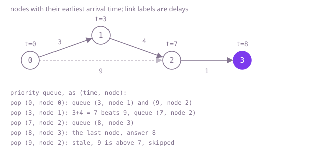

## The question

A signal starts at one node of a one-way network at time 0 and travels along links, each with a delay; a node passes it on as soon as it first hears it. Return when the last node hears it, or -1 if some node never does. Nodes are numbered from 0.

What makes it harder than it looks is that the shortest route is by total delay, not by number of links: the direct link from node 0 to node 2 in Example 1 costs 9, while the route through node 1 uses an extra link and costs 7. So a plain search that counts links gets it wrong. And the network is large, up to 100,000 nodes and 200,000 links, so anything that explores every route, or repeats a sweep over all links many times, is too slow.

## How to think about it

The first idea is to follow every route from the source and keep the smallest arrival time seen at each node. That is correct and it repeats a huge amount: the same node is reached again and again by different routes, and each arrival is followed onward in full. What you need is the earliest arrival at each node, and then the answer is the largest of them, or -1 if one is missing.

Repeated improvement gets there more cheaply: start with 0 at the source and infinity elsewhere, and keep relaxing every link, which means lowering the arrival time at its end if the start's time plus the delay is smaller. Sweeping over all links until nothing changes is correct, but each sweep may settle only one more node, so a long chain needs a sweep per node.

The sweeps can be avoided by choosing the order. Among the nodes whose time is not final, the one with the smallest known time cannot be improved later: any other route reaches it through a node with an equal or larger time, plus a delay that is not negative. So its time is final. Settle that node, relax its outgoing links, and repeat. A priority queue hands out the smallest known time quickly. This is Dijkstra's algorithm.

Walk Example 1, `links = {{0,1,3},{1,2,4},{0,2,9},{2,3,1}}`, `source = 0`. Node 0 settles at 0 and queues node 1 at 3 and node 2 at 9. The smallest is node 1 at 3, final; its link gives node 2 time 7, which beats 9, so node 2 is queued at 7. The smallest is now node 2 at 7, final; it queues node 3 at 8. Node 3 settles at 8, and the old entry for node 2 at 9 is skipped as stale when it comes out. All four nodes settled and the last time is 8.



## Brute force

Follow every path that never repeats a node, starting at the source, and record the smallest arrival time at each node on the way. It comes first because it is the definition restated, and it fixes the answer the faster versions must match. It is correct because the earliest arrival at a node is the cost of some path, and a cheapest path never repeats a node when delays are not negative, so one of the paths followed is it.

```java
static int timeToReachAll(int n, int[][] links, int source) {
    long[] best = new long[n]; // earliest arrival found so far for each node
    Arrays.fill(best, Long.MAX_VALUE);
    follow(links, source, 0, new boolean[n], best);
    long last = 0;
    for (long time : best) {
        if (time == Long.MAX_VALUE) {
            return -1; // never reached
        }
        last = Math.max(last, time);
    }
    return (int) last;
}

/** Follows every path that never repeats a node, recording the earliest arrival at each node. */
private static void follow(int[][] links, int node, long time, boolean[] onPath, long[] best) {
    best[node] = Math.min(best[node], time);
    onPath[node] = true;
    for (int[] link : links) {
        if (link[0] == node && !onPath[link[1]]) {
            follow(links, link[1], time + link[2], onPath, best);
        }
    }
    onPath[node] = false; // free the node for other paths
}
```

**Complexity:** time exponential in the number of nodes in the worst case, since it walks every simple path and scans all links at each step; extra space O(V), and the recursion can be V deep, so a long chain overflows the call stack.

## Better: Bellman-Ford sweeps

Keep the best known arrival time per node, 0 at the source and infinity elsewhere. Sweep over every link, lowering the end's time when the start's time plus the delay is smaller, and repeat until a sweep changes nothing. A time is only ever lowered to a real route's cost, and when nothing improves, no link can improve any more, so every time is the earliest.

```java
static int timeToReachAll(int n, int[][] links, int source) {
    long[] best = new long[n];
    Arrays.fill(best, Long.MAX_VALUE);
    best[source] = 0;
    boolean changed = true;
    while (changed) { // sweep over every link until nothing improves
        changed = false;
        for (int[] link : links) {
            if (best[link[0]] != Long.MAX_VALUE && best[link[0]] + link[2] < best[link[1]]) {
                best[link[1]] = best[link[0]] + link[2];
                changed = true;
            }
        }
    }
    long last = 0;
    for (long time : best) {
        if (time == Long.MAX_VALUE) {
            return -1;
        }
        last = Math.max(last, time);
    }
    return (int) last;
}
```

**Complexity:** time O(V × E), at most V sweeps of E links each; extra space O(V). No hashing is involved, so this is a true worst case.

**Prefer it when:** some delays may be negative, which is the follow-up. This code never assumes a time is final, so negative links are fine as long as no cycle of negative total delay exists; with such a cycle it would never stop. It is also the shortest to write, and fine for a small network.

## Optimal: Dijkstra with a priority queue

Build an adjacency list, and keep the best known time per node and a priority queue of `(time, node)` entries. Take the smallest entry; if its time is older than the best known time for that node, skip it. Otherwise the node is settled: try each outgoing link, and when it improves the target's time, record it and queue the target. A node can be queued more than once, which is why stale entries are skipped. This is the reference solution.

```java
static int timeToReachAll(int n, int[][] links, int source) {
    List<List<int[]>> out = new ArrayList<>();
    for (int i = 0; i < n; i++) {
        out.add(new ArrayList<>());
    }
    for (int[] link : links) {
        out.get(link[0]).add(new int[] {link[1], link[2]});
    }
    long[] best = new long[n];
    Arrays.fill(best, Long.MAX_VALUE);
    best[source] = 0;
    PriorityQueue<long[]> queue = new PriorityQueue<>((a, b) -> Long.compare(a[0], b[0]));
    queue.add(new long[] {0, source}); // time first, then node
    int settled = 0;
    long last = 0;
    while (!queue.isEmpty()) {
        long[] entry = queue.poll();
        int node = (int) entry[1];
        if (entry[0] > best[node]) {
            continue; // stale entry: a faster route was found after this was queued
        }
        settled++;
        last = entry[0];
        for (int[] link : out.get(node)) {
            long arrival = entry[0] + link[1];
            if (arrival < best[link[0]]) {
                best[link[0]] = arrival;
                queue.add(new long[] {arrival, link[0]});
            }
        }
    }
    return settled == n ? (int) last : -1;
}
```

**Complexity:** time O((V + E) log V), since each link queues at most one entry and each queue operation costs a logarithm; extra space O(V + E). The queue is a binary heap, not a hash map, so this is the worst case.

Entries leave the queue in increasing time order, so the last node settled has the largest earliest time. Breadth-first search would not do here: it counts links, and a route with fewer links can take longer.

## Complexity

| Approach | Time | Extra space |
| --- | --- | --- |
| Brute force | exponential in V | O(V), and the recursion can overflow the call stack |
| Better: Bellman-Ford sweeps | O(V × E) | O(V) |
| Optimal: Dijkstra with a priority queue | O((V + E) log V) | O(V + E) |

V is the number of nodes and E the number of links.

## Where it shows up

`corridor-router` asks for cheapest routes in a network of fee-carrying corridors, and its two searches show both sides of this question. `fewestHops` is a breadth-first search that ignores fees. `cheapest` adds a limit on the number of hops, and its reference deliberately does not use Dijkstra: with a hop cap, the cheapest way to reach a node may use too many hops to be of any use, so settling each node once at its lowest fee is wrong, and it runs rounds of Bellman-Ford instead, one round per allowed hop. Without the cap, that question would be this one, and the priority queue would settle nodes in order of cost. Beyond that coding-round problem, the same algorithm routes packets (link-state routing computes shortest paths this way), finds the quickest drive between two places, and computes how long a change takes to propagate through a chain of dependent jobs.

## Follow-up answers

**What if some delays could be negative?** Dijkstra is then wrong, because a later, longer route can end up cheaper than a node already settled. Use Bellman-Ford, which handles negative links and also detects a negative cycle: if a sweep still improves a time after V sweeps, an earlier arrival is possible forever and the time is not defined.

**How would you return the node that is reached last, not just the time?** Remember the node alongside the time each time you settle one. The final value of that pair is the answer. If several nodes tie, say which one you return.

**What if you needed the time for many different sources on the same network?** For a handful of sources, run the algorithm once per source. For many, and when the network is small, an all-pairs method such as Floyd-Warshall does it in O(V³), which pays off only on small graphs; on large ones you precompute landmarks or limit the questions asked.
