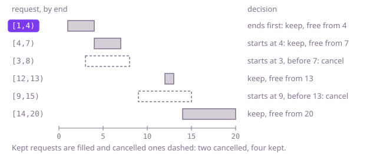

## The question

A telescope serves one request at a time, and each request needs it from a start minute up to, but not including, an end minute. Cancel as few requests as possible so that no two of the remaining ones overlap; two requests that only touch, one ending at the minute the other starts, can both stay.

What makes it harder than it looks is that the rules that sound right are wrong. Keeping the request that starts first fails Example 1: `[9,15]` starts before `[12,13]` and `[14,20]` and blocks both of them. Cancelling the longest request fails Example 2: without `[5,16]`, the other two still overlap. Keeping the shortest fails on `[[0,5],[4,7],[6,11]]`, where the short `[4,7]` overlaps both of the others. And trying every set of requests to keep is 2^n sets, hopeless at 100,000 requests.

## How to think about it

Cancelling the fewest is the same as keeping the most, so I think about the plan I keep. The first idea is to decide request by request, in order of start: cancel it, or keep it if it starts no earlier than the last kept request ends, and take the better of the two. That tries every plan, at 2^n cost. What it repeats is the rest of the decision: what can still be kept depends only on which request was kept last, so I can record, for each request, the most a plan can keep when that request is its last one. That is a table, at n² cost.

The step to the fast answer is to ask which request should come first in the plan. Take the request that ends first of all, E, and any best plan. The plan's first request ends no earlier than E. Swap it for E: E ends no later, and every other request in the plan starts at or after the end of the one it replaced, so nothing new overlaps, and the plan is just as large. So some best plan keeps E. Once E is kept, every request that starts before E ends overlaps it, because none of them ends before E does, and they all go. What is left, the requests starting at or after E's end, is the same question on fewer requests. So: sort by end, walk the list, keep a request when it starts no earlier than the last kept one ends, and cancel it otherwise.

Walk Example 1, `[[9,15],[1,4],[3,8],[12,13],[4,7],[14,20]]`. Sorted by end: `[1,4]`, `[4,7]`, `[3,8]`, `[12,13]`, `[9,15]`, `[14,20]`. Keep `[1,4]`; the telescope is free from minute 4. `[4,7]` starts at 4, so it touches and stays; free from 7. `[3,8]` starts at 3, before 7: cancel. `[12,13]` stays; free from 13. `[9,15]` starts at 9, before 13: cancel. `[14,20]` stays. Two requests are cancelled.



## Brute force

Sort the requests by start and decide each one in turn: cancel it, or keep it if it starts no earlier than the last kept request ends, and take whichever choice keeps more. It is the first thing to say, because it is the question written as a search, and it fixes the answers every faster version must agree with. It is correct because it tries both choices for every request, and in order of start a kept request only has to clear the one kept before it: the kept requests then each end before the next one starts.

```java
static int minCancellations(int[][] requests) {
    int[][] byStart = requests.clone();
    Arrays.sort(byStart, (a, b) -> Integer.compare(a[0], b[0]));
    return requests.length - mostKept(byStart, 0, Integer.MIN_VALUE);
}

/** The most requests from byStart[i..] that can be kept after a kept request ending at lastEnd. */
static int mostKept(int[][] byStart, int i, int lastEnd) {
    if (i == byStart.length) {
        return 0;
    }
    int best = mostKept(byStart, i + 1, lastEnd); // cancel request i
    if (byStart[i][0] >= lastEnd) { // touching is fine, so >=
        best = Math.max(best, 1 + mostKept(byStart, i + 1, byStart[i][1])); // keep it
    }
    return best;
}
```

**Complexity:** time O(2^n), because every request is either kept or cancelled; extra space O(n) for the recursion, one call per request, which overflows the stack long before 100,000 requests.

## Better: the longest chain ending at each request

Sort by end. For each request, record the most requests a plan can keep when this request is the last of them: one more than the best record among the requests that end by the time this one starts, or just one if there are none. Those requests all come earlier in the list, because they end before this one does. The best record over all requests is the most that can be kept, and the rest are cancelled.

```java
static int minCancellations(int[][] requests) {
    int[][] byEnd = requests.clone();
    Arrays.sort(byEnd, (a, b) -> Integer.compare(a[1], b[1]));
    int n = byEnd.length;
    int[] chain = new int[n]; // chain[i]: most requests kept when byEnd[i] is the last of them
    int most = 0;
    for (int i = 0; i < n; i++) {
        chain[i] = 1;
        for (int j = 0; j < i; j++) {
            if (byEnd[j][1] <= byEnd[i][0]) { // j ends by the time i starts
                chain[i] = Math.max(chain[i], chain[j] + 1);
            }
        }
        most = Math.max(most, chain[i]);
    }
    return n - most;
}
```

**Complexity:** time O(n²), extra space O(n).

**Prefer it when:** each request carries a value and you must keep the most total value. Start `chain[i]` at the request's value and add that value instead of 1, and the table gives the best total; the greedy below has no such fix, because one long valuable request can be worth more than the several short ones that keeping the earliest end would choose.

## Optimal: keep the request that ends first

Sort by end and walk the list with the end of the last kept request. A request that starts at or after it is kept and moves the end forward; any other request overlaps the kept one and is cancelled. The swap argument above is why this is safe. Sorting by start works as well if, whenever two requests overlap, the one that ends later is the one cancelled: that is the same rule seen from the other side. This is the reference solution.

```java
static int minCancellations(int[][] requests) {
    int[][] byEnd = requests.clone();
    Arrays.sort(byEnd, (a, b) -> Integer.compare(a[1], b[1]));
    int cancelled = 0;
    int freeFrom = Integer.MIN_VALUE; // the end of the last request kept
    for (int[] request : byEnd) {
        if (request[0] >= freeFrom) { // touching is fine: the telescope is free at minute end
            freeFrom = request[1];
        } else {
            cancelled++; // overlaps the kept request, which ends no later than this one
        }
    }
    return cancelled;
}
```

**Complexity:** time O(n log n) for the sort, then O(n) for the walk; extra space O(n) for the sorted copy of the references.

## Complexity

| Approach | Time | Extra space |
| --- | --- | --- |
| Brute force: keep or cancel each request | O(2^n) | O(n) recursion, overflows the stack at large n |
| Better: the longest chain ending at each request | O(n²) | O(n) |
| Optimal: keep the request that ends first | O(n log n) | O(n) |

## Where it shows up

No coding-round problem is linked to this question. It is the scheduling question for any single shared resource that takes bookings with fixed times: fitting the most jobs on one machine, the most talks into one lecture hall, or the most adverts into one broadcast slot, where the earliest-finishing choice is the rule that leaves the most room. The same walk also answers "is this calendar free of clashes after removing the fewest meetings", which is how a booking system reports how many requests it must turn down.

## Follow-up answers

**What if each request carries a value, and you must keep the most total value instead of the most requests?** The greedy breaks, because one valuable long request can beat two short ones. Use the table from the Better approach with values: sort by end, and let `best[i]` be the most value among the first `i` requests, the larger of `best[i - 1]` (skip request `i`) and its value plus `best[p]`, where `p` counts the requests that end by the time it starts. The ends are sorted, so `p` comes from a binary search, and the whole thing is O(n log n).

**How would you also say which requests to cancel?** The greedy decides each request as it passes it, so record the cancelled ones there. To report them as positions in the input, sort the positions by end instead of the rows, and add the position to the list whenever a request is cancelled.

**What if the observatory had two telescopes, so two requests could run at once?** Still sort by end, and keep the time each telescope is free from. Give each request to the telescope that became free the latest while still being free by the request's start, and cancel the request if neither is free. Taking the tighter fit leaves the telescope that freed earlier for a later request that starts sooner. With k telescopes, keep the free times in a sorted multiset and look up the latest one at or before each start, so each request costs O(log k) after the sort.
