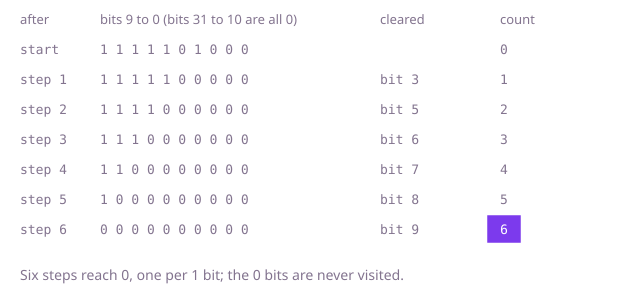

## The question

An `int` holds 32 on/off switches, one per bit; return how many of its bits are 1. Every 32-bit pattern is a valid input, so a pattern whose top bit is set arrives as a negative `int`.

What makes it harder than it looks: nearly every slip is about negative inputs. `>>` copies the sign bit into the top, so a loop that shifts right "until the value is 0" never ends on a negative input, which only ever gets to -1. A loop `while (x > 0)` never starts on one. `x % 2` is -1 for a negative odd `x`. `Integer.toString(x, 2)` writes a minus sign and the bits of the magnitude, so -256 comes out as `-100000000`, with a single 1. `Integer.toBinaryString(x)` does write the pattern, but without its leading zeros, so its length is 32 only when bit 31 is 1.

## How to think about it

The first idea is to write the bits out and count the 1s. That works once the text really is the pattern: `Integer.toBinaryString` reads the `int` as unsigned and writes its bits, so counting its '1' characters is right for every input, at the cost of building a string. The next step drops the string: move each of the 32 bits to the lowest place with a shift and read it with `& 1`. With exactly 32 steps either right shift works, since only the lowest bit is read. A loop that stops once the value is 0 needs `>>>`, which brings in zeros, because `>>` brings in copies of bit 31 and a negative value never gets to 0.

Both look at all 32 positions, though most of them may be 0. To touch only the 1 bits, use `x & (x - 1)`. Subtracting 1 turns the lowest 1 bit into 0 and the 0s below it into 1s, and leaves everything above alone; the AND with `x` then clears those lower bits again. So the lowest 1 bit is gone and nothing else has changed. Repeat until the value is 0 and count the steps. Negative values need no special case, as long as the loop runs while the value is not 0: the subtraction works on the bit pattern, and for `-2147483648`, bit 31 alone, it wraps around to `Integer.MAX_VALUE`, bits 0 to 30, which shares no bit with it, so one step reaches 0.

Walk Example 1, `1000`, which is 1111101000 in binary. Clearing the lowest 1 bit gives 1111100000, then 1111000000, 1110000000, 1100000000, 1000000000 and finally 0: six steps, so six switches are on.



## Brute force

Write the pattern out with `Integer.toBinaryString` and count the '1' characters. It comes first because it is the question read literally, the bits written out and counted, and it fixes the answer every faster version must agree with. It is correct because `Integer.toBinaryString` writes the bits of the pattern read as unsigned, all 32 of them when bit 31 is 1, and only leaves out leading zeros, which add nothing to the count.

```java
static int countOn(int switches) {
    String bits = Integer.toBinaryString(switches); // the pattern, without its leading zeros
    int on = 0;
    for (int i = 0; i < bits.length(); i++) { // 32 characters only when bit 31 is 1
        if (bits.charAt(i) == '1') {
            on++;
        }
    }
    return on;
}
```

**Complexity:** time O(w) for the w = 32 bits, extra space O(w) for the string.

## Better: test each of the 32 positions

Shift each bit in turn to the lowest place and add it to the count. There is no string, and always exactly 32 steps, so the sign bit is read like any other and no shift can run on forever.

```java
static int countOn(int switches) {
    int on = 0;
    for (int bit = 0; bit < 32; bit++) {
        on += (switches >>> bit) & 1; // bit number `bit`, moved to the lowest place
    }
    return on;
}
```

**Complexity:** time O(w), always 32 steps; extra space O(1).

**Prefer it when:** you need every position anyway, such as printing which switches are on and which are off in order: this loop visits all 32 bits, lowest first, while the Optimal skips the 0 bits and its number of steps depends on the input.

## Optimal: clear the lowest 1 bit until none is left

While the value is not 0, clear its lowest 1 bit with `x & (x - 1)` and count the step. The loop runs once per 1 bit. This is the reference solution.

```java
static int countOn(int switches) {
    int on = 0;
    // != 0, not > 0: a pattern with bit 31 set is negative and still has bits to count
    while (switches != 0) {
        switches &= switches - 1; // clears the lowest 1 bit
        on++;
    }
    return on;
}
```

**Complexity:** time O(k) for k bits that are 1, at most 32; extra space O(1).

## Complexity

| Approach | Time | Extra space |
| --- | --- | --- |
| Brute force: count the 1s of the binary string | O(w), w = 32 | O(w) for the string |
| Better: test each of the 32 positions | O(w), always 32 steps | O(1) |
| Optimal: clear the lowest 1 bit until none is left | O(k) for k bits that are 1, at most 32 | O(1) |

## Where it shows up

No coding-round problem is linked to this question. Counting the 1 bits, often called popcount, is how a bitmap answers "how many": `java.util.BitSet.cardinality()` adds up the counts of its 64-bit words, a chess engine that keeps each kind of piece as a 64-bit board counts pieces this way, and a database bitmap index counts the rows that match a filter by counting the 1 bits of the combined bitmaps. With XOR first, it gives the number of differing bits between two hashes, which is how near-duplicate images and documents are found by comparing short fingerprints.

## Follow-up answers

**Can you make the work depend on the number of 1 bits instead of on all 32 positions?** Yes: clear the lowest 1 bit with `x & (x - 1)` until the value is 0, as in the Optimal. A pattern with three 1 bits takes three steps; only the pattern of 32 ones takes 32.

**If you must count the bits of millions of values, how would you make it faster?** Count without a loop. One way is a table of the counts of all 256 byte values, built once, and four lookups per `int`, one per byte. The other is to add the bits in parallel inside the `int`: neighbouring bits are added into 2-bit counts with the mask `0x55555555`, those into 4-bit counts with `0x33333333`, then into byte counts with `0x0f0f0f0f`, and the four byte counts are summed with two more shifts and adds. That is a fixed fifteen or so operations, which is what `Integer.bitCount` does in its Java code, and the JIT compiler replaces that call with the processor's population-count instruction where there is one.

**How would you find how many bits differ between two patterns?** XOR them and count the 1 bits of the result: `a ^ b` has a 1 exactly where `a` and `b` differ. That count is the Hamming distance, and it works for negative patterns too, since XOR and the count both work on the 32 bits.
