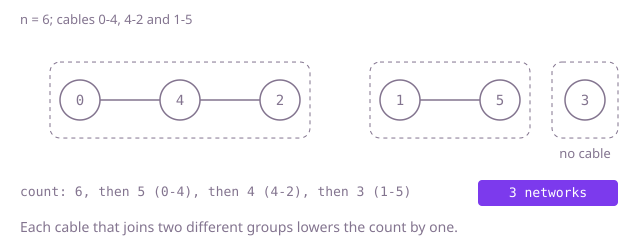

## The question

Machines are joined by two-way cables, and machines that can reach each other through any chain of cables form one network. Count the networks, where a machine with no cables counts as one.

What makes it harder than it looks: a shortcut like "machines minus cables" is right only when there are no loops, and loops and repeated cables are allowed. A machine with no cables never appears in the cable list but still counts. A recursive search goes as deep as the longest chain of machines, which overflows the stack on a line of 100,000. And settling the networks by repeated passes over the cable list is quadratic when the list happens to be in the wrong order.

## How to think about it

The first idea is to give every machine a label, its own number, and keep passing over the cables: whenever a cable joins two different labels, both ends take the smaller one. When a pass changes nothing, every network carries the number of its smallest machine, so the count is the number of machines whose label is still their own number. It is correct, but on a line listed from the far end the smallest label moves one machine per pass, so it needs as many passes as there are machines.

The waste is in passing over the whole list to move a label one step. Group the cables by machine instead, and a search from an unreached machine reaches its whole network in one go; each new starting machine is one more network. The other view never searches at all: start with `n` networks, and let each cable merge the networks of its two ends. A cable lowers the count only when its ends were in different networks, which is exactly the test union-find answers.

Walk Example 1: `n = 6`, `links = [[0, 4], [4, 2], [1, 5]]`. Start with 6 networks. Cable `[0, 4]` merges two of them: 5. Cable `[4, 2]` joins 2 to the network of 0 and 4: 4. Cable `[1, 5]` merges 1 and 5: 3. Machine 3 has no cable and keeps its own network, so the answer is 3. In Example 2 the cable `[2, 0]` finds 2 and 0 already together and changes nothing.



## Brute force

Label every machine with its own number and pass over the cables until no pass changes a label, each cable pulling both its ends down to the smaller label. It is what you say first, and it fixes the answer to compare against. It is correct because labels only spread along cables, so two machines end with the same label only if they are connected, and a pass that changes nothing means every cable's ends agree, so each network ends with one label: the number of its smallest machine, which no pass can lower.

```java
static int count(int n, int[][] links) {
    int[] label = new int[n];
    for (int i = 0; i < n; i++) {
        label[i] = i;
    }
    boolean changed = true;
    while (changed) { // stop when a full pass moves no label
        changed = false;
        for (int[] link : links) {
            int a = label[link[0]];
            int b = label[link[1]];
            if (a != b) {
                int low = Math.min(a, b); // both ends take the smaller label
                label[link[0]] = low;
                label[link[1]] = low;
                changed = true;
            }
        }
    }
    int networks = 0;
    for (int i = 0; i < n; i++) {
        if (label[i] == i) { // each network keeps the number of its smallest machine
            networks++;
        }
    }
    return networks;
}
```

**Complexity:** time O(n times m) for m cables, since each pass costs O(m) and up to n passes can be needed; extra space O(n).

## Better: neighbour lists and a search from each unreached machine

Build a list of neighbours per machine, adding each cable at both ends. Go through the machines in order; each one not yet reached starts a new network, and a search from it with an explicit stack marks its whole network. Repeated cables and loops only lead to machines already marked.

```java
static int count(int n, int[][] links) {
    List<List<Integer>> next = new ArrayList<>();
    for (int i = 0; i < n; i++) {
        next.add(new ArrayList<>());
    }
    for (int[] link : links) {
        next.get(link[0]).add(link[1]);
        next.get(link[1]).add(link[0]);
    }
    boolean[] seen = new boolean[n];
    int networks = 0;
    Deque<Integer> stack = new ArrayDeque<>();
    for (int start = 0; start < n; start++) {
        if (seen[start]) {
            continue;
        }
        networks++; // an unreached machine opens a new network
        seen[start] = true;
        stack.push(start);
        while (!stack.isEmpty()) {
            for (int other : next.get(stack.pop())) {
                if (!seen[other]) {
                    seen[other] = true;
                    stack.push(other);
                }
            }
        }
    }
    return networks;
}
```

**Complexity:** time O(n + m), extra space O(n + m) for the neighbour lists and the stack. The stack is explicit because a recursive search is as deep as the longest chain and overflows on a line of 100,000 machines.

**Prefer it when:** you need the members of each network, not just the count: the search hands them over one network at a time.

## Optimal: union-find, count the merges

Start the count at `n` with every machine in its own group. For each cable, find the representative of each end; if they differ, merge the smaller group under the larger and lower the count. A cable whose ends already share a group, from a loop or a repeat, changes nothing. Finding a representative halves the path as it climbs. This is the reference solution.

```java
static int count(int n, int[][] links) {
    int[] parent = new int[n];
    int[] size = new int[n];
    for (int i = 0; i < n; i++) {
        parent[i] = i;
        size[i] = 1;
    }
    int networks = n;
    for (int[] link : links) {
        int a = find(parent, link[0]);
        int b = find(parent, link[1]);
        if (a == b) { // a loop or a repeated cable joins nothing new
            continue;
        }
        if (size[a] < size[b]) { // hang the smaller group under the larger
            int swap = a;
            a = b;
            b = swap;
        }
        parent[b] = a;
        size[a] += size[b];
        networks--;
    }
    return networks;
}

private static int find(int[] parent, int x) {
    while (parent[x] != x) {
        parent[x] = parent[parent[x]]; // path halving
        x = parent[x];
    }
    return x;
}
```

**Complexity:** time O(n + m times α(n)), where α is the inverse Ackermann function and is at most 4 for any input that fits in memory, so effectively linear; extra space O(n). No neighbour lists and no recursion.

## Complexity

| Approach | Time | Extra space |
| --- | --- | --- |
| Brute force: pass over the cables until labels settle | O(n times m) | O(n) |
| Better: neighbour lists and an explicit-stack search | O(n + m) | O(n + m) |
| Optimal: union-find, count the merges | O(n + m times α(n)), effectively linear | O(n) |

## Where it shows up

Counting connected groups is how a network tool reports how many isolated segments a set of hosts falls into, how image software counts separate blobs of set pixels, and how a social or payments system finds clusters of accounts linked by shared devices or cards. Union-find is the usual choice when the links arrive as a stream, such as entity resolution that merges duplicate customer records as matches are found.

## Follow-up answers

**Cables keep being added one at a time; how do you report the count after each one?** Keep the union-find alive between cables. Each new cable costs two finds and maybe a merge, and the count drops by one exactly when the merge happens, so every report is effectively constant time.

**What if cables can also be removed?** Union-find cannot split a group. If all the operations are known in advance, process them backwards so removals become additions. Otherwise you need a dynamic connectivity structure, or you recount with a search after each removal, which costs O(n + m) each time.

**How would you find the size of the largest network?** Union-find already keeps `size` for each representative; take the largest. With the search, count the machines marked during each network's search and keep the maximum.
