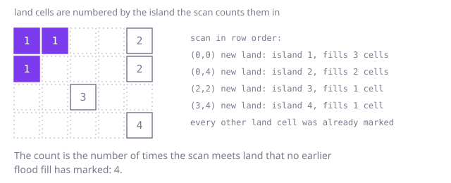

## The question

Given a map drawn as rows of land and water, count the islands, where land cells belong to the same island when they share a side. Cells that touch only at a corner are separate islands.

What makes it harder than it looks is counting each island once. Scanning for land cells would count every cell, so something must remember which land already belongs to an island that was counted. And size bites in two ways: the map can have a million cells, and one island can snake through half of them, so a search that goes one level deeper for every cell of the island runs out of call stack long before it finishes.

## How to think about it

The first idea is natural: scan the map cell by cell, and when you meet land that you have not seen, you have found a new island. Add one to the count, then spread out from that cell and mark every land cell you can reach through side neighbours, so that the scan will not count any of them again. That repeats nothing: every cell is marked once and examined a few times, and the count is the number of times the scan found unmarked land.

Spreading out can be written three ways. Recursion is the shortest and the first thing to say, but its depth is the length of the longest path it follows, which on a snake-shaped island of 500,000 cells overflows the stack. An explicit stack or queue does the same spreading in a loop with no such limit. And union-find skips the spreading: every land cell starts as its own island, and each time a cell is next to land that is already counted, the two groups merge and the count drops by one.

Walk Example 1, `{"##..#", "#...#", "..#..", "....#"}`. The scan meets land at row 0, column 0, which is unmarked: island 1, and the fill marks the cells at (0,0), (0,1) and (1,0). Land at (0,1) and (1,0) is already marked, so the scan passes it. Land at (0,4) is unmarked: island 2, and the fill marks (0,4) and (1,4). Land at (2,2) is unmarked: island 3. Land at (3,4) is unmarked, because the cell above it at (2,4) is water: island 4. The count is 4.



## Brute force

Scan the map, and for each unmarked land cell, count an island and run a recursive depth-first search that marks the cell and every land cell reachable from it. It comes first because it is the idea written as code, with no machinery, and it fixes the answer the other versions must match. It is correct because each island is entered by exactly one scan hit, since the search marks all of the island before the scan moves on.

```java
static int countIslands(String[] rows) {
    boolean[][] seen = new boolean[rows.length][];
    for (int r = 0; r < rows.length; r++) {
        seen[r] = new boolean[rows[r].length()];
    }
    int islands = 0;
    for (int r = 0; r < rows.length; r++) {
        for (int c = 0; c < rows[r].length(); c++) {
            if (rows[r].charAt(c) == '#' && !seen[r][c]) {
                islands++; // unmarked land: a new island
                mark(rows, seen, r, c);
            }
        }
    }
    return islands;
}

/** Marks the cell and every land cell connected to it through a side. */
private static void mark(String[] rows, boolean[][] seen, int r, int c) {
    if (r < 0 || r >= rows.length || c < 0 || c >= rows[r].length()) {
        return; // off the map
    }
    if (seen[r][c] || rows[r].charAt(c) != '#') {
        return; // water, or already part of a counted island
    }
    seen[r][c] = true;
    mark(rows, seen, r - 1, c);
    mark(rows, seen, r + 1, c);
    mark(rows, seen, r, c - 1);
    mark(rows, seen, r, c + 1);
}
```

**Complexity:** time O(R × C) for R rows and C columns, extra space O(R × C), because the recursion can be as deep as the island is long. On an island that snakes through half of a 1,000 by 1,000 map it overflows the call stack.

## Better: union-find over land cells

Union-find is a different tool at the same cost, not a faster one: it reaches the same count without any search, and it is the one to reach for when land arrives over time. Give every cell a parent, starting with itself. Scan the map once; each land cell starts as a new island, and if the cell above it or to its left is land, merge the two groups, subtracting one from the count whenever the merge joins two groups that were different. Looking only up and left covers every side-sharing pair exactly once. Merging by size and halving paths while searching keeps the trees flat, and nothing recurses.

```java
static int countIslands(String[] rows) {
    if (rows.length == 0) {
        return 0;
    }
    int width = rows[0].length();
    int[] parent = new int[rows.length * width];
    int[] size = new int[parent.length];
    for (int i = 0; i < parent.length; i++) {
        parent[i] = i; // every cell starts in a group of its own
        size[i] = 1;
    }
    int islands = 0;
    for (int r = 0; r < rows.length; r++) {
        for (int c = 0; c < width; c++) {
            if (rows[r].charAt(c) != '#') {
                continue;
            }
            islands++; // a new land cell is an island until it merges
            int cell = r * width + c;
            if (r > 0 && rows[r - 1].charAt(c) == '#' && union(parent, size, cell, cell - width)) {
                islands--;
            }
            if (c > 0 && rows[r].charAt(c - 1) == '#' && union(parent, size, cell, cell - 1)) {
                islands--;
            }
        }
    }
    return islands;
}

private static int find(int[] parent, int x) {
    while (parent[x] != x) {
        parent[x] = parent[parent[x]]; // path halving keeps the trees flat
        x = parent[x];
    }
    return x;
}

/** Merges the groups of a and b; returns false when they were already one group. */
private static boolean union(int[] parent, int[] size, int a, int b) {
    int rootA = find(parent, a);
    int rootB = find(parent, b);
    if (rootA == rootB) {
        return false;
    }
    if (size[rootA] < size[rootB]) {
        int swap = rootA;
        rootA = rootB;
        rootB = swap;
    }
    parent[rootB] = rootA; // the smaller group hangs under the larger
    size[rootA] += size[rootB];
    return true;
}
```

**Complexity:** time O(R × C × α(R × C)), amortized, where α is the inverse Ackermann function and is at most 4 for any map that fits in memory; extra space O(R × C).

**Prefer it when:** land arrives one cell at a time and you must report the count after each addition, because a new cell is one more island and each merge that joins two groups lowers the count by one, so the count is always current. The code shown must change for that: cells can arrive in any order, so a new cell is merged with all four neighbours that are already land, not only the ones above and to the left. For a single count on a fixed map it does more work per cell than the flood fill below.

## Optimal: flood fill with an explicit stack

Scan the map once. On unmarked land, count an island and spread out with a stack of cells to visit, marking each cell the moment it is pushed so no cell is pushed twice. The stack lives on the heap, so the longest island is no problem. This is the reference solution.

```java
static int countIslands(String[] rows) {
    int height = rows.length;
    if (height == 0) {
        return 0;
    }
    int width = rows[0].length();
    boolean[] seen = new boolean[height * width];
    int[] stack = new int[height * width];
    int islands = 0;
    for (int start = 0; start < height * width; start++) {
        if (rows[start / width].charAt(start % width) != '#' || seen[start]) {
            continue;
        }
        islands++; // unvisited land: a new island
        int top = 0;
        stack[top++] = start;
        seen[start] = true;
        while (top > 0) {
            int cell = stack[--top];
            int r = cell / width;
            int c = cell % width;
            if (r > 0) top = visit(rows, seen, stack, top, (r - 1) * width + c, width);
            if (r + 1 < height) top = visit(rows, seen, stack, top, (r + 1) * width + c, width);
            if (c > 0) top = visit(rows, seen, stack, top, r * width + c - 1, width);
            if (c + 1 < width) top = visit(rows, seen, stack, top, r * width + c + 1, width);
        }
    }
    return islands;
}

/** Pushes the cell and marks it when it is unvisited land; returns the new stack size. */
private static int visit(String[] rows, boolean[] seen, int[] stack, int top, int cell, int width) {
    if (!seen[cell] && rows[cell / width].charAt(cell % width) == '#') {
        seen[cell] = true; // mark on push so a cell is never stacked twice
        stack[top++] = cell;
    }
    return top;
}
```

**Complexity:** time O(R × C), since every cell is marked once and looked at from at most four neighbours; extra space O(R × C) for the marks and the stack.

## Complexity

| Approach | Time | Extra space |
| --- | --- | --- |
| Brute force: recursive depth-first search | O(R × C) | O(R × C) call stack, which overflows on a long snake-shaped island |
| Better: union-find | O(R × C × α(R × C)) amortized | O(R × C) |
| Optimal: flood fill with an explicit stack | O(R × C) | O(R × C) |

R is the number of rows and C the number of columns. There is no approach that looks at fewer than every cell, so none is meaningfully faster in the worst case.

## Where it shows up

`friend-suggestion` answers `degreesApart` with a breadth-first search over the friend graph, and its visited map is claimed when a person is queued (`steps.putIfAbsent`), so nobody is reached twice. That is the marking rule of the flood fill here: mark on the way in, not on the way out. A grid is a graph whose edges are the four side neighbours, so the same discipline carries over; the difference is that `degreesApart` asks for a distance between two people, while this question counts the separate groups. Outside the coding round, the same count answers how many separate regions a segmentation mask holds, how many disconnected clusters a map has after a flood, or how many isolated networks a set of links forms.

## Follow-up answers

**How would you also report the size of the largest island?** Count the cells popped during each flood and keep the maximum over islands. It is the same pass with one extra counter.

**What if land can be added one cell at a time and you must report the count after each addition?** Use union-find. Adding a cell makes one more island, then each land neighbour already present is merged with it, and every merge that joins two different groups lowers the count by one. Each update is close to constant time, instead of re-scanning the grid.

**What if diagonal neighbours also connect land?** Visit eight neighbours instead of four. Nothing else changes.
