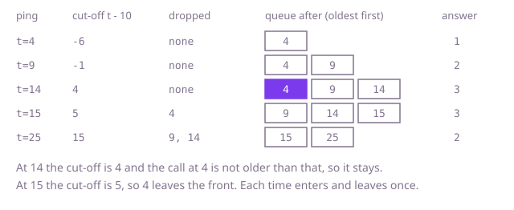

## The question

Build a counter that is told the arrival time of each call, in increasing order, and after each call says how many calls so far, this one included, arrived in the last `window` milliseconds. Both ends of the range count, so a call exactly `window` old is still inside.

What makes it harder than it looks: the answer must come fast on every ping, not only on average inputs. With 200,000 calls and a window that holds half of them, re-counting the recent calls from scratch on each ping is about 15 billion steps. And the boundary is easy to get off by one: the call that is exactly `window` old stays, so the test for dropping a call is "strictly older than `t - window`", not "older or equal".

## How to think about it

The first idea is to keep every call and, on each ping, count backwards from the newest until a call is too old. That is correct and obvious, but it repeats work: the call from two pings ago is counted again, and the one before it, and so on.

What is worth remembering? Time only moves forward, so a call that is too old for this ping is too old for every later one. Nothing needs to be looked at twice, and a call that has dropped out never needs to come back. That points to a structure where the oldest call is at one end, the newest goes in at the other, and old calls are discarded from the front: a queue. The answer is then just the queue's size. Each call enters once and leaves at most once, so over all pings the total work is linear, even though one ping may drop many calls.

A second route keeps all the times in an array and finds the start of the range by binary search, since the times are increasing. It costs a search per ping instead of a few removals, but it keeps the whole history.

Walk Example 1, `window = 10`, calls at `4, 9, 14, 15, 25`. At 4 the cut-off is -6, nothing is older, the queue is `[4]` and the answer is 1. At 9 the queue is `[4, 9]`, answer 2. At 14 the cut-off is 4, the call at 4 is not strictly older, so it stays: `[4, 9, 14]`, answer 3. At 15 the cut-off is 5, so 4 leaves the front: `[9, 14, 15]`, answer 3. At 25 the cut-off is 15, so 9 and 14 leave: `[15, 25]`, answer 2.



## Brute force

Keep every call in a list. On each ping append the new time, then walk back from the newest, counting while the call is not older than `t - window`. It comes first because it is the question restated as a loop, and it fixes the answer the faster versions must agree with. It is correct because the times are increasing, so walking back from the newest, the first call that is too old marks the end of the range and every call before it is older still.

```java
private final int window;
private final List<Integer> times = new ArrayList<>(); // every arrival time, oldest first

int ping(int t) {
    times.add(t);
    int count = 0;
    // walk back until a call is older than t - window
    for (int i = times.size() - 1; i >= 0 && times.get(i) >= t - window; i--) {
        count++;
    }
    return count;
}
```

**Complexity:** time O(calls inside the window) per ping, so O(n²) over n pings when the window is wide; extra space O(n).

## Better: keep the history and binary search

Times arrive in increasing order, so the stored array is sorted. The calls in the range are exactly those from the first index whose time is at least `t - window` up to the newest. Find that index by binary search and the count is the array's length minus that index.

```java
private final int window;
private int[] times = new int[16]; // every arrival time, increasing
private int size = 0;

int ping(int t) {
    if (size == times.length) {
        times = Arrays.copyOf(times, size * 2); // grow by doubling
    }
    times[size++] = t;
    int lo = 0, hi = size - 1; // the new call is in the range, so the answer index is at most size - 1
    while (lo < hi) {
        int mid = (lo + hi) >>> 1;
        if (times[mid] >= t - window) hi = mid; else lo = mid + 1;
    }
    return size - lo;
}
```

**Complexity:** time O(log n) per ping, so O(n log n) over n pings; extra space O(n).

**Prefer it when:** you must also answer questions about the same history with another window length or an earlier moment. The search takes the start of the range as a value, so only `t - window` would change to the new bound. The queue throws old calls away and cannot answer those.

## Optimal: a queue with expiry from the front

Keep a queue of the arrival times, oldest first. On each ping add the new time at the back, then remove from the front while the front is strictly older than `t - window`. What is left is exactly the calls in the range, so the answer is the queue's size. This is the reference solution.

```java
private final int window;
private final Deque<Integer> recent = new ArrayDeque<>(); // arrival times, oldest first

int ping(int t) {
    recent.addLast(t);
    while (recent.peekFirst() < t - window) {
        recent.pollFirst(); // too old now, and too old for every later call
    }
    return recent.size();
}
```

The loop cannot empty the queue, because the call just added is never older than `t - window`.

**Complexity:** time O(1) amortized per ping (one ping can drop many calls, but each call is dropped once, so n pings cost O(n) in total), extra space O(calls inside the window), which is O(n) in the worst case.

## Complexity

| Approach | Time | Extra space |
| --- | --- | --- |
| Brute force | O(calls inside the window) per ping, O(n²) worst case over n pings | O(n) |
| Better: history and binary search | O(log n) per ping | O(n) |
| Optimal: queue with expiry | O(1) amortized per ping, O(n) over n pings | O(calls inside the window), O(n) worst case |

## Where it shows up

`rate-limiter-audit` has both ends of this question. Its `countInWindow` walks the whole log of a client for every question, which is the brute force. Its `rejections` runs this queue: a deque of one client's accepted request times in milliseconds, with the expired ones removed from the front before each decision, so each time enters and leaves once. Two things differ there. Only accepted requests enter the deque, and a request is rejected when the deque already holds `limit` of them. And its window is `(t - w, t]`, so a time exactly one window old has expired and is removed with `<=`, whereas here the range includes `t - window` and the loop removes only strictly older times.

Outside the coding round, the same queue sits behind a requests-per-minute counter on a dashboard, a "failed logins in the last five minutes" alarm, and the throttle of any API client that must not exceed a quota.

## Follow-up answers

**What if calls can arrive out of order?** The queue idea breaks, because the front is no longer the oldest. Keep a sorted structure instead, such as a balanced tree of times, and count the ones in the range from two searches. Each ping then costs O(log n).

**How would you count calls in the window for several different clients at once?** Keep one queue per client in a map from client to queue. The cost per ping stays the same. Empty queues can be removed from the map so that idle clients do not take memory.

**What changes if the window is a count of the last k calls instead of a length of time?** Time stops mattering. Add the new call, and if the queue is longer than k remove one from the front. The size is then min(calls so far, k), so a counter would do and no queue is needed unless the times themselves are wanted.
