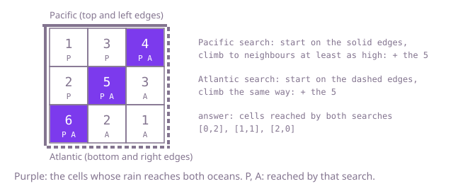

## The question

Given a grid of heights with one ocean on the top and left edges and another on the bottom and right edges, find every cell from which rain can reach both oceans. Water runs from a cell to any side neighbour that is no higher, so it can cross level ground.

What makes it harder than it looks is the direction of the search. Following the water from each cell is natural and correct, but every cell starts its own search, and on a map with a large basin each of those searches crosses the whole basin. Two smaller traps sit beside it: water moves between equal heights, so "strictly lower" strands whole plateaus, and the two corners at the top right and bottom left touch both oceans by themselves.

## How to think about it

The first idea is to drop water on each cell and follow it downhill with a search, noting whether it touches the Pacific edge and the Atlantic edge. It is correct and it is what you say first, but on a 200 by 200 map it is 40,000 searches, and in the worst case each one walks most of the map.

Turn the question around. Instead of asking where a cell's water ends up, ask which cells can send water to the Pacific. Every Pacific edge cell can, trivially. And if a cell can send water to the Pacific, so can any neighbour at least as high as it, because that neighbour's water can run onto it. So one search that starts from all the Pacific edge cells at once and climbs to neighbours at least as high finds every cell that drains to the Pacific. A second search from the Atlantic edge does the same for the Atlantic, and the answer is the cells both searches reached. Two searches over the map replace 40,000.

The climbing search can be recursive or use a queue. Recursion goes as deep as the longest chain of steps it takes before backing out, and on a level plain of 40,000 cells a depth-first search can wander through every cell in one chain, which overflows the call stack; a queue has no such limit.

Walk Example 1, `[[1, 3, 4], [2, 5, 3], [6, 2, 1]]`. The Pacific search starts from the top row and left column, 1, 3, 4, 2 and 6, and climbs to the 5 in the middle, which is higher than the 3 above it and the 2 beside it; nothing else climbs further. The Atlantic search starts from the right column and bottom row, 4, 3, 1, 6 and 2, and also climbs to the 5, from the 3 on its right and the 2 below it. The cells reached by both are the 4 at the top right, the 6 at the bottom left and the 5 in the middle.



## Brute force

From every cell, run a breadth-first search downhill, to neighbours no higher, and stop once both an edge of the Pacific and an edge of the Atlantic have been reached. It comes first because it follows the rain exactly as the statement describes it, and it fixes the answer the faster version must agree with. It is correct because the search visits every cell the water from the start can reach.

```java
static List<int[]> bothOceans(int[][] heights) {
    List<int[]> both = new ArrayList<>();
    for (int r = 0; r < heights.length; r++) {
        for (int c = 0; c < heights[0].length; c++) {
            if (reachesBoth(heights, r, c)) { // a fresh search from every cell
                both.add(new int[] {r, c});
            }
        }
    }
    return both;
}

// Follows the water downhill (to neighbours no higher) from (r, c) until both oceans are touched.
private static boolean reachesBoth(int[][] heights, int r, int c) {
    int rows = heights.length;
    int cols = heights[0].length;
    boolean[][] seen = new boolean[rows][cols];
    ArrayDeque<int[]> queue = new ArrayDeque<>();
    queue.add(new int[] {r, c});
    seen[r][c] = true;
    boolean pacific = false;
    boolean atlantic = false;
    int[][] steps = {{1, 0}, {-1, 0}, {0, 1}, {0, -1}};
    while (!queue.isEmpty()) {
        int[] cell = queue.poll();
        pacific |= cell[0] == 0 || cell[1] == 0;
        atlantic |= cell[0] == rows - 1 || cell[1] == cols - 1;
        if (pacific && atlantic) {
            return true;
        }
        for (int[] step : steps) {
            int nr = cell[0] + step[0];
            int nc = cell[1] + step[1];
            if (nr >= 0 && nc >= 0 && nr < rows && nc < cols && !seen[nr][nc]
                    && heights[nr][nc] <= heights[cell[0]][cell[1]]) {
                seen[nr][nc] = true;
                queue.add(new int[] {nr, nc});
            }
        }
    }
    return false;
}
```

**Complexity:** time O((m × n)²) in the worst case for an m by n map, since each of the m × n searches can visit every cell and clears a fresh visited grid; extra space O(m × n).

## Better: climb from both edges, recursively

Mark the cells that drain to each ocean with a depth-first search from that ocean's edge cells, stepping to unmarked neighbours at least as high. Then collect the cells marked for both.

```java
static List<int[]> bothOceans(int[][] heights) {
    int rows = heights.length;
    int cols = heights[0].length;
    boolean[][] pacific = new boolean[rows][cols];
    boolean[][] atlantic = new boolean[rows][cols];
    for (int r = 0; r < rows; r++) {
        climb(heights, pacific, r, 0, -1); // left edge
        climb(heights, atlantic, r, cols - 1, -1); // right edge
    }
    for (int c = 0; c < cols; c++) {
        climb(heights, pacific, 0, c, -1); // top edge
        climb(heights, atlantic, rows - 1, c, -1); // bottom edge
    }
    List<int[]> both = new ArrayList<>();
    for (int r = 0; r < rows; r++) {
        for (int c = 0; c < cols; c++) {
            if (pacific[r][c] && atlantic[r][c]) {
                both.add(new int[] {r, c});
            }
        }
    }
    return both;
}

// Marks (r, c) and everything that can drain to it, if it is on the map, unmarked and at least as high as below.
private static void climb(int[][] heights, boolean[][] reaches, int r, int c, int below) {
    if (r < 0 || c < 0 || r >= heights.length || c >= heights[0].length
            || reaches[r][c] || heights[r][c] < below) {
        return;
    }
    reaches[r][c] = true;
    climb(heights, reaches, r + 1, c, heights[r][c]);
    climb(heights, reaches, r - 1, c, heights[r][c]);
    climb(heights, reaches, r, c + 1, heights[r][c]);
    climb(heights, reaches, r, c - 1, heights[r][c]);
}
```

**Complexity:** time O(m × n), since each search marks every cell at most once; extra space O(m × n) for the marks and a recursion depth of up to m × n = 40,000, which overflows a default call stack on a 200 by 200 level plain.

**Prefer it when:** maps are small, such as a game level of a few hundred cells; it is the shortest version of the reversed search.

## Optimal: climb from both edges with a queue

The same reversed search, breadth first: queue all edge cells of one ocean, marked, and repeatedly take a cell and queue its unmarked neighbours that are at least as high. Do it for both oceans and collect the cells marked twice. This is the reference solution.

```java
static List<int[]> bothOceans(int[][] heights) {
    int rows = heights.length;
    int cols = heights[0].length;
    boolean[] pacific = new boolean[rows * cols];
    boolean[] atlantic = new boolean[rows * cols];
    int[] pQueue = new int[rows * cols];
    int[] aQueue = new int[rows * cols];
    int pTail = 0;
    int aTail = 0;
    for (int r = 0; r < rows; r++) {
        for (int c = 0; c < cols; c++) {
            int cell = r * cols + c;
            if (r == 0 || c == 0) { // top and left edges touch the Pacific
                pacific[cell] = true;
                pQueue[pTail++] = cell;
            }
            if (r == rows - 1 || c == cols - 1) { // bottom and right edges touch the Atlantic
                atlantic[cell] = true;
                aQueue[aTail++] = cell;
            }
        }
    }
    climb(heights, pacific, pQueue, pTail);
    climb(heights, atlantic, aQueue, aTail);
    List<int[]> both = new ArrayList<>();
    for (int cell = 0; cell < rows * cols; cell++) {
        if (pacific[cell] && atlantic[cell]) {
            both.add(new int[] {cell / cols, cell % cols});
        }
    }
    return both;
}

// Breadth-first search from the queued border cells, moving only to neighbours at least as high:
// water from such a neighbour can flow down to the cell we came from, and on to the ocean.
private static void climb(int[][] heights, boolean[] reaches, int[] queue, int tail) {
    int cols = heights[0].length;
    int[][] steps = {{1, 0}, {-1, 0}, {0, 1}, {0, -1}};
    for (int head = 0; head < tail; head++) {
        int r = queue[head] / cols;
        int c = queue[head] % cols;
        for (int[] step : steps) {
            int nr = r + step[0];
            int nc = c + step[1];
            if (nr < 0 || nc < 0 || nr >= heights.length || nc >= cols) {
                continue;
            }
            int next = nr * cols + nc;
            if (!reaches[next] && heights[nr][nc] >= heights[r][c]) {
                reaches[next] = true; // mark when queued, so no cell is queued twice
                queue[tail++] = next;
            }
        }
    }
}
```

**Complexity:** time O(m × n), since each of the two searches queues every cell at most once; extra space O(m × n) for the marks and the queues, with no recursion.

## Complexity

| Approach | Time | Extra space |
| --- | --- | --- |
| Brute force: search downhill from every cell | O((m × n)²) worst case | O(m × n) |
| Better: climb from both edges, recursively | O(m × n) | O(m × n), recursion depth up to m × n, which overflows on a large level plain |
| Optimal: climb from both edges with a queue | O(m × n) | O(m × n) |

## Where it shows up

No coding-round problem is linked to this question. Reversing a search so that it starts from all the targets at once is how watershed maps are drawn from elevation data (which outlets each cell drains to), how a router finds every node that can reach a set of exits, and how a build tool finds every module affected by a change by walking the dependency graph backwards from the changed files.

## Follow-up answers

**What changes if water may only flow to a strictly lower cell?** Only the comparison: the climbing search steps to neighbours strictly higher instead of at least as high, and the brute force follows neighbours strictly lower. Plateaus then stop draining across their own level, so fewer cells qualify.

**How would you answer for three or more oceans, each along its own stretch of the border?** Run one climbing search per ocean from its own edge cells, each with its own marks, or one search per ocean that adds that ocean's bit to a mask per cell. A cell's answer is then the set of oceans it drains to, and "all of them" is a full mask. The cost is O(k × m × n) for k oceans.

**How would you find the cells from which water reaches neither ocean?** They are the cells that neither climbing search marked. Collect them in the same final pass that collects the cells marked twice.
