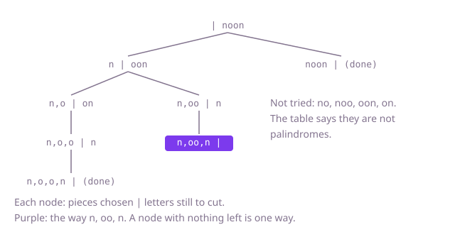

## The question

Given a string, list every way to cut it into consecutive pieces that are all palindromes, each way as its pieces from left to right. A single letter always counts, so there is at least one way.

What makes it harder than it looks is that the answer itself can be huge: a string of one repeated letter can be cut at every gap or not, so twelve equal letters have 2^11 = 2,048 ways, and nothing can beat writing them down. The work worth saving is the palindrome test. The search asks "is this stretch a palindrome?" about the same stretches over and over, and a test that only grows palindromes around a centre letter misses even-length pieces like `mm`.

## How to think about it

A way to cut a string of n letters is a choice, at each of the n − 1 gaps, of cut or no cut. The first idea is to try all 2^(n−1) choices and keep those whose pieces are all palindromes. It is correct and fixes the answer to compare against, but most choices fail on their first piece, and it still checks the rest.

Choose the pieces from left to right instead. The first piece must be a palindrome; once it is chosen, the rest of the string is the same question again. So try each palindromic first piece, recurse on the rest with one working list of pieces, and save a copy when nothing is left. Branches whose first piece is not a palindrome are never entered. What remains repeated is the palindrome test: the stretch from i to j is a palindrome exactly when its end letters match and the stretch from i + 1 to j − 1 is one, so a table filled from the right answers every test in O(1) after O(n²) work.

Walk Example 1, `s = "noon"`. The first piece can be `n` or `noon`; `no` and `noo` are not palindromes. `noon` uses everything, one way. After `n`, the rest is `oon`, whose first piece can be `o` or `oo`. After `oo`, only `n` is left: the way `n, oo, n`. After `o`, the rest `on` can only start with `o`, then `n`: the way `n, o, o, n`.



## Brute force

Read each number from 0 to 2^(n−1) − 1 as a set of cuts, bit i meaning "cut after letter i", and keep the sets whose pieces are all palindromes. It comes first because it is the definition of a cut written as code, and it fixes the answer the faster versions must agree with. It is correct because the numbers are exactly the 2^(n−1) sets of cuts, each once; with `n <= 12` the shift cannot overflow.

```java
static List<List<String>> all(String s) {
    int n = s.length();
    List<List<String>> result = new ArrayList<>();
    for (int cuts = 0; cuts < (1 << (n - 1)); cuts++) {
        List<String> pieces = new ArrayList<>();
        int start = 0;
        boolean ok = true;
        for (int i = 0; i < n && ok; i++) {
            if (i == n - 1 || (cuts & (1 << i)) != 0) { // a piece ends after letter i
                String piece = s.substring(start, i + 1);
                ok = new StringBuilder(piece).reverse().toString().equals(piece);
                pieces.add(piece);
                start = i + 1;
            }
        }
        if (ok) {
            result.add(pieces);
        }
    }
    return result;
}
```

**Complexity:** time O(n · 2^n), for every one of the 2^(n−1) sets of cuts, extra space O(n) for the pieces being built, beyond the output.

## Better: backtracking with a two-pointer test

Choose the first piece, recurse on the rest, and test each candidate piece by comparing letters from both ends inward. Only palindromic first pieces are explored, so the dead sets of cuts are never built.

```java
static List<List<String>> all(String s) {
    List<List<String>> result = new ArrayList<>();
    cut(s, 0, new ArrayList<>(), result);
    return result;
}

// Chooses the next piece, which starts at start; pieces holds the pieces chosen so far.
private static void cut(String s, int start, List<String> pieces, List<List<String>> result) {
    if (start == s.length()) {
        result.add(new ArrayList<>(pieces)); // a copy: pieces keeps changing after this
        return;
    }
    for (int end = start; end < s.length(); end++) {
        if (isPalindrome(s, start, end)) {
            pieces.add(s.substring(start, end + 1));
            cut(s, end + 1, pieces, result);
            pieces.remove(pieces.size() - 1);
        }
    }
}

private static boolean isPalindrome(String s, int i, int j) {
    while (i < j) {
        if (s.charAt(i++) != s.charAt(j--)) {
            return false;
        }
    }
    return true;
}
```

**Complexity:** time O(n · 2^n) in the worst case (one repeated letter, where every piece passes and each test costs up to n), extra space O(n) for the working list and a recursion depth of n, beyond the output.

**Prefer it when:** memory is tight and the string is long but has few palindromes; it needs no n by n table.

## Optimal: backtracking over a palindrome table

Fill `pal[i][j]` from the right first, so each entry reads the one just inside it, then run the same search with an O(1) test. This is the reference solution. It cannot beat the size of the answer, but no palindrome question is answered twice.

```java
static List<List<String>> all(String s) {
    int n = s.length();
    // pal[i][j]: s[i..j] is a palindrome; filled from the right so pal[i + 1][j - 1] is ready
    boolean[][] pal = new boolean[n][n];
    for (int i = n - 1; i >= 0; i--) {
        for (int j = i; j < n; j++) {
            pal[i][j] = s.charAt(i) == s.charAt(j) && (j - i < 2 || pal[i + 1][j - 1]);
        }
    }
    List<List<String>> result = new ArrayList<>();
    cut(s, pal, 0, new ArrayList<>(), result);
    return result;
}

// Chooses the next piece, which starts at start; pieces holds the pieces chosen so far.
private static void cut(String s, boolean[][] pal, int start, List<String> pieces, List<List<String>> result) {
    if (start == s.length()) {
        result.add(new ArrayList<>(pieces)); // a copy: pieces keeps changing after this
        return;
    }
    for (int end = start; end < s.length(); end++) {
        if (pal[start][end]) {
            pieces.add(s.substring(start, end + 1));
            cut(s, pal, end + 1, pieces, result);
            pieces.remove(pieces.size() - 1);
        }
    }
}
```

**Complexity:** time O(n²) for the table plus O(n · 2^n) in the worst case for the search, which is the size of the answer (copying the pieces of each way); extra space O(n²) for the table and a recursion depth of n, beyond the output.

## Complexity

| Approach | Time | Extra space (beyond the output) |
| --- | --- | --- |
| Brute force: every set of cuts | O(n · 2^n) | O(n) |
| Better: backtracking, two-pointer test | O(n · 2^n) worst case | O(n), recursion depth n |
| Optimal: backtracking over a palindrome table | O(n² + n · 2^n) worst case | O(n²), recursion depth n |

## Where it shows up

No coding-round problem is linked to this question. Cutting a sequence into pieces that each pass a test is how word segmentation works (splitting `"newyorkcity"` into dictionary words for search), how a parser lists every way to split an ambiguous token stream, and how text tools find every way to break a line at allowed points. The table of "is this stretch valid" is the same idea that speeds up those, built once and read many times.

## Follow-up answers

**How would you count the ways without listing them?** Let `ways[i]` be the number of ways to cut the suffix from position i, with `ways[n] = 1`. Then `ways[i]` is the sum of `ways[j + 1]` over every j where `pal[i][j]` holds. Going from i = n − 1 down to 0 takes O(n²) time with the table, with no search at all.

**How would you find the fewest cuts that leave only palindromes?** Use the same table and let `best[i]` be the fewest pieces for the suffix from i: `best[i]` is the minimum of `1 + best[j + 1]` over palindromic `s[i..j]`, with `best[n] = 0`. The fewest cuts is `best[0] − 1`, in O(n²) time.

**Why is the answer exponential in the worst case, and which strings reach it?** Each of the n − 1 gaps is cut or not, so there are at most 2^(n−1) ways. A string of one repeated letter reaches the bound, because every piece of it is a palindrome and every set of cuts is valid; that is why no approach can run in polynomial time on every input.
