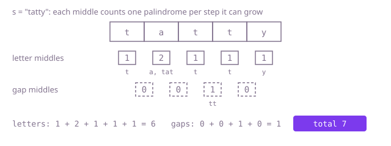

## The question

Given a string of lowercase letters, count its substrings that read the same in both directions. Every position counts on its own: each single letter is one, and the same letters at two places are two.

What makes it harder than it looks is that every palindrome must be found, not just the biggest, and the easy shortcuts each lose some of them. Growing only around single letters misses the even ones (`"xyyx"` has six, not four); putting the palindromes in a set counts `wow` once in `"wowow"` when it occurs twice; starting at length two forgets the letters. And a string of 5,000 equal letters has 12,502,500 palindromes, so testing each substring from scratch costs about 10^10 letter comparisons.

## How to think about it

The first idea is to test every substring with two pointers walking inward and count the ones that pass. It is correct, but the tests overlap: `tat` is `a` with a `t` added at each end, and testing `tat` from scratch walks over `a` again. A stretch is a palindrome exactly when its end letters match and the stretch inside them is one, so a table indexed by start and end can reuse every inner answer. That brings the work down to one comparison per substring, but the table holds all n² of them.

Turn the rule around. Every palindrome has exactly one middle, a letter for odd lengths or the gap between two letters for even ones, and from that middle it is reached by stepping outward one letter on each side at a time. The steps around one middle give palindromes until the first pair that differs, and nothing further out around that middle can be one. So grow from each of the 2n − 1 middles and add one for every successful step: each palindrome is counted once, at its own middle, and no table is needed.

Walk Example 1, `s = "tatty"`. Around each letter: `t` gives 1; `a` gives `a` and then `tat`, 2; the second `t` gives 1, since `a` and `t` differ; the third `t` gives 1, since `t` and `y` differ; `y` gives 1. That is 6. Around each gap, only the one between the two `t`s grows, to `tt`, and it stops there because `a` and `y` differ: 1. The total is 7.



## Brute force

Test every substring and count the palindromes. It comes first because it is the definition written as code, and it fixes the count every faster version must match. It is correct because it looks at each of the n(n + 1)/2 substrings exactly once, by its start and end, so equal letters at different positions are counted separately.

```java
static int count(String s) {
    int total = 0;
    for (int i = 0; i < s.length(); i++) {
        for (int j = i; j < s.length(); j++) { // every substring s[i..j], single letters included
            if (isPalindrome(s, i, j)) {
                total++;
            }
        }
    }
    return total;
}

private static boolean isPalindrome(String s, int i, int j) {
    while (i < j) {
        if (s.charAt(i++) != s.charAt(j--)) {
            return false;
        }
    }
    return true;
}
```

**Complexity:** time O(n³) in the worst case, when most substrings are palindromes or nearly so (one repeated letter, or two letters taking turns), extra space O(1).

## Better: table of palindromic stretches

Fill `pal[i][j]`, "is `s[i..j]` a palindrome", one row at a time from the last start back to the first, so the row below, which holds `pal[i + 1][j - 1]`, is complete before it is read. Each cell is one comparison and one lookup, and every true cell is one palindrome.

```java
static int count(String s) {
    int n = s.length();
    boolean[][] pal = new boolean[n][n]; // pal[i][j]: s[i..j] is a palindrome
    int total = 0;
    for (int i = n - 1; i >= 0; i--) { // row i + 1 is complete before row i reads it
        for (int j = i; j < n; j++) {
            pal[i][j] = s.charAt(i) == s.charAt(j) && (j - i < 2 || pal[i + 1][j - 1]);
            if (pal[i][j]) {
                total++;
            }
        }
    }
    return total;
}
```

**Complexity:** time O(n²), extra space O(n²): 25 million booleans, about 25 MB, at 5,000 letters.

**Prefer it when:** the count is only the first question and more follow about the same string, such as whether an arbitrary stretch is a palindrome while cutting the string into palindromic pieces; the table, once filled, answers each in O(1).

## Optimal: grow from every middle and count

For each letter, grow once with the letter as the middle and once with the gap after it as the middle, adding one for each step outward while the ends match. This is the reference solution.

```java
static int count(String s) {
    int total = 0;
    for (int centre = 0; centre < s.length(); centre++) {
        total += grow(s, centre, centre); // odd lengths: the middle is a letter
        total += grow(s, centre, centre + 1); // even lengths: the middle is the gap after it
    }
    return total;
}

/** Counts the palindromes with this middle: one for each step outward while the ends match. */
private static int grow(String s, int lo, int hi) {
    int found = 0;
    while (lo >= 0 && hi < s.length() && s.charAt(lo) == s.charAt(hi)) {
        found++;
        lo--;
        hi++;
    }
    return found;
}
```

**Complexity:** time O(n²) in the worst case, one repeated letter, where every middle grows to an end of the string; extra space O(1). The largest count, 12,502,500, fits an `int`.

## Complexity

| Approach | Time | Extra space |
| --- | --- | --- |
| Brute force | O(n³) worst case | O(1) |
| Better: table of palindromic stretches | O(n²) | O(n²) |
| Optimal: grow from every middle and count | O(n²) worst case | O(1) |

## Where it shows up

How far each middle of a sequence can grow is a measure of its mirror symmetry, and sequence tools compute it for DNA, with "match" meaning complementary bases, to find the inverted repeats that fold into hairpins. The same per-middle growth is a common first step when text has to be cut into palindromic pieces, since it lists every palindromic stretch, middle by middle, without a table.

## Follow-up answers

**Can you count them in O(n) time?** Yes. Manacher's algorithm finds how far every middle grows in O(n) total: a middle inside the palindrome reaching furthest right so far starts from its mirror image's growth, cut off at that palindrome's right edge, so the right edge only moves forward. The count is the sum of the growths, exactly as in the reference.

**What if equal substrings at different positions were counted only once?** A string of n letters has at most n distinct palindromes, because each new letter adds at most one new one, its longest palindromic ending. A palindromic tree (eertree) adds the letters one by one, finds that ending and keeps each distinct palindrome as one node, in O(n) time. Without it, growing from every middle and putting each palindrome's hash into a set, with prefix hashes so each stretch's hash costs O(1), works in O(n²) expected time.

**What if only palindromes of at least k letters counted?** Grow from every middle as before, but add one only once the current stretch, `hi - lo + 1`, is at least k long. The cost stays O(n²); a middle that cannot reach k still stops at its first mismatch.
