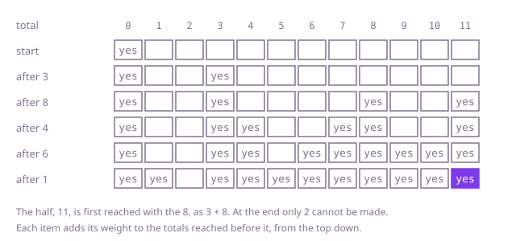

## The question

Given item weights, decide whether the items can be split into two groups of exactly the same total weight, each item in one group. Equivalently: does some group of the items weigh exactly half the total?

What makes it harder than it looks is that handing items out by a rule fails. Giving each item, heaviest first, to the lighter pack ends at 21 against 17 on Example 2, where 11 + 8 against 9 + 6 + 4 works; filling one pack heaviest first while items fit stops at 6 + 4 = 10 on `[6,4,4,4,3,3]`, where 4 + 4 + 4 makes 12. An odd total can never be halved, but a search for half the total rounded down can still succeed, as 3 + 2 = 5 does for the 11 of Example 3. And 200 items have 2^200 groups, so trying them all is out.

## How to think about it

The first idea is to decide item by item whether it goes into the first pack, and see whether any choice makes the pack weigh exactly half. That is correct and it can try every group. What it repeats: after the first few items, all that matters is how much weight the first pack still needs, not which items gave it. With weights up to 100 and 200 items the half is at most 10,000, so there are only that many different needs per item, where the groups number 2^200.

So remember which totals are possible. Start with only 0, reachable with no items. Each item adds itself to every total reached so far, and the answer is whether the half is reached. One boolean per total from 0 to the half is enough if each item updates the totals from the top down, so the entry it reads, `total - weight`, still describes the items before it and the item is used once. Going upwards would let an item build on a total it has just made and count twice: on `[2,9,3]` it would make 7 as 2 + 2 + 3.

Walk Example 1, `weights = [3,8,4,6,1]`, total 22, half 11. With no items only 0 is reachable. The 3 adds 3. The 8 adds 8 and 11, so the half is already reachable as 3 + 8. The 4 adds 4 and 7; the 6 adds 6, 9 and 10; the 1 adds 1 and 5. Every total from 0 to 11 except 2 is reachable at the end, 11 among them, so the answer is `true`.



## Brute force

Decide each item in turn: into the first pack, or not, and stop when the pack needs nothing more. It comes first because it says what the question asks, and it fixes the answers to compare against. It is correct because every group is one set of in-or-out choices, and a branch is dropped only when the pack is already too heavy, which no later item can undo since every weight is positive.

```java
static boolean canBalance(int[] weights) {
    int total = 0;
    for (int w : weights) {
        total += w;
    }
    return total % 2 == 0 && fills(weights, 0, total / 2);
}

/** Whether some of the items from position i on weigh exactly need. */
private static boolean fills(int[] weights, int i, int need) {
    if (need == 0) {
        return true;
    }
    if (i == weights.length || need < 0) {
        return false; // no items left, or this pack is already too heavy
    }
    // item i goes into the first pack, or it does not
    return fills(weights, i + 1, need - weights[i]) || fills(weights, i + 1, need);
}
```

**Complexity:** time O(2^n), worst when no group makes the half; extra space O(n) for the recursion, at most 200 deep, which fits in the stack.

## Better: memoised search

The same search, with the answer for each item position and remaining need stored the first time it is found. The need is between 0 and half the total, so there are at most n × (half + 1) different calls.

```java
static boolean canBalance(int[] weights) {
    int total = 0;
    for (int w : weights) {
        total += w;
    }
    if (total % 2 != 0) {
        return false; // an odd total has no half
    }
    return fills(weights, 0, total / 2, new Boolean[weights.length][total / 2 + 1]);
}

private static boolean fills(int[] weights, int i, int need, Boolean[][] memo) {
    if (need == 0) {
        return true;
    }
    if (i == weights.length || need < 0) {
        return false;
    }
    if (memo[i][need] == null) { // null: not worked out yet
        memo[i][need] = fills(weights, i + 1, need - weights[i], memo) || fills(weights, i + 1, need, memo);
    }
    return memo[i][need];
}
```

**Complexity:** time O(n × S), where S is half the total, at most 10,000; extra space O(n × S) for the memo, up to about 2 million entries, plus the recursion, at most 200 deep.

**Prefer it when:** a group that makes the half is likely to turn up early: the search stops at the first one, and it only visits the needs that the items before can leave, where the table updates every total for every item.

## Optimal: one table of reachable totals

Keep one boolean per total from 0 to the half. Start with 0 reachable; for each item, run the totals from the half down to the item's weight and mark a total reachable when the total one item lighter was. The answer is whether the half is reachable. This is the reference solution.

```java
static boolean canBalance(int[] weights) {
    int total = 0;
    for (int w : weights) {
        total += w;
    }
    if (total % 2 != 0) {
        return false; // an odd total has no half
    }
    int half = total / 2;
    boolean[] reachable = new boolean[half + 1]; // reachable[s]: some of the items so far weigh s
    reachable[0] = true;
    for (int w : weights) {
        // downwards, so reachable[s - w] still means "without this item" and it is used once
        for (int s = half; s >= w; s--) {
            if (reachable[s - w]) {
                reachable[s] = true;
            }
        }
    }
    return reachable[half];
}
```

**Complexity:** time O(n × S), where S is half the total, at most 10,000; extra space O(S).

## Complexity

| Approach | Time | Extra space |
| --- | --- | --- |
| Brute force | O(2^n) | O(n) recursion, at most 200 deep |
| Better: memoised search | O(n × S) | O(n × S), recursion at most 200 deep |
| Optimal: one table of reachable totals | O(n × S) | O(S) |

## Where it shows up

Balancing loads between two sides has this shape: splitting tasks between two machines so they finish together, loading two trucks or the two sides of a boat evenly, or dividing an inheritance of indivisible items into two equal shares. It is the subset-sum question, which is hard in general but falls to this table whenever the totals are small, as they are here; the same table, with values instead of flags, is the 0/1 knapsack.

## Follow-up answers

**What if the packs only had to weigh as close to each other as possible?** Run the same table, then take the largest reachable total that is at most half the total. That group goes in one pack and the rest in the other, and the difference is the total minus twice that group's weight. The cost stays O(n × S).

**What if you also had to say which items go into each pack?** Keep, for each total, the item that first made it reachable. From the half, take that item, step down by its weight and repeat until 0. Because each total is recorded the first time it is reached, with only the items before that one, the items found this way are all different. The rest go into the other pack.

**What if there were three hikers instead of two?** Each pack must weigh a third of the total, and finding one group of that weight is not enough, because the rest must still split in two. Track pairs of totals for the first two packs, which costs O(n × S²) for a third S of the total, or search item by item into three packs with pruning. With many hikers the problem is hard in general, and a search with good pruning is the usual answer.
