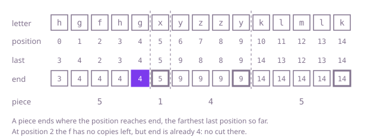

## The question

Cut a string of lowercase letters into as many pieces as possible so that each letter lives in only one piece, and return the lengths of the pieces in order.

What makes it harder than it looks is that whether you may cut depends on letters you have not read yet. Cutting once the current letter has no copies left is too early: in Example 1 the `f` at position 2 never appears again, but the `h` and `g` before it do, so a cut after `hgf` splits both. Cutting before every new letter fails the same way. And checking each possible cut by comparing the letters on its two sides reads the whole string for every cut, O(n²) at 100,000 letters.

## How to think about it

Start with what one cut needs. A cut after position `i` is allowed exactly when no letter appears both at or before `i` and after it. That depends only on `i`, not on any other cut, and the pieces keep every letter in one piece exactly when each cut between them is allowed. So the most pieces come from making every allowed cut, and the answer is unique: any valid cutting uses allowed cuts only, so it can have no more pieces. That is why cutting greedily, as early and as often as allowed, is safe.

The brute force checks each position by collecting the letters on both sides: O(n) per position. A better view is that each letter covers a span, from its first copy to its last, and a cut is allowed where no span crosses it, so merging the overlapping spans gives the pieces. The optimal pass does that merge as it walks. First record the last position of each letter. Then walk the string keeping `end`, the farthest last position of any letter in the current piece. When the walk reaches `end`, no letter of the piece appears later, so the cut is allowed; before that, some letter of the piece still has a copy ahead, so no earlier cut was.

Walk Example 1, `s = "hgfhgxyzzyklmlk"`. The last positions are h 3, g 4, f 2, x 5, y 9, z 8, k 14, l 13 and m 12. From position 0, `end` becomes 3 for the `h`, then 4 for the `g`; the `f`'s 2 does not move it, and the walk reaches 4 at position 4: a piece of 5. The `x` at position 5 is its own last copy: a piece of 1. The `y` at 6 sets `end` to 9, the `z`'s 8 does not move it, and position 9 closes a piece of 4. The `k` at 10 sets `end` to 14, which the `l` and `m` do not move: a piece of 5. The answer is `[5,1,4,5]`.



## Brute force

For every position, collect the letters up to it and test whether any of them appears after it; cut wherever none does, and always at the end of the string. It comes first because it is the rule written as code, and it fixes the answers to compare against. It is correct by the argument above: allowed cuts do not depend on each other, so making all of them gives the most pieces.

```java
static List<Integer> sizes(String s) {
    List<Integer> sizes = new ArrayList<>();
    int start = 0;
    for (int i = 0; i < s.length(); i++) {
        if (i == s.length() - 1 || cutAllowed(s, i)) { // the end of the string always ends a piece
            sizes.add(i - start + 1);
            start = i + 1;
        }
    }
    return sizes;
}

/** Whether no letter appears both at or before position i and after it. */
private static boolean cutAllowed(String s, int i) {
    boolean[] before = new boolean[26];
    for (int j = 0; j <= i; j++) {
        before[s.charAt(j) - 'a'] = true;
    }
    for (int j = i + 1; j < s.length(); j++) {
        if (before[s.charAt(j) - 'a']) {
            return false; // this letter would be in two pieces
        }
    }
    return true;
}
```

**Complexity:** time O(n²): collecting the letters up to position `i` reads `i + 1` letters, at every position, whatever the string holds. Extra space O(1) besides the output, 26 flags per check.

## Better: merge the letters' spans

Record the first and last position of each letter. Each letter's span must lie inside one piece, so overlapping spans belong to the same piece. Sort the spans by where they start and merge them as with any overlapping intervals; each merged span is a piece. Since every position holds a letter, the spans cover the whole string, and a span that starts after the merged span so far ends must start right after it.

```java
static List<Integer> sizes(String s) {
    int[] first = new int[26];
    int[] last = new int[26];
    Arrays.fill(first, -1);
    for (int i = 0; i < s.length(); i++) {
        int letter = s.charAt(i) - 'a';
        if (first[letter] < 0) {
            first[letter] = i;
        }
        last[letter] = i;
    }
    List<int[]> spans = new ArrayList<>(); // [first, last] of each letter present
    for (int letter = 0; letter < 26; letter++) {
        if (first[letter] >= 0) {
            spans.add(new int[] {first[letter], last[letter]});
        }
    }
    spans.sort(Comparator.comparingInt(span -> span[0]));
    List<Integer> sizes = new ArrayList<>();
    int start = 0;
    int end = -1; // the merged span being built
    for (int[] span : spans) {
        if (span[0] > end && end >= 0) { // no span so far reaches this one: a piece ends
            sizes.add(end - start + 1);
            start = span[0];
        }
        end = Math.max(end, span[1]);
    }
    sizes.add(end - start + 1);
    return sizes;
}
```

**Complexity:** time O(n): one pass to find the spans, and sorting at most 26 of them costs a constant. Extra space O(1) besides the output, at most 26 spans.

**Prefer it when:** what you have is already a set of spans, such as the first and last time each user appears in a log: the merge works on the spans alone, and it is the standard merge of overlapping intervals.

## Optimal: one pass with the farthest last position

Record the last position of each letter, then walk the string keeping `end`, the farthest last position of any letter in the current piece, and close the piece when the walk reaches it. This is the reference solution.

```java
static List<Integer> sizes(String s) {
    int[] last = new int[26]; // the last position of each letter
    for (int i = 0; i < s.length(); i++) {
        last[s.charAt(i) - 'a'] = i;
    }
    List<Integer> sizes = new ArrayList<>();
    int start = 0;
    int end = 0; // the piece must reach the last copy of every letter it holds so far
    for (int i = 0; i < s.length(); i++) {
        end = Math.max(end, last[s.charAt(i) - 'a']);
        if (i == end) { // no letter of this piece appears after i
            sizes.add(end - start + 1);
            start = i + 1;
        }
    }
    return sizes;
}
```

**Complexity:** time O(n), two passes over the string. Extra space O(1) besides the output, 26 last positions.

## Complexity

| Approach | Time | Extra space |
| --- | --- | --- |
| Brute force | O(n²) | O(1) besides the output |
| Better: merge the letters' spans | O(n) | O(1) besides the output, at most 26 spans |
| Optimal: one pass with the farthest last position | O(n) | O(1) besides the output, 26 last positions |

## Where it shows up

Splitting work into independent chunks: a log or event stream cut into batches that can be processed in parallel, where every session id must stay inside one batch, so a batch can end only where every session it has seen is over; a list of database changes split into groups that touch disjoint rows; tasks on a timeline grouped so that no resource is shared between groups. The span view is the same merge that calendar tools use to join overlapping bookings into busy blocks.

## Follow-up answers

**What if the letters were arbitrary ids, such as user names in a log?** Keep the last positions in a hash map from id to position instead of an array of 26; the walk is unchanged. That is O(n) expected time and O(d) extra space for d distinct ids. Java's `HashMap` turns crowded buckets into trees, so the worst case is O(log d) per lookup, O(n log d) in all, plus the cost of hashing each id.

**What if the string could be read only once, from start to end?** Then the last positions are not known in advance, so keep the pieces found so far on a stack, each with its start, and the position of each letter's first copy. A letter seen for the first time opens a new piece. A letter seen before means everything from its first copy to here is one piece: pop every piece that starts after that first copy and merge them into the piece below. Each piece is pushed once and popped at most once, so it stays O(n), and the sizes are final only when the input ends.

**What if you wanted as few pieces as possible, each at most k letters long?** The cuts allowed here are the only places a piece may end, so every valid piece is a run of consecutive pieces from this question. If one of them is longer than k there is no answer. Otherwise pack them from the left, starting a new piece whenever the next one would push the current piece past k. That is optimal: the greedy's first i pieces always reach at least as far as those of any other packing, so it never needs more.
