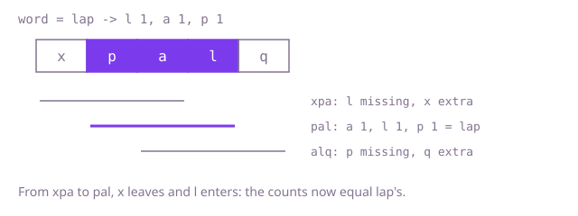

## The question

Given a word and a longer text, say whether some run of consecutive characters in the text is a rearrangement of the word: the same letters, each the same number of times, in any order.

What makes it harder than it looks: comparing letter sets is wrong, because `"aab"` and `"abb"` use the same letters with different counts. A matching stretch must be exactly as long as the word, and the word can be longer than the text, so no stretch exists at all. And with 100,000 characters on each side, counting every stretch from scratch is about 2.5 billion character reads when the word is half the text.

## How to think about it

The first idea is to look at every stretch of the word's length, count its letters, and compare with the word's counts. Order does not matter for a rearrangement, so counts are the whole test. What that repeats: two neighbouring stretches share all but two characters, yet each is counted from zero. Sliding fixes that. Keep one array of counts for the current stretch; when the stretch moves one step, add the letter that enters and subtract the letter that leaves. Comparing the whole array with the word's counts is then a fixed 26 comparisons per step, which is fine for lowercase letters but is the next thing to remove: instead of comparing, keep the number of letters whose counts differ from the word's, and update it with the same two letters. When that number is zero the stretch matches.

Walk Example 1, `word = "lap"`, `text = "xpalq"`. The word needs one `l`, one `a`, one `p`. The first stretch `"xpa"` holds `x`, `p` and `a`: the `l` is missing and the `x` is extra, two letters out of line. Moving one step, `x` leaves and `l` enters. Now the stretch is `"pal"`, and every count equals the word's, so nothing is out of line and the answer is `true`. The stretch `"alq"` is never reached.



## Brute force

For every start position that leaves room for the word's length, count the letters of that stretch into a fresh array and compare it with the word's counts. It is what you say first, and it fixes the answer every faster version must agree with. It is correct because it looks at every stretch of the right length, and equal counts for all 26 letters is exactly the definition of a rearrangement.

```java
static boolean appearsIn(String word, String text) {
    int m = word.length();
    int[] need = new int[26];
    for (int i = 0; i < m; i++) {
        need[word.charAt(i) - 'a']++; // the word's counts, computed once
    }
    for (int start = 0; start + m <= text.length(); start++) { // every stretch of the word's length
        int[] have = new int[26];
        for (int i = start; i < start + m; i++) {
            have[text.charAt(i) - 'a']++; // counted from zero every time
        }
        if (Arrays.equals(need, have)) {
            return true;
        }
    }
    return false;
}
```

**Complexity:** time O(n * m) for a text of length n and a word of length m (there are n - m + 1 stretches, each counted in m steps), extra space O(1) (two arrays of 26).

## Better: slide the counts, compare all 26

Keep one array of counts for the current stretch. Build it for the first stretch, then for each step add the entering letter and subtract the leaving one, and compare with the word's counts after every step.

```java
static boolean appearsIn(String word, String text) {
    int m = word.length();
    if (m > text.length()) {
        return false; // no stretch is long enough
    }
    int[] need = new int[26];
    int[] have = new int[26];
    for (int i = 0; i < m; i++) {
        need[word.charAt(i) - 'a']++;
        have[text.charAt(i) - 'a']++; // the first stretch
    }
    if (Arrays.equals(need, have)) {
        return true;
    }
    for (int end = m; end < text.length(); end++) {
        have[text.charAt(end) - 'a']++; // enters the stretch
        have[text.charAt(end - m) - 'a']--; // leaves the stretch
        if (Arrays.equals(need, have)) { // 26 comparisons per step
            return true;
        }
    }
    return false;
}
```

**Complexity:** time O(n * s) where s is the alphabet size (26 here), so O(n) for lowercase letters; extra space O(s).

**Prefer it when:** the alphabet is small and fixed and you want the least code to get right: one comparison call stands in for all the bookkeeping. It stops being cheap when the alphabet grows, because every step compares every counter.

## Optimal: slide the counts, track how many letters differ

Store, per letter, the count in the stretch minus the count in the word, and keep `off`, the number of letters whose difference is not zero. Adding or removing a letter changes one difference, and `off` changes by at most one, so each step costs a constant. The stretch matches exactly when `off` is zero. This is the reference solution.

```java
static boolean appearsIn(String word, String text) {
    int m = word.length();
    if (m > text.length()) {
        return false; // no stretch is long enough
    }
    int[] diff = new int[26]; // per letter: count in the stretch minus count in the word
    int off = 0; // how many letters have a non-zero difference
    for (int i = 0; i < m; i++) {
        off += shift(diff, word.charAt(i) - 'a', -1);
        off += shift(diff, text.charAt(i) - 'a', +1);
    }
    if (off == 0) {
        return true;
    }
    for (int end = m; end < text.length(); end++) {
        off += shift(diff, text.charAt(end) - 'a', +1); // enters the stretch
        off += shift(diff, text.charAt(end - m) - 'a', -1); // leaves the stretch
        if (off == 0) {
            return true;
        }
    }
    return false;
}

/** Changes one letter's difference and returns how the number of unequal letters changed. */
private static int shift(int[] diff, int letter, int by) {
    boolean wasOff = diff[letter] != 0;
    diff[letter] += by;
    return (diff[letter] != 0 ? 1 : 0) - (wasOff ? 1 : 0);
}
```

**Complexity:** time O(n + m), extra space O(s) for the alphabet (26 here, so constant).

## Complexity

| Approach | Time | Extra space |
| --- | --- | --- |
| Brute force | O(n * m) | O(1) |
| Better: slide the counts, compare all 26 | O(n * s), O(n) for 26 letters | O(s) |
| Optimal: slide the counts, track how many differ | O(n + m) | O(s) |

## Where it shows up

No coding-round problem is linked to this question. The fixed-width window with a running count summary appears when a stream must be screened for a known multiset in any order: a short motif of bases in a genome read, or a fixed set of event types seen within the last k log lines. The same bookkeeping, "which counters are out of line", is how a monitor checks the last k events against an expected mix without re-reading them.

## Follow-up answers

**How would you return the start positions of all such stretches?** Do not return at the first match. Whenever `off` is zero after a step, record the stretch's start, `end - m + 1` (and `0` for the first stretch), and keep sliding. The cost is the same O(n + m) plus the size of the output.

**What changes if the text and the word can contain any Unicode character?** The array of 26 no longer fits, so keep the differences in a `HashMap` from character (or code point, if the text has characters outside the basic plane) to count, removing the entry when it reaches zero. The `off` counter still gives constant work per step on average (O(log n) in the worst case, when Java's `HashMap` treeifies a crowded bucket), so the cost stays O(n + m) on average. The compare-all-counters version would slow down, since it would compare every distinct character on each step.
