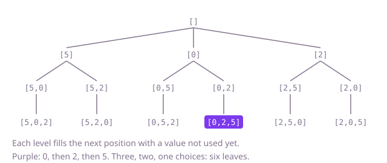

## The question

Given an array of distinct numbers, list every ordering of it exactly once. The orderings may come in any order, but each one is a sequence, so `[0, 2, 5]` and `[0, 5, 2]` are different answers.

What makes it harder than it looks is the bookkeeping, since n! orderings is the size of the answer and nothing can beat writing them down. Recursive code shares one working list and one set of "used" marks across the whole search; forget to clear a mark on the way back and only the first ordering comes out, and add the working list without copying it and every entry ends up the same list.

## How to think about it

The first idea is to try every sequence of n positions, n choices for each, and keep the ones that use no position twice. It is correct and fixes the answer to compare against, but most of the n^n sequences are thrown away: for 8 values, 16.7 million are tried for 40,320 answers.

The waste is that a repeat is noticed only at the end. Check it while building instead: fill the positions one at a time and only offer the values not used yet. The first position has n choices, the second n − 1, and so on, so the search tree has exactly n! leaves and every leaf is an answer. A boolean per value records what the current prefix has taken; set it before going a level deeper and clear it on the way back, so every level sees the right free values. A different route to the same set is to grow the answer: the orderings of the first k values, with value k + 1 inserted into every gap of each, are the orderings of k + 1 values.

Walk Example 1, `nums = [5, 0, 2]`. Put 5 first; free are 0 and 2. Put 0, then 2: `[5, 0, 2]`. Back, clear 0 and 2, put 2 then 0: `[5, 2, 0]`. Back to the top, clear 5, put 0 first: `[0, 5, 2]`, `[0, 2, 5]`. Then 2 first: `[2, 5, 0]`, `[2, 0, 5]`. Six leaves.



## Brute force

Count through all n^n sequences of positions, as a number in base n, and keep the ones in which no position repeats. It comes first because it needs no insight, only the definition, and it fixes the answer to compare against. It is correct because every ordering is one such sequence without repeats, and each is counted once. With `n <= 8`, n^n is at most 16,777,216 and fits in an `int`.

```java
static List<List<Integer>> all(int[] nums) {
    int n = nums.length;
    int total = 1;
    for (int i = 0; i < n; i++) {
        total *= n; // n^n sequences of positions
    }
    List<List<Integer>> result = new ArrayList<>();
    for (int code = 0; code < total; code++) {
        boolean[] used = new boolean[n];
        List<Integer> ordering = new ArrayList<>();
        int rest = code;
        for (int k = 0; k < n && ordering.size() == k; k++, rest /= n) { // digit k of code in base n
            int position = rest % n;
            if (!used[position]) { // a repeat stops the loop and drops this sequence
                used[position] = true;
                ordering.add(nums[position]);
            }
        }
        if (ordering.size() == n) {
            result.add(ordering);
        }
    }
    return result;
}
```

**Complexity:** time O(n^n · n), extra space O(n) for the marks and the ordering being built, beyond the output.

## Better: insert each value into every gap

Start with one empty ordering. For each value, take every ordering built so far and make one new ordering for each gap it has, from before the first value to after the last, with the value placed there. Every ordering of k + 1 values comes from exactly one ordering of the first k values, the one left after removing the last value, so nothing is listed twice.

```java
static List<List<Integer>> all(int[] nums) {
    List<List<Integer>> result = new ArrayList<>();
    result.add(new ArrayList<>()); // the one ordering of no values
    for (int value : nums) {
        List<List<Integer>> next = new ArrayList<>();
        for (List<Integer> ordering : result) {
            for (int gap = 0; gap <= ordering.size(); gap++) { // k values leave k + 1 gaps
                List<Integer> grown = new ArrayList<>(ordering);
                grown.add(gap, value);
                next.add(grown);
            }
        }
        result = next;
    }
    return result;
}
```

**Complexity:** time O(n · n!), counting every level (the last level dominates, and the earlier ones add up to less); extra space O(n · (n − 1)!) for the previous level's orderings, held while the last level is built, beyond the output.

**Prefer it when:** you want no recursion and no shared state to restore, for example when each level is handed to another stage; the cost is holding a whole level in memory.

## Optimal: backtracking with used marks

Fill positions left to right. At each position, try every value not marked as used: mark it, add it, recurse, then remove it and clear the mark. When the working list is full, save a copy. This is the reference solution.

```java
static List<List<Integer>> all(int[] nums) {
    List<List<Integer>> result = new ArrayList<>();
    place(nums, new boolean[nums.length], new ArrayList<>(), result);
    return result;
}

// Fills the next position of chosen with each value not used yet.
private static void place(int[] nums, boolean[] used, List<Integer> chosen, List<List<Integer>> result) {
    if (chosen.size() == nums.length) {
        result.add(new ArrayList<>(chosen)); // a copy: chosen keeps changing after this
        return;
    }
    for (int i = 0; i < nums.length; i++) {
        if (used[i]) {
            continue;
        }
        used[i] = true;
        chosen.add(nums[i]);
        place(nums, used, chosen, result);
        chosen.remove(chosen.size() - 1); // undo both marks so the next value starts clean
        used[i] = false;
    }
}
```

**Complexity:** time O(n · n!), each of the n! leaves costing O(n) to copy and each inner node an O(n) loop; extra space O(n) for the marks, the working list and a recursion depth of n, beyond the output. At `n <= 8` the depth is no risk.

## Complexity

| Approach | Time | Extra space (beyond the output) |
| --- | --- | --- |
| Brute force: all n^n sequences | O(n^n · n) | O(n) |
| Better: insert into every gap | O(n · n!) | O(n · (n − 1)!) |
| Optimal: backtracking with used marks | O(n · n!) | O(n), recursion depth n |

## Where it shows up

No coding-round problem is linked to this question. Listing every ordering is how small exact searches work: trying every visiting order of a handful of stops to find the shortest route, every order of a few jobs on one machine to meet deadlines, or every seating of a small table under constraints. Test tools use it too, running a handful of steps in every order to flush out order-dependent bugs.

## Follow-up answers

**Can you produce the next ordering from the current one without recursion?** Yes, in sorted order. From the right, find the first position whose value is smaller than the one after it; swap it with the smallest larger value to its right, then reverse everything after it. Starting from the sorted array and repeating until no such position exists lists all orderings, each step O(n) and no extra memory.

**What changes if the array may hold repeated values?** Two equal values swapped give the same ordering, so the plain search lists it twice. Sort the array and, at each position, skip a value equal to the previous one when that previous one is not in use; then each distinct ordering is built once.

**How would you find the k-th ordering in sorted order without listing the ones before it?** Each choice of first value covers (n − 1)! orderings, so the first value is the one at index (k − 1) / (n − 1)! among the sorted values. Remove it, keep the remainder of k, and repeat with (n − 2)!, which takes O(n²) time with a list, without generating anything else.
