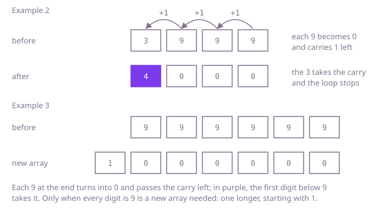

## The question

A number of up to 100 decimal digits is given as an array, most significant digit first. Return the digits of the number plus one, with no leading zeros.

What makes it harder than it looks: a `long` holds at most 19 digits, so turning the array into a `long`, adding one and turning it back fails on longer numbers. Adding one on the digits is short, but three details are easy to get wrong: the carry runs through every 9 at the end, so 3999 becomes 4000; it stops at the first digit below 9, so the 9s further left, as in 949, keep their value; and when every digit is 9, the answer is one digit longer than the array, so it needs a new array.

## How to think about it

Add one the way you would on paper, starting at the last digit. If that digit is below 9 it goes up by one and nothing else changes, which is the usual case. If it is 9, it becomes 0 and a carry of one moves to the digit on its left, which then faces the same choice: below 9 it takes the carry and the work is done, a 9 turns into 0 and passes the carry on. So the only digits that change are the run of 9s at the end, which all become 0, and the one digit before that run, which goes up by one.

There is no need for a carry variable or a pass over the whole number: walk from the right, turn 9s into 0s, and return as soon as a digit below 9 has been increased. If the walk falls off the front, every digit was 9 and is now 0, and the answer is 1 followed by those zeros, an array one longer. In Example 2, `[3, 9, 9, 9]`, the three 9s become 0 and the 3 becomes 4: `[4, 0, 0, 0]`. In Example 3, all six digits are 9, so the walk ends without returning and the answer is a new array of seven digits, `[1, 0, 0, 0, 0, 0, 0]`.



## Brute force

Turn the digits into a number, add one, and turn the sum back into digits. A `long` would overflow past 19 digits, so the number has to be a `java.math.BigInteger`. It comes first because it is the definition read literally, plus one on the value, and it hands all of the carrying to a library. It is correct because a `BigInteger` holds any number of digits exactly.

```java
static int[] plusOne(int[] digits) {
    StringBuilder text = new StringBuilder();
    for (int digit : digits) {
        text.append(digit);
    }
    // a long would overflow past 19 digits, a BigInteger holds them all
    String sum = new java.math.BigInteger(text.toString()).add(java.math.BigInteger.ONE).toString();
    int[] out = new int[sum.length()];
    for (int i = 0; i < out.length; i++) {
        out[i] = sum.charAt(i) - '0';
    }
    return out;
}
```

**Complexity:** time O(n²) for n digits, since converting between decimal and the binary `BigInteger` costs about one pass over the number per group of nine digits, though at 100 digits that is still tiny; extra space O(n) for the text, the number and the result.

## Better: one full pass with a carry

Add the digits and a carry of 1 from the right into a new array one digit longer, as written addition does: each position gets `(digit + carry) % 10` and passes `(digit + carry) / 10` on. The extra first slot holds the final carry. When that carry is 0, the slot is a leading zero, and the answer is the rest of the array.

```java
static int[] plusOne(int[] digits) {
    int n = digits.length;
    int[] sum = new int[n + 1]; // one more slot for a carry off the front
    int carry = 1; // the one being added
    for (int i = n - 1; i >= 0; i--) {
        int value = digits[i] + carry;
        sum[i + 1] = value % 10;
        carry = value / 10;
    }
    sum[0] = carry;
    // without a final carry the first slot is a leading zero
    return carry == 1 ? sum : Arrays.copyOfRange(sum, 1, n + 1);
}
```

**Complexity:** time O(n), always a full pass and usually a copy; extra space O(n) for the new arrays.

**Prefer it when:** you are adding something other than one, such as a second digit array or a number of several digits: this loop is general addition, and plus one is only the case of a carry of 1 into the last digit.

## Optimal: stop where the carry stops

Walk from the right. A 9 becomes 0 and the walk goes on; the first digit below 9 goes up by one and the array is returned as it is. If the walk ends, every digit was 9, so return a new array one longer with a 1 in front. This is the reference solution.

```java
static int[] plusOne(int[] digits) {
    for (int i = digits.length - 1; i >= 0; i--) {
        if (digits[i] < 9) {
            digits[i]++;
            return digits; // the carry is used up, so nothing to the left changes
        }
        digits[i] = 0; // a 9 turns into 0 and carries one to the left
    }
    // only all nines get here: 99...9 + 1 is 1 followed by as many zeros
    int[] longer = new int[digits.length + 1];
    longer[0] = 1;
    return longer;
}
```

**Complexity:** time O(k + 1) for k 9s at the end, so O(n) only when the number ends in a long run of 9s; extra space O(1), except for the new array of n + 1 digits when every digit is 9.

## Complexity

| Approach | Time | Extra space |
| --- | --- | --- |
| Brute force: through `BigInteger` | O(n²) for the conversions | O(n) |
| Better: one full pass with a carry | O(n), always | O(n) |
| Optimal: stop where the carry stops | O(k + 1) for k 9s at the end, O(n) worst | O(1), O(n) only when every digit is 9 |

## Where it shows up

No coding-round problem is linked to this question. Adding one with a carry is how an odometer or a counter display turns over, how a library such as `BigInteger` increments a long number word by word, and how a sequence number kept as text, such as an invoice number `INV-000999`, moves to the next value. The same walk in another base gives the next item in an enumeration: the next string of a fixed length in alphabetical order, or the next combination of a lock.

## Follow-up answers

**Can you stop as soon as the carry is used up, and when do you need a new array?** Yes, the Optimal version stops at the first digit below 9, so a number that does not end in 9 costs one step. A new array is needed only when every digit is 9, and then its contents are known without looking: a 1 followed by n zeros.

**How would you add two such digit arrays of different lengths?** Walk both from the right with one carry, treating a digit past the front of the shorter array as 0, and write each `(a + b + carry) % 10` into a result of `max(m, n) + 1` slots. Keep the first slot only if the last carry is 1. That is O(max(m, n)) time.

**What changes if the digits are stored lowest digit first, or the number can be decremented as well?** Lowest digit first, the walk runs from the front of the array, and the all-nines case appends a 1 at the end instead of putting it in front, so the new array is a copy with one more slot. Decrementing is the mirror image: 0s at the end become 9s and the first digit above 0 goes down by one, and if that digit was the leading 1 of a longer number, such as `[1, 0, 0]`, it is dropped and the answer, `[9, 9]`, is one digit shorter. `[0]` has no decrement in this form, since -1 is not a non-negative number.
