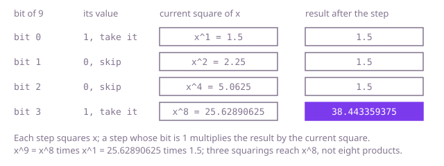

## The question

Raise a `double` `x` to an `int` power `n`, where `n` may be zero, negative or as large as an `int` gets, and return the result, which is accepted within a relative error of 10^-6.

What makes it harder than it looks: `n` can be about two billion in either direction, so multiplying `x` in one factor at a time is two billion multiplications per call. A negative `n` means a reciprocal, and the smallest `int`, -2147483648, has no positive partner in an `int`: `-n` overflows back to the same negative number, so code that negates `n` in an `int` loops forever, recurses forever or quietly returns 1. Negative bases need the sign of odd powers kept, and 0 to a positive power must come out as 0.

## How to think about it

The first idea is the definition: start from 1 and multiply by `x` once per unit of `n`, after replacing `x` by `1 / x` when `n` is negative. That is right, but look at what it repeats. To get `x^8` it multiplies eight times, yet `x^8` is `(x^4)^2`, `x^4` is `(x^2)^2` and `x^2` is `x · x`: three squarings. In general `x^n` is `(x^(n/2))^2` when `n` is even and `x · (x^(n/2))^2` when it is odd, so halving the exponent at each step reaches the answer in about log2 |n| steps, 31 for the largest `int`.

The same idea without recursion reads the bits of the exponent from the lowest. `x^n` is the product of `x^(2^k)` over the bits `k` that are set in `n`, and `x^(2^k)` is what you get by squaring `x` k times. So keep squaring `x`, and multiply the result by the current square whenever the current bit is 1. For a negative `n`, take `1 / x` and work with `-n`, held in a `long`, where the negation of the smallest `int` fits.

Walk Example 1, `x = 1.5`, `n = 9`, which is 1001 in binary. Bit 0 is 1: the result takes 1.5. Square: 2.25; bit 1 is 0, skip. Square: 5.0625; bit 2 is 0, skip. Square: 25.62890625; bit 3 is 1, so the result becomes 1.5 × 25.62890625 = 38.443359375. Every value is a fraction over a power of 2, so the answer is exact.



## Brute force

Multiply `x` into the result |n| times, after taking the reciprocal for a negative `n`. It is what you say first, because it is the definition, and it fixes the answer the faster versions must agree with. It is correct because x^n for a positive n is exactly n factors of x, and x^n for a negative n is (1/x)^-n; holding the exponent in a `long` makes `-n` safe for the smallest `int`.

```java
static double raise(double x, int n) {
    long e = n; // in a long, -n fits even for Integer.MIN_VALUE
    if (e < 0) {
        x = 1 / x;
        e = -e;
    }
    double result = 1;
    for (long i = 0; i < e; i++) {
        result *= x; // one multiplication per unit of the exponent
    }
    return result;
}
```

**Complexity:** time O(|n|), about two billion multiplications for the largest exponents; extra space O(1).

## Better: halve the exponent recursively

Compute `x^(e/2)` once, square it, and multiply by one more `x` when `e` is odd. Each call halves the exponent, so a call for `e` up to 2^31 is at most 32 calls deep. The negation happens on a `long`, cast before the minus sign.

```java
static double raise(double x, int n) {
    return n < 0 ? 1 / positive(x, -(long) n) : positive(x, n); // cast first: -n overflows in an int
}

private static double positive(double x, long e) {
    if (e == 0) {
        return 1;
    }
    double half = positive(x, e / 2); // x^(e/2), computed once and used twice
    return e % 2 == 0 ? half * half : half * half * x;
}
```

**Complexity:** time O(log |n|), extra space O(log |n|) for the calls, at most 33 deep.

**Prefer it when:** you want the version that is easiest to check, because each call is the identity x^e = (x^(e/2))^2 written down, and at 33 calls the stack is no concern.

## Optimal: square and multiply, bit by bit

Read the exponent's bits from the lowest. Square `x` at every step, and multiply the result by the current square when the bit is 1. A negative `n` becomes the reciprocal of `x` and the exponent `-n` in a `long`. This is the reference solution.

```java
static double raise(double x, int n) {
    long e = n; // in a long, -n fits even for Integer.MIN_VALUE
    if (e < 0) {
        x = 1 / x;
        e = -e;
    }
    double result = 1;
    while (e > 0) {
        if ((e & 1) == 1) { // this bit of the exponent asks for the current square
            result *= x;
        }
        x *= x; // x to the power 1, 2, 4, 8, ... of the original
        e >>= 1;
    }
    return result;
}
```

**Complexity:** time O(log |n|), at most 32 squarings and 31 products; extra space O(1).

## Complexity

| Approach | Time | Extra space |
| --- | --- | --- |
| Brute force: one factor at a time | O(\|n\|) | O(1) |
| Better: halve the exponent recursively | O(log \|n\|) | O(log \|n\|), at most 33 calls |
| Optimal: square and multiply, bit by bit | O(log \|n\|) | O(1) |

## Where it shows up

No coding-round problem is linked to this question. Square-and-multiply is how cryptography raises numbers to huge powers modulo a prime (RSA, Diffie-Hellman, primality tests), how a matrix is raised to a power to jump a linear recurrence, such as a Fibonacci number or a Markov chain, many steps ahead, and how compound growth over many periods is computed without a loop per period.

## Follow-up answers

**Can you do it with O(log |n|) multiplications?** Yes: square the base once per bit of the exponent and multiply the result by the squares whose bit is set. For any `int` exponent that is at most 32 squarings and 31 products, where the definition needs up to about two billion.

**How would you compute x^n modulo m for integers, as in modular exponentiation?** Run the same loop on `long` values and reduce modulo m after every product and every squaring, so nothing grows past m². That keeps every number in a `long` while m is below about 3 · 10^9; beyond that, use `Math.multiplyHigh` or `BigInteger.modPow`. A negative n needs the modular inverse of x, which exists only when x and m share no factor.

**Why does the rounding error grow with n, and how large can it get?** Each multiplication rounds to within about 1.1 · 10^-16 of its exact value, relatively. Squaring doubles the relative error of the number it squares, so an error made early in the chain of squarings is doubled at every later step, and in total the result can be off by up to about |n| such units: for n near 2^31 that is about 2.4 · 10^-7, and about twice that when `1 / x` was rounded first. Multiplying one factor at a time has the same bound, |n| roundings that add up. That is why the answer is checked to a relative 10^-6, and why a library `pow`, which works through logarithms with extra precision, is accurate to the last digit.
