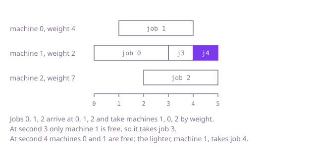

## The question

Given machines with weights and a stream of jobs, one arriving each second, give every job in arrival order to the lightest free machine, and make jobs wait for the first machine to finish when none is free. Report which machine took each job.

What makes it harder than it looks: it needs two different orderings at once, "best free machine" by weight and "first to finish" among the busy ones. A waiting job also does not start when it arrived but when a machine frees up, and that chain of delays adds up: a single machine fed long jobs is busy until a second far beyond the range of an `int`, and a program that keeps seconds in `int` quietly treats that machine as free too early. And with 200,000 jobs and 150,000 machines, scanning every machine for every job is about 30 billion steps.

## How to think about it

The first idea is to simulate it directly. Keep the second each machine becomes free. For each job, scan the machines for the free one with the smallest weight (lowest number on ties); if none is free, find the earliest finishing second, move the clock there, and scan again. That follows the rules word for word, and it costs a pass over every machine per job.

What does the scan repeat? It answers two questions from scratch each time, and each answer is the smallest item of an ordering. Among free machines, the smallest by `(weight, number)`. Among busy machines, the smallest by `(finishing second, number)`. A min-heap keeps its smallest item at the top and updates in logarithmic time, so two heaps, one per group, replace both scans. A machine moves from the busy heap to the free heap when its second comes, and back to the busy heap each time it takes a job.

Two details decide the code. The clock `now` becomes `max(now, j)` for job `j`, because a job cannot start before it arrives nor before the job ahead of it, which may itself have waited. And when no machine is free, the clock jumps straight to the earliest finishing second instead of ticking, and everything finishing at that same second is released together. The finishing second is a `long`.

Walk Example 1, `weights = [4, 2, 7]`, `durations = [3, 3, 3, 1, 1]`. Job 0 at second 0: all three are free, machine 1 has the smallest weight, 2, and is busy until 3. Job 1 at second 1: machine 0 is the lighter of the free two and is busy until 4. Job 2 at second 2: machine 2, until 5. Job 3 at second 3: machine 1 has just finished, so it takes it, until 4. Job 4 at second 4: machines 0 and 1 both finish at 4, so both are released, and the lighter machine 1 takes it. The answer is `[1, 0, 2, 1, 1]`.



## Brute force

Keep one `long` per machine, the second it becomes free. For each job, advance the clock, scan all machines for the free one with the smallest weight (the first one found wins a tie, since the scan runs in number order), and if none is free, move the clock to the earliest finishing second and scan again. It comes first because it is the rules as a loop, and it fixes the answer the faster versions must agree with. It is correct because each scan applies the choice rule to every machine, so it cannot pick a worse one.

```java
static int[] assign(int[] weights, int[] durations) {
    int machines = weights.length;
    long[] freeAt = new long[machines]; // long: busy-until seconds can pass the int range
    int[] answer = new int[durations.length];
    long now = 0;
    for (int job = 0; job < durations.length; job++) {
        now = Math.max(now, job); // not before it arrives, not before the job ahead of it
        int best = lightestFree(weights, freeAt, now);
        if (best < 0) { // every machine busy: jump to the first finish
            long earliest = Long.MAX_VALUE;
            for (int m = 0; m < machines; m++) {
                earliest = Math.min(earliest, freeAt[m]);
            }
            now = earliest;
            best = lightestFree(weights, freeAt, now);
        }
        answer[job] = best;
        freeAt[best] = now + durations[job];
    }
    return answer;
}

static int lightestFree(int[] weights, long[] freeAt, long now) {
    int best = -1;
    for (int m = 0; m < weights.length; m++) {
        if (freeAt[m] <= now && (best < 0 || weights[m] < weights[best])) { // strictly lighter: ties keep the lower number
            best = m;
        }
    }
    return best;
}
```

**Complexity:** time O(n × m) for n jobs and m machines, extra space O(m) beyond the answer.

## Better: ordered sets instead of heaps

This is a different tool at the same cost. A `TreeSet` with a comparator keeps its items sorted, so `pollFirst()` gives the smallest the way a heap's `poll()` does. The free set orders machines by weight then number, the busy set by finishing second then number. The comparator for the busy set reads `freeAt`, so a machine's `freeAt` must only change while the machine is in neither set, which is how the loop below uses it.

```java
static int[] assign(int[] weights, int[] durations) {
    int machines = weights.length;
    TreeSet<Integer> free = new TreeSet<>(
            Comparator.<Integer>comparingInt(m -> weights[m]).thenComparingInt(m -> m));
    for (int m = 0; m < machines; m++) {
        free.add(m);
    }
    long[] freeAt = new long[machines];
    TreeSet<Integer> busy = new TreeSet<>(
            Comparator.<Integer>comparingLong(m -> freeAt[m]).thenComparingInt(m -> m));
    int[] answer = new int[durations.length];
    long now = 0;
    for (int job = 0; job < durations.length; job++) {
        now = Math.max(now, job);
        while (!busy.isEmpty() && freeAt[busy.first()] <= now) {
            free.add(busy.pollFirst()); // finished by now
        }
        if (free.isEmpty()) {
            now = freeAt[busy.first()]; // wait for the first machine to finish
            while (!busy.isEmpty() && freeAt[busy.first()] <= now) {
                free.add(busy.pollFirst());
            }
        }
        int machine = free.pollFirst();
        answer[job] = machine;
        freeAt[machine] = now + durations[job]; // changed while in neither set
        busy.add(machine);
    }
    return answer;
}
```

**Complexity:** time O((n + m) log m), extra space O(m) beyond the answer; a balanced tree guarantees the logarithm in the worst case.

**Prefer it when:** you must take a specific machine out. If a machine can be withdrawn, `free.remove(m)` or `busy.remove(m)` finds it in O(log m), where a heap would search for it in O(m). The code as shown does not withdraw machines, so those lines would be the addition. For the question as asked, the heaps do the same work with less memory per item.

## Optimal: a heap of free machines and a heap of busy machines

Free machines sit in a min-heap ordered by weight, then number. Busy machines sit in a min-heap ordered by their finishing second, then number. For each job set `now = max(now, j)` and release every busy machine whose finishing second is at most `now`. If the free heap is still empty, set `now` to the earliest finishing second and release again, which also collects every machine finishing at that very second. Then pop the best free machine, record it, and push it onto the busy heap with its new finishing second. A machine that finishes at the second a job arrives is free for it, so the release test is `<=`. This is the reference solution.

```java
static int[] assign(int[] weights, int[] durations) {
    int machines = weights.length;
    PriorityQueue<Integer> free = new PriorityQueue<>(
            Comparator.<Integer>comparingInt(m -> weights[m]).thenComparingInt(m -> m));
    for (int m = 0; m < machines; m++) {
        free.add(m);
    }
    long[] freeAt = new long[machines]; // one machine queueing many jobs passes the int range
    PriorityQueue<Integer> busy = new PriorityQueue<>(
            Comparator.<Integer>comparingLong(m -> freeAt[m]).thenComparingInt(m -> m));
    int[] answer = new int[durations.length];
    long now = 0;
    for (int job = 0; job < durations.length; job++) {
        now = Math.max(now, job); // a job starts neither before it arrives nor before the job ahead of it
        release(busy, free, freeAt, now);
        if (free.isEmpty()) {
            now = freeAt[busy.peek()]; // wait for the first machine to finish
            release(busy, free, freeAt, now);
        }
        int machine = free.poll();
        answer[job] = machine;
        freeAt[machine] = now + durations[job];
        busy.add(machine);
    }
    return answer;
}

/** Moves every busy machine that has finished by the given second into the free queue. */
private static void release(PriorityQueue<Integer> busy, PriorityQueue<Integer> free, long[] freeAt, long now) {
    while (!busy.isEmpty() && freeAt[busy.peek()] <= now) {
        free.add(busy.poll());
    }
}
```

**Complexity:** time O((n + m) log m), extra space O(m) beyond the answer. Each job causes one removal from the free heap and one insertion into the busy heap, and each machine moves back at most once per job it took.

## Complexity

| Approach | Time | Extra space |
| --- | --- | --- |
| Brute force | O(n × m) | O(m) |
| Better: ordered sets | O((n + m) log m) | O(m) |
| Optimal: two heaps | O((n + m) log m) | O(m) |

Here n is the number of jobs and m the number of machines; extra space is beyond the answer array.

## Where it shows up

`courier-load-balancer` keeps the same kind of heap in `LoadBalancer.plan`: a min-heap of `{load, courier index}` whose comparator orders by load and then by index, so the lightest courier is on top and ties go to the one listed first. It peeks at the top, then takes the courier out, adds the parcel's weight and puts it back. This question adds time. A machine is unavailable while busy, which is why a second heap holds it until its finishing second, whereas a courier is always available and only its load changes. The tie-break lives in the comparator in both places, because a heap keeps only the order it is given.

Outside the coding round, the same two-heap shape runs a thread pool or batch scheduler that hands each job to the best idle worker and otherwise waits for the first worker to finish.

## Follow-up answers

**How would you also report when each job started?** Record `now` when the job takes its machine. It is the start second, and `now - j` is how long the job waited. Keep it as a `long` array.

**What changes if jobs can arrive at arbitrary seconds instead of one per second?** Replace `j` by the arrival second of the job, and sort the jobs by arrival if they do not come in that order. The rest is unchanged: `now` becomes `max(now, arrival)`.

**What if a machine can break down while it is working?** The busy heap no longer knows the finishing second for certain. Remove the machine from it when it breaks, which needs a structure that deletes by key (the ordered-set version, not the heap), and decide whether its job restarts on another machine or fails.
