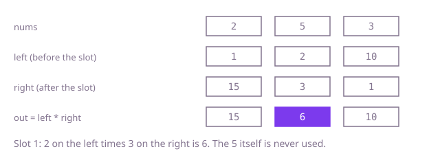

## The question

Given an array of numbers, return an array of the same length where each slot holds the product of every number in the input except the one at that position. The input must not be changed.

What makes it harder than it looks is the zero. The shortcut "multiply everything once, then divide by the number at each slot" fails when a number is zero, because the total is zero and dividing by zero is undefined, while the slot of the zero itself still needs the product of all the others. And at 200,000 numbers, multiplying the other 199,999 for every slot is far too slow.

## How to think about it

The first idea is to recompute: for each position, multiply all the others. It repeats a lot, because neighbouring positions share almost all of their product. The answer for position `i` is the product of everything to its left times the product of everything to its right, and each of those grows by one multiplication as `i` moves one step, so it can be built once and reused. That gives two arrays, one of left products and one of right products. Then one more look: the right products can be folded into the answer array on the way back, using a single running variable, which removes the extra arrays.

Walk Example 1, `nums = [2, 5, 3]`. The product to the left of each slot is 1, 2 and 10: nothing before the first, then 2, then 2 times 5. The product to the right is 15, 3 and 1: 5 times 3, then 3, then nothing. Multiplying slot by slot gives `[1*15, 2*3, 10*1] = [15, 6, 10]`. A zero needs no special case. In `[4, 0, 6]` the left products are 1, 4, 0 and the right products are 0, 6, 1, so the answer is `[0, 24, 0]`: the zero poisons every product that passes it, and the zero's own slot never multiplies by it.



## Brute force

For each position, multiply every other number. It is the definition of the answer, and it fixes the values every faster version must produce. It is correct because it follows the definition literally, with `j != i` leaving out exactly the slot's own number.

```java
static int[] exceptSelf(int[] nums) {
    int n = nums.length;
    int[] out = new int[n];
    for (int i = 0; i < n; i++) {
        int product = 1;
        for (int j = 0; j < n; j++) {
            if (j != i) { // skip only the slot's own number
                product *= nums[j];
            }
        }
        out[i] = product;
    }
    return out;
}
```

**Complexity:** time O(n²), extra space O(1) besides the answer.

## Better: prefix and suffix arrays

Store the product of everything before each slot in one array and the product of everything after it in another, then multiply them slot by slot. Each array is built in one pass with one multiplication per step.

```java
static int[] exceptSelf(int[] nums) {
    int n = nums.length;
    int[] left = new int[n];  // left[i]: product of nums[0..i-1]
    int[] right = new int[n]; // right[i]: product of nums[i+1..n-1]
    left[0] = 1;
    for (int i = 1; i < n; i++) {
        left[i] = left[i - 1] * nums[i - 1];
    }
    right[n - 1] = 1;
    for (int i = n - 2; i >= 0; i--) {
        right[i] = right[i + 1] * nums[i + 1];
    }
    int[] out = new int[n];
    for (int i = 0; i < n; i++) {
        out[i] = left[i] * right[i]; // everything except nums[i]
    }
    return out;
}
```

**Complexity:** time O(n), extra space O(n) for the two arrays.

**Prefer it when:** you want the two halves to be easy to read or to reuse. The `left` and `right` arrays stay available, so a related question, such as the product of everything except a range, is one more multiplication per query.

## Optimal: two sweeps into the answer array

Fold the two arrays into the output. A left-to-right sweep writes each slot's left product into `out` and keeps the running product in one variable. A right-to-left sweep multiplies each slot by the running product of everything after it. This is the reference solution.

```java
static int[] exceptSelf(int[] nums) {
    int n = nums.length;
    int[] out = new int[n];
    int left = 1; // product of everything before the current slot
    for (int i = 0; i < n; i++) {
        out[i] = left;
        left *= nums[i];
    }
    int right = 1; // product of everything after the current slot
    for (int i = n - 1; i >= 0; i--) {
        out[i] *= right;
        right *= nums[i];
    }
    return out;
}
```

**Complexity:** time O(n), extra space O(1) besides the answer array.

## Complexity

| Approach | Time | Extra space |
| --- | --- | --- |
| Brute force | O(n²) | O(1) besides the answer |
| Better: prefix and suffix arrays | O(n) | O(n) |
| Optimal: two sweeps into the answer array | O(n) | O(1) besides the answer |

## Where it shows up

Prefix and suffix products (or sums) answer "everything except this one" questions without recomputing: leave-one-out statistics in analytics, "total minus this item's share" in billing, and the left and right running values used to compute things like compound growth up to and after a given day.

## Follow-up answers

**Can you use only O(1) extra space besides the answer array?** Yes, that is the optimal version above: the answer array holds the left products, and the right product is a single variable.

**Why is dividing the total product by each number a poor idea here?** A zero makes the total zero and division by zero is not defined, so the code needs separate cases for no zero, one zero and several zeros. The two sweeps need none of that, and they also avoid exact-division surprises with other number types.

**How would you answer many queries after changing single values in the array?** Keep the products in a segment tree or a Fenwick-style structure. A point update then costs O(log n), and the product of everything except one position is the product of the range before it times the range after it.
