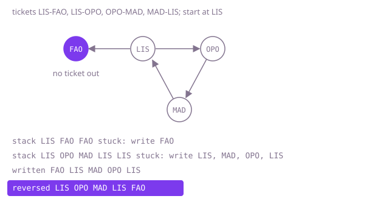

## The question

You get a stack of one-way tickets and a starting airport, and must chain every ticket exactly once into one trip. When several chains work, return the alphabetically smallest list of airports.

What makes it harder than it looks: the obvious rule, always fly to the smallest destination available, can fly into an airport no ticket leaves while other tickets are still unused (Example 2). Undoing flights when you get stuck fixes that but can retry an enormous number of orders. Duplicate tickets must each be flown, so storing destinations in a set loses flights. And a trip can be 100,000 flights long, so a search that recurses once per flight overflows the stack.

## How to think about it

The first idea is a search: fly to the smallest destination first, and when you are stuck with tickets left, undo the last flight and try the next destination. Because options are tried in alphabetical order, the first complete trip found is the smallest. It is correct, but it can be exponential: in the test where the smallest first flight leads into a region with eleven loops and no way back, it tries every order of the eleven loops before giving up on that flight.

The waste is in undoing. Look at where a greedy walk can get stuck: every airport other than the start and the end has as many tickets out as tickets in, so a walk that lands there can always leave again, and the first time a greedy walk is stuck, it is at the airport where the whole trip must end. That airport is not a mistake, it is the last entry of the answer. So never undo: when stuck, write the airport down and step back to the previous airport, which may still have tickets left; those tickets form loops that are spliced in before what is already written. Writing airports as you leave them for good builds the trip back to front, and reversing it at the end gives the answer. This is Hierholzer's algorithm for an Euler path, with destinations kept in alphabetical order. A greedy choice that runs into the dead end is written first and so lands at the end of the trip, which is where it has to be, while loops that come back land before it; so taking the smallest destination at every step is safe.

Walk Example 2: from LIS the smallest destination is FAO. FAO has no ticket out, so FAO is written first; it is the last stop. Back at LIS, fly to OPO, then MAD, then LIS, which has no tickets left, so LIS is written, then MAD, OPO and the starting LIS as each runs out. Written: FAO, LIS, MAD, OPO, LIS. Reversed: `["LIS", "OPO", "MAD", "LIS", "FAO"]`.



## Brute force

Try destinations in alphabetical order and undo the last flight whenever you are stuck with tickets left. It is what you say first, and it fixes the answer to compare against. It is correct because it tries complete trips in alphabetical order and stops at the first one that uses every ticket. The search keeps its own stack of choices instead of recursing, so long trips do not overflow.

```java
static List<String> route(String[][] tickets, String start) {
    int m = tickets.length;
    Map<String, List<Integer>> out = new HashMap<>(); // ticket indices by departure airport
    for (int i = 0; i < m; i++) {
        out.computeIfAbsent(tickets[i][0], k -> new ArrayList<>()).add(i);
    }
    for (List<Integer> options : out.values()) {
        options.sort((a, b) -> tickets[a][1].compareTo(tickets[b][1])); // smallest destination first
    }
    boolean[] used = new boolean[m];
    int[] chosen = new int[m]; // ticket flown at each step
    int[] tried = new int[m + 1]; // where to resume the options at each step
    int depth = 0;
    while (depth < m) {
        String here = depth == 0 ? start : tickets[chosen[depth - 1]][1];
        List<Integer> options = out.getOrDefault(here, List.of());
        int pos = tried[depth];
        while (pos < options.size() && used[options.get(pos)]) {
            pos++;
        }
        if (pos < options.size()) {
            int ticket = options.get(pos);
            used[ticket] = true;
            chosen[depth] = ticket;
            tried[depth] = pos + 1;
            depth++;
            tried[depth] = 0;
        } else { // stuck with tickets left: undo the previous flight
            depth--;
            used[chosen[depth]] = false;
        }
    }
    List<String> route = new ArrayList<>();
    route.add(start);
    for (int ticket : chosen) {
        route.add(tickets[ticket][1]);
    }
    return route;
}
```

**Complexity:** time exponential in the worst case, since a dead end found late can force every order of the loops before it to be retried; extra space O(m) for m tickets, plus the hash map, whose operations are O(1) on average and O(log m) in the worst case (Java's `HashMap` turns a crowded bucket of `String` keys into a tree).

## Better: Hierholzer, recursive

Keep each airport's destinations in a priority queue. Visiting an airport flies every ticket out of it, smallest first, visiting each destination in turn; when none are left, the airport is added to the front of the answer. This is the same algorithm as the optimal one, written the way it is usually taught.

```java
static List<String> route(String[][] tickets, String start) {
    Map<String, PriorityQueue<String>> out = new HashMap<>();
    for (String[] ticket : tickets) {
        out.computeIfAbsent(ticket[0], k -> new PriorityQueue<>()).add(ticket[1]);
    }
    LinkedList<String> route = new LinkedList<>();
    visit(start, out, route);
    return route;
}

private static void visit(String airport, Map<String, PriorityQueue<String>> out, LinkedList<String> route) {
    PriorityQueue<String> next = out.get(airport);
    while (next != null && !next.isEmpty()) {
        visit(next.poll(), out, route); // fly the smallest ticket left
    }
    route.addFirst(airport); // no tickets left here: it comes after everything still unwritten
}
```

**Complexity:** time O(m log m), extra space O(m); hash map operations are O(1) on average and O(log m) in the worst case. The recursion is one level per flight on the current path, so it overflows the stack on a long trip: the 100,000-ticket ring in the tests crashes it.

**Prefer it when:** trips are short, such as a few hundred tickets, and you want the shortest code to read in an interview.

## Optimal: Hierholzer with an explicit stack

The same idea with the call stack made explicit. Push the start. Look at the airport on top: if it has a ticket left, fly the smallest one and push the destination; if not, pop it onto the answer. When the stack is empty, reverse the answer. This is the reference solution.

```java
static List<String> route(String[][] tickets, String start) {
    Map<String, PriorityQueue<String>> out = new HashMap<>();
    for (String[] ticket : tickets) {
        out.computeIfAbsent(ticket[0], k -> new PriorityQueue<>()).add(ticket[1]);
    }
    Deque<String> stack = new ArrayDeque<>();
    List<String> route = new ArrayList<>();
    stack.push(start);
    while (!stack.isEmpty()) {
        PriorityQueue<String> next = out.get(stack.peek());
        if (next != null && !next.isEmpty()) {
            stack.push(next.poll()); // fly the smallest ticket left
        } else {
            route.add(stack.pop()); // stuck: this airport is written, back to front
        }
    }
    Collections.reverse(route);
    return route;
}
```

**Complexity:** time O(m log m) for the priority queues, extra space O(m); hash map operations are O(1) on average and O(log m) in the worst case. No recursion, so a trip of 100,000 flights is fine.

## Complexity

| Approach | Time | Extra space |
| --- | --- | --- |
| Brute force: smallest first, undo when stuck | exponential in the worst case | O(m), hash map O(1) average, O(log m) worst per operation |
| Better: Hierholzer, recursive | O(m log m), hash map O(1) average, O(log m) worst per operation; overflows the stack on long trips | O(m) plus recursion depth up to m |
| Optimal: Hierholzer with an explicit stack | O(m log m), hash map O(1) average, O(log m) worst per operation | O(m) |

## Where it shows up

An Euler path, a route that uses every link exactly once, is what a street-sweeping or snow-plough schedule needs to cover every street without repeating one, what a genome assembler builds through a de Bruijn graph of overlapping fragments, and what a test generator walks to exercise every transition of a state machine in one run.

## Follow-up answers

**How would you know whether any valid trip exists at all?** Count tickets in and out per airport. A trip from `start` exists only if every airport has equal counts except that `start` may have one more out and some other airport one more in, or all are equal and the trip returns to `start`; and every airport with a ticket must be reachable from `start`. Checking only the length of Hierholzer's output is not enough: on tickets with no valid trip it still writes every airport, but splices pieces that do not join, so check the counts first or check that each consecutive pair of the output is a ticket.

**What if the trip had to end back at the starting airport?** Then every airport must have equal counts in and out, and the same algorithm returns a closed trip. Nothing in the code changes; only the existence condition is stricter.

**What if you could choose the starting airport?** Pick the airport with one more ticket out than in if there is one, since a trip must start there. If every airport is balanced, any airport with a ticket works, and to get the smallest trip overall you start at the smallest code that has a ticket out.
