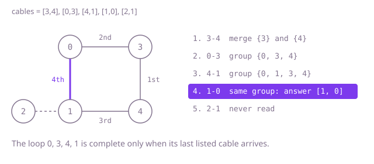

## The question

A network of buildings was a tree until one extra cable was added, so it now has exactly one loop. Return the cable that can be removed to make it a tree again, and when several can, the one listed last.

What makes it harder than it looks: any cable on the loop qualifies, so the answer is decided by list order, not by the shape alone, and the cable must come back exactly as listed. A cable can look spare without being on the loop (a bridge between two buildings that both have several cables still cuts the network in two). And the honest first idea, removing each cable and checking that the rest still connects, searches the whole network once per cable.

## How to think about it

The first idea follows the definition: try removing cables from the end of the list backwards, and after each removal check by a search from building 0 that every building is still reached. The first cable that passes is the answer. It is correct but repeats a full search for every cable, and when the loop sits at the start of the list, every cable after it is a bridge whose check fails.

The repeated work is rediscovering the loop. One way to find it once is to peel the network like an onion: a building with a single cable cannot be on the loop, so remove it, which may leave its neighbour with a single cable, and so on. What survives is exactly the loop, and the answer is the last listed cable with both ends on it.

The neatest view reads the list once in order. Lay the cables one by one; the loop closes at the moment a cable joins two buildings that are already connected, and since a loop is complete only when its last listed cable arrives, that cable is the answer. Asking "already connected?" while cables arrive is what union-find does: every building starts in its own group, a cable merges two groups, and two buildings are connected when their groups have the same representative.

Walk Example 1: `[[3, 4], [0, 3], [4, 1], [1, 0], [2, 1]]`. Cable `[3, 4]` merges {3} and {4}. Cable `[0, 3]` adds 0 to that group, and `[4, 1]` adds 1, giving {0, 1, 3, 4}. Cable `[1, 0]` joins 1 and 0, which are already in the same group, so it is the answer, `[1, 0]`. Cable `[2, 1]` is never read.



## Brute force

Remove cables from the last one backwards and keep the first whose removal still lets a search from building 0 reach all `n` buildings. It is what you say first, and it fixes the answer the faster versions must match. It is correct because it checks the definition directly, in the order the tie rule asks for.

```java
static int[] spare(int[][] cables) {
    int n = cables.length;
    List<List<Integer>> touching = new ArrayList<>(); // cable indices at each building
    for (int i = 0; i < n; i++) {
        touching.add(new ArrayList<>());
    }
    for (int i = 0; i < n; i++) {
        touching.get(cables[i][0]).add(i);
        touching.get(cables[i][1]).add(i);
    }
    for (int skip = n - 1; skip >= 0; skip--) { // the last listed qualifying cable wins
        boolean[] seen = new boolean[n];
        Deque<Integer> queue = new ArrayDeque<>();
        seen[0] = true;
        queue.add(0);
        int reached = 1;
        while (!queue.isEmpty()) {
            int building = queue.poll();
            for (int c : touching.get(building)) {
                int other = cables[c][0] == building ? cables[c][1] : cables[c][0];
                if (c != skip && !seen[other]) {
                    seen[other] = true;
                    reached++;
                    queue.add(other);
                }
            }
        }
        if (reached == n) {
            return cables[skip];
        }
    }
    return new int[0];
}
```

**Complexity:** time O(n²), one O(n) search per cable tried, extra space O(n).

## Better: peel off buildings with one cable

Count each building's cables and queue every building that has exactly one. Take one off, mark it peeled, and lower the count of its neighbours that are still in; a neighbour that drops to one cable is queued in turn. The loop's buildings always keep their two loop cables, so they are never peeled, and every other building eventually is. Then scan the list from the end for the first cable with both ends unpeeled. Both ends on the loop means the cable is on the loop, since a second cable between loop buildings would make a second loop.

```java
static int[] spare(int[][] cables) {
    int n = cables.length;
    List<List<Integer>> next = new ArrayList<>();
    for (int i = 0; i < n; i++) {
        next.add(new ArrayList<>());
    }
    int[] degree = new int[n];
    for (int[] cable : cables) {
        next.get(cable[0]).add(cable[1]);
        next.get(cable[1]).add(cable[0]);
        degree[cable[0]]++;
        degree[cable[1]]++;
    }
    Deque<Integer> leaves = new ArrayDeque<>();
    for (int i = 0; i < n; i++) {
        if (degree[i] == 1) {
            leaves.add(i);
        }
    }
    while (!leaves.isEmpty()) {
        int leaf = leaves.poll();
        degree[leaf] = 0; // peeled: off the loop for good
        for (int other : next.get(leaf)) {
            if (degree[other] > 0 && --degree[other] == 1) {
                leaves.add(other);
            }
        }
    }
    for (int i = n - 1; i >= 0; i--) {
        if (degree[cables[i][0]] > 0 && degree[cables[i][1]] > 0) {
            return cables[i];
        }
    }
    return new int[0];
}
```

**Complexity:** time O(n), extra space O(n) for the neighbour lists and the queue. No recursion, so a loop through 100,000 buildings is fine.

**Prefer it when:** you need the whole loop, not just one cable: the unpeeled buildings are its members, ready to report.

## Optimal: union-find, stop at the first cable inside one group

Give every building its own group. For each cable in list order, find the representative of each end; if they are equal the cable closes the loop and is the answer, otherwise merge the smaller group under the larger. Finding a representative halves the path as it climbs, so the trees stay flat. The loop is complete only when its last listed cable arrives, and no earlier cable can join two connected buildings because the earlier cables form no loop, so the first cable caught is the last listed loop cable. This is the reference solution.

```java
static int[] spare(int[][] cables) {
    int n = cables.length;
    int[] parent = new int[n];
    int[] size = new int[n];
    for (int i = 0; i < n; i++) {
        parent[i] = i;
        size[i] = 1;
    }
    for (int[] cable : cables) {
        int a = find(parent, cable[0]);
        int b = find(parent, cable[1]);
        if (a == b) { // already connected: this cable closes the loop
            return cable;
        }
        if (size[a] < size[b]) { // hang the smaller group under the larger
            int swap = a;
            a = b;
            b = swap;
        }
        parent[b] = a;
        size[a] += size[b];
    }
    return new int[0];
}

private static int find(int[] parent, int x) {
    while (parent[x] != x) {
        parent[x] = parent[parent[x]]; // path halving
        x = parent[x];
    }
    return x;
}
```

**Complexity:** time O(n times α(n)), where α is the inverse Ackermann function and is at most 4 for any input that fits in memory, so effectively linear; extra space O(n). The find is a loop, so it cannot overflow the stack the way a recursive find can on a long chain of buildings.

## Complexity

| Approach | Time | Extra space |
| --- | --- | --- |
| Brute force: remove each cable and search again | O(n²) | O(n) |
| Better: peel off buildings with one cable | O(n) | O(n) |
| Optimal: union-find in list order | O(n times α(n)), effectively linear | O(n) |

## Where it shows up

Finding the one connection that makes a loop is how a network switch running a spanning-tree protocol decides which port to block so frames do not circle forever. The same "is this already connected?" test, made while links arrive, flags a duplicate route when a road or pipe network is entered link by link, and it is the core of Kruskal's algorithm for minimum spanning trees, which skips exactly the edges this question returns.

## Follow-up answers

**What changes if the cables were one-way, so the network was a rooted tree plus one extra link?** A building can now have two incoming links, or the extra link can point back at the root and make a directed loop. You check for a building with two parents first: one of its two incoming links must go, and union-find over the rest decides which. Without such a building, the answer is the link that closes the directed loop, found as here.

**How would you list every building on the loop?** Peel off the buildings with one cable as in the Better approach; the survivors are the loop. With union-find, you can instead stop at the spare cable `[a, b]` and search the tree laid so far for the route from `a` to `b`: that route plus the cable is the loop.

**What if more than one extra cable had been added?** Union-find still reads the list once and reports every cable that joins two already connected buildings. Removing all of them leaves a spanning tree, though when loops share cables it is no longer true that any loop cable would do, so the tie rule has to be stated per cable.
