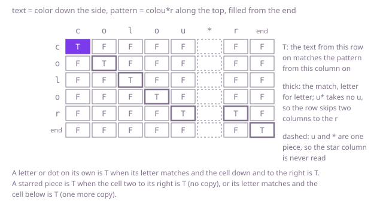

## The question

Given a text and a pattern of letters, dots and stars, decide whether the pattern matches the whole text, where a dot stands for any one letter and a star lets the piece before it match any number of letters, none included.

What makes it harder than it looks is that a starred piece cannot tell how many letters to take. Taking every letter it can fails Example 2: `.*` swallows all of `eventeen` and leaves nothing for `en`. Taking as few as it can fails it too: `.*` stops at the first `en` and `teen` is left over. A starred piece may also take no letter at all, as `a*` does in Example 1, and the star repeats only the one piece before it, so `ban*` is not "ban and anything after", as a file-name pattern would read it. And the match must cover the whole text. Trying both choices at every starred piece is correct, but on the timed tests it has far too many ways to try, whether it starts from the front of the text or from the back, and so does Java's own `String.matches`, which searches the same way.

## How to think about it

The first idea is to match from the front. A plain letter or dot must match the next letter of the text. A starred piece either matches no letter, so skip it and the star, or matches the next letter and stays in play for the one after. When both are possible, try one, and if it fails, back up and try the other. It is correct, because every way of sharing the text out among the pieces is one sequence of these choices. But a text that does not match makes it try every sharing: against `ab` fifty times, a pattern of ten `.*b` pieces, a `c` and ten more `.*b` pieces places its first ten b's on any 10 of the text's 50 b's, about 10^10 ways, each time finding no c after them. Matching from the back instead does not help, since the last ten pieces have about 2 × 10^9 ways of their own before they reach the c.

What is worth remembering is that, whichever choices led there, the search only ever asks one kind of question: does the pattern from position j on match the text from position i on? There are just (n + 1) × (m + 1) of them. Fill a table of them from the end: `can[n][m]` is true, since the empty pattern matches the empty text, and `can[i][m]` is false for any other i. When the piece at j is starred, `can[i][j]` is `can[i][j + 2]`, no copy, or, when letter i matches the piece, `can[i + 1][j]`, one more copy with the piece still in play. Otherwise `can[i][j]` needs letter i to match the piece and `can[i + 1][j + 1]`. The column under a star is never read, since a starred piece jumps over it. Each row reads only itself and the row below it, so two rows are enough.

Walk Example 1, `text = "toast"` down the side and `pattern = "to.a*st"` along the top, starting from the bottom-right corner, the end of both. In the bottom row the text is used up, and only the end of the pattern matches it: the last `t` needs a letter, and every piece before it still has that `t` to come. In the row for the last t, the `t` column is true, since t matches t and the cell down and to the right is the true corner. In the row for s, the `s` column is true the same way, and so is the `a*` column, because the cell two to its right, the `s` column, is: the piece takes no a. In the row for a, the dot matches the a and the cell down and to the right is that `a*` cell, so it is true; then the o and the first t each match their own letter in the same way, the top-left cell is true, and the answer is `true`. Two more cells come out true, `a*` against `ast` and the dot against `oast`, but no path from the top-left reaches them.



## Brute force

Match from the front, and at each starred piece try no copy first, then one more copy. It comes first because it is the definition of a match written as code, and it fixes the answers the faster versions must match. It is correct because each way the pieces can share out the text is one path of these choices, and the search tries them all before it says no.

```java
static boolean matches(String text, String pattern) {
    return from(text, pattern, 0, 0);
}

/** Whether pattern from position j on matches all of text from position i on. */
private static boolean from(String text, String pattern, int i, int j) {
    if (j == pattern.length()) {
        return i == text.length(); // the whole text must be used up
    }
    boolean first = i < text.length() && (pattern.charAt(j) == '.' || pattern.charAt(j) == text.charAt(i));
    if (j + 1 < pattern.length() && pattern.charAt(j + 1) == '*') {
        // try the piece matching no letter, then matching one more letter and staying in play
        return from(text, pattern, i, j + 2) || (first && from(text, pattern, i + 1, j));
    }
    return first && from(text, pattern, i + 1, j + 1);
}
```

**Complexity:** time exponential, up to 2^(n + m + 1) calls, since each call makes at most two and each step moves at least one place through the text or the pattern; extra space O(n + m) for the recursion, at most 201 calls deep at 100 characters each, which fits the test thread's stack.

## Better: memoised recursion

The same search, with the answer for each pair of positions stored the first time it is worked out.

```java
static boolean matches(String text, String pattern) {
    // memo[i][j]: null until worked out, then whether pattern from j matches text from i
    return from(text, pattern, 0, 0, new Boolean[text.length() + 1][pattern.length() + 1]);
}

private static boolean from(String text, String pattern, int i, int j, Boolean[][] memo) {
    if (memo[i][j] != null) {
        return memo[i][j];
    }
    boolean result;
    if (j == pattern.length()) {
        result = i == text.length();
    } else {
        boolean first = i < text.length() && (pattern.charAt(j) == '.' || pattern.charAt(j) == text.charAt(i));
        if (j + 1 < pattern.length() && pattern.charAt(j + 1) == '*') {
            result = from(text, pattern, i, j + 2, memo) || (first && from(text, pattern, i + 1, j, memo));
        } else {
            result = first && from(text, pattern, i + 1, j + 1, memo);
        }
    }
    memo[i][j] = result;
    return result;
}
```

**Complexity:** time O(n × m), since each pair of positions is worked out once with constant work besides its two calls; extra space O(n × m) for the memo, plus the recursion, at most 201 calls deep, which fits the test thread's stack.

**Prefer it when:** most patterns have few stars. The search only works out the pairs it reaches: with no star at all it walks one diagonal and stops at the first letter that differs, at most min(n, m) + 1 calls, where the table works out every one of its (n + 1) × (m + 1) cells. The memo is still allocated in full, but the JVM clears it in bulk rather than working out each cell.

## Optimal: two rows of the table

Fill `can` from the last row up, keeping only the row below and the row being filled. This is the reference solution.

```java
static boolean matches(String text, String pattern) {
    int n = text.length();
    int m = pattern.length();
    // next[j]: whether text from i + 1 on matches pattern from j on; cur[j]: the same from i on
    boolean[] next = new boolean[m + 1]; // all false: past the end of text, nothing has a next letter
    boolean[] cur = new boolean[m + 1];
    for (int i = n; i >= 0; i--) {
        cur[m] = i == n; // the empty rest of the pattern matches only the empty rest of the text
        for (int j = m - 1; j >= 0; j--) {
            boolean first = i < n && (pattern.charAt(j) == '.' || pattern.charAt(j) == text.charAt(i));
            if (j + 1 < m && pattern.charAt(j + 1) == '*') {
                // the piece matches no letter, or one more letter and stays in play
                cur[j] = cur[j + 2] || (first && next[j]);
            } else {
                cur[j] = first && next[j + 1]; // a single letter or dot; a cell under a star is never read
            }
        }
        boolean[] done = next;
        next = cur;
        cur = done; // reused for the next row; every entry is overwritten
    }
    return next[0];
}
```

**Complexity:** time O(n × m), extra space O(m). No recursion.

## Complexity

| Approach | Time | Extra space |
| --- | --- | --- |
| Brute force | exponential, up to 2^(n + m + 1) calls | O(n + m) recursion, at most 201 deep |
| Better: memoised recursion | O(n × m) | O(n × m), recursion at most 201 deep |
| Optimal: two rows of the table | O(n × m) | O(m) |

## Where it shows up

Every regular-expression search in editors, `grep` and log tools answers this question with more kinds of pieces. Engines that search with an automaton, such as RE2 and Go's `regexp`, keep the set of pattern positions reached so far, which is this table run forwards, and so promise time linear in the text. Engines that back up and retry, such as `java.util.regex`, are the brute force: a bad pattern on a long input can take exponential time, the cause of real outages when an expression in a web service met an unlucky input. File-name patterns such as `*.log` are the cousin where a star stands on its own.

## Follow-up answers

**What if the text arrived one letter at a time and was too long to keep in memory?** Run the table forwards instead. Keep one row of booleans over the pattern: the positions the text read so far can have brought the pattern to, counting a starred piece as passed when it can be skipped. Each new letter turns that row into the next one in O(m), and after the last letter the answer is whether the end of the pattern is in the row. The memory is O(m) whatever the length of the text, and nothing of the text is kept.

**What if the pattern could also use + for one or more copies and ? for at most one?** `x+` is `xx*`, so it can be rewritten before matching, or given its own rule: one copy, then the piece stays in play as a starred one. `x?` is a piece that matches no copy or exactly one: `can[i][j]` is `can[i][j + 2]`, or, when letter i matches, `can[i + 1][j + 2]`. The table and its cost stay the same.

**What if the pattern only had to match some stretch of the text, not all of it?** Put `.*` at both ends of the pattern and match as before, which still costs O(n × m). When the table is run forwards, as in the first answer, the same idea is to add the start of the pattern to the row at every letter and to stop as soon as the end of the pattern is in the row.
