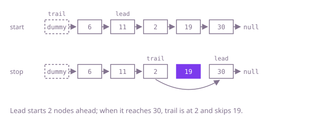

## The question

Given a singly linked list and a number `n`, unlink the node that sits `n` places from the end (the last node is 1) and return the head. The list only links forwards, so "from the end" has to be turned into a position you can reach from the front.

What makes it harder than it looks: unlinking a node means changing the node before it, and when `n` equals the length the node to remove is the head, which has no node before it. Code that handles the middle of the list cleanly often crashes or removes the wrong node there, and the one-node list must come back empty. An off-by-one in how far ahead you look removes a neighbour instead.

## How to think about it

The first idea is to make positions explicit: put the nodes in an array, and the node to remove is at index `size - n`; link its predecessor past it. That is correct, but it stores every node just to look one up.

You only need the length, so count first, then walk `length - n` steps from a dummy node placed in front of the head; the dummy is the "node before" when the head itself goes. That reads the list twice. To read it once, keep the gap instead of the length: send a `lead` reference `n` nodes ahead of a `trail` reference that starts at the dummy, then move both together. When `lead` is on the last node, `trail` is exactly `n` nodes behind it, which is the node just before the one to remove.

Walk Example 1, `[6,11,2,19,30]` with `n = 2`. `trail` starts on the dummy and `lead` moves two nodes, to 11. Move both: `lead` 2, `trail` 6; `lead` 19, `trail` 11; `lead` 30, `trail` 2. `lead` has no next, so `trail.next`, the node holding 19, is skipped: `[6,11,2,30]`.



## Brute force

Put the nodes in an array and remove the one at index `size - n`. It comes first because it is what you say first, and it fixes the answer to compare against. It is correct because the array turns "n from the end" into a plain index, and the head, which has no predecessor, is handled by returning the second node.

```java
static ListNode remove(ListNode head, int n) {
    List<ListNode> nodes = new ArrayList<>();
    for (ListNode cur = head; cur != null; cur = cur.next) {
        nodes.add(cur);
    }
    int target = nodes.size() - n; // index of the node to remove, counted from the front
    if (target == 0) {
        return head.next; // the head has no node before it
    }
    nodes.get(target - 1).next = nodes.get(target).next;
    return head;
}
```

**Complexity:** time O(L) for a list of L nodes, extra space O(L) for the array.

## Better: count, then walk

Count the nodes, then walk from a dummy node `L - n` steps, which stops just before the node to remove, and link past it. The dummy makes removing the head the same as removing any other node.

```java
static ListNode remove(ListNode head, int n) {
    int length = 0;
    for (ListNode cur = head; cur != null; cur = cur.next) {
        length++;
    }
    ListNode dummy = new ListNode(0, head); // the node before the head, for when the head goes
    ListNode before = dummy;
    for (int i = 0; i < length - n; i++) {
        before = before.next; // stops just before the node to remove
    }
    before.next = before.next.next;
    return dummy.next;
}
```

**Complexity:** time O(L), extra space O(1).

**Prefer it when:** you want each loop to do one obvious job. It takes the same number of node steps as the one-pass version (see the follow-up answers), so it gives nothing away in speed.

## Optimal: two pointers n apart

Start `lead` and `trail` on a dummy node, move `lead` `n` nodes ahead, then move both until `lead` is on the last node; `trail` is then just before the node to remove. This is the reference solution.

```java
static ListNode remove(ListNode head, int n) {
    ListNode dummy = new ListNode(0, head); // removing the head then works like any other node
    ListNode lead = dummy;
    for (int i = 0; i < n; i++) {
        lead = lead.next; // lead runs n nodes ahead of trail
    }
    ListNode trail = dummy;
    while (lead.next != null) {
        lead = lead.next;
        trail = trail.next;
    }
    trail.next = trail.next.next; // trail stops just before the node to remove
    return dummy.next;
}
```

**Complexity:** time O(L), one pass, extra space O(1).

## Complexity

| Approach | Time | Extra space |
| --- | --- | --- |
| Brute force | O(L) | O(L) |
| Better: count, then walk | O(L), two passes | O(1) |
| Optimal: two pointers n apart | O(L), one pass | O(1) |

## Where it shows up

No coding-round problem is linked to this question. A fixed gap between two references over a stream is how you keep "the item k back from the newest" without storing the stream: the k-th most recent entry of a forward-only log, the reading k samples ago on a sensor feed kept as a linked buffer, or the point to cut a chain of undo records so only the last k remain.

## Follow-up answers

**Is the one-pass version actually faster than counting first?** Not by node steps: counting takes L steps and the second walk L - n, while the one-pass version moves `lead` L steps and `trail` L - n steps, the same total. It reads the list once, which matters only when a second read is expensive or impossible, such as a stream you cannot rewind or a list too large to stay in cache.

**How would you return the middle node of a list in one pass?** Move one reference a node at a time and another two at a time; when the fast one reaches the end, the slow one is in the middle. Whether you get the first or second middle of an even-length list depends on whether the loop checks `fast.next.next` or `fast.next`.

**What would you do if n could be larger than the length of the list?** Detect it while sending `lead` ahead: if `lead.next` is `null` before all `n` steps are taken, the list has fewer than `n` nodes. Then return the list unchanged or throw, whichever the caller's contract says; the current code would dereference `null` there.
