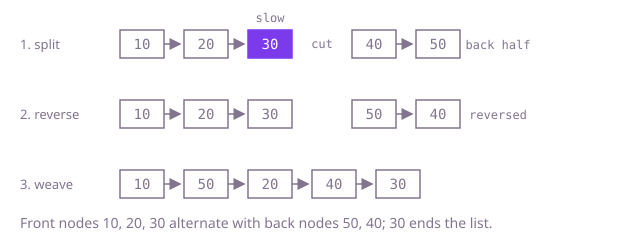

## The question

Given a singly linked list, relink it in place so it runs first node, last node, second node, second-to-last node, and so on. Nothing is returned; the same head starts the reordered list.

What makes it harder than it looks: a singly linked list can only be walked forwards, so "the last node" costs a full walk every time you want it, which is quadratic at 200,000 nodes. The fast version has three steps, and each one has a way to go wrong: a split that leaves the back half longer than the front loses a node, a missing cut leaves a loop, and a reversal that drops `next` loses the rest of the list.

## How to think about it

The first idea follows the definition: stand on a node, walk to the end, unhook the last node and splice it in after the current one, then move two nodes on. It is correct, but every splice repeats a walk to the end of the list.

What it repeats is reaching the back. Writing the result out shows the structure: it is the front half, in order, woven with the back half, backwards. An array of the nodes gives you both ends at once, at the price of O(n) memory. To do it in O(1), find the middle with two pointers (one moving one node a step, the other two), cut the list there, reverse the back half in place, and weave the two halves together. The front half keeps the middle node when the length is odd, so the back half is never longer and the weave can stop when the back half runs out.

Walk Example 1, `[10,20,30,40,50]`. The slow pointer stops at 30, so the front half is `[10,20,30]` and the back half `[40,50]`. Reversed, the back half is `[50,40]`. Weaving takes 10, 50, 20, 40, and then the back half is empty; 30 is already linked after 40 and its `next` is null from the cut. The result is `[10,50,20,40,30]`.



## Brute force

Repeatedly walk to the second-to-last node, unhook the last node and splice it in after the current one. It comes first because it is the definition turned into code, and it fixes the answer to compare against. It is correct because each step places the current last node right after the current front node, which is exactly the next back node the order asks for, and the list after it still holds the remaining nodes in order.

```java
static void reorder(ListNode head) {
    ListNode cur = head;
    while (cur != null && cur.next != null && cur.next.next != null) {
        ListNode beforeLast = cur;
        while (beforeLast.next.next != null) { // walk to the second-to-last node every time
            beforeLast = beforeLast.next;
        }
        ListNode last = beforeLast.next;
        beforeLast.next = null;
        last.next = cur.next;
        cur.next = last;
        cur = last.next;
    }
}
```

**Complexity:** time O(n²), extra space O(1).

## Better: an array of the nodes

Put the nodes in an array, then link them from both ends towards the middle: front `i` to back `j`, back `j` to front `i + 1`, until the two indexes meet. The node where they meet ends the list.

```java
static void reorder(ListNode head) {
    List<ListNode> nodes = new ArrayList<>();
    for (ListNode n = head; n != null; n = n.next) {
        nodes.add(n);
    }
    int i = 0;
    int j = nodes.size() - 1;
    while (i < j) {
        nodes.get(i).next = nodes.get(j);
        i++;
        if (i == j) {
            break; // even length: the meeting node is the last one placed
        }
        nodes.get(j).next = nodes.get(i);
        j--;
    }
    nodes.get(i).next = null; // the node in the middle ends the list
}
```

**Complexity:** time O(n), extra space O(n) for the array.

**Prefer it when:** you want the obvious-at-a-glance version and O(n) memory is fine, or when you need random access for another step anyway, for example a different interleaving rule.

## Optimal: split, reverse, weave

Find the end of the front half with slow and fast pointers, cut there, reverse the back half in place and weave it into the front half. This is the reference solution.

```java
static void reorder(ListNode head) {
    if (head == null) {
        return;
    }
    ListNode slow = head;
    ListNode fast = head;
    while (fast.next != null && fast.next.next != null) { // slow stops at the end of the first half
        slow = slow.next;
        fast = fast.next.next;
    }
    ListNode back = slow.next;
    slow.next = null; // cut, or the merged list loops back into the second half
    ListNode prev = null;
    while (back != null) { // reverse the second half so its first node is the old last
        ListNode next = back.next;
        back.next = prev;
        prev = back;
        back = next;
    }
    ListNode front = head;
    back = prev;
    while (back != null) { // the second half is never longer than the first
        ListNode frontNext = front.next;
        ListNode backNext = back.next;
        front.next = back;
        back.next = frontNext;
        front = frontNext;
        back = backNext;
    }
}
```

**Complexity:** time O(n), extra space O(1).

## Complexity

| Approach | Time | Extra space |
| --- | --- | --- |
| Brute force | O(n²) | O(1) |
| Better: an array of the nodes | O(n) | O(n) |
| Optimal: split, reverse, weave | O(n) | O(1) |

## Where it shows up

No coding-round problem is linked to this question. Interleaving the front of a sequence with its back appears when dealing a sorted list out so that strong and weak items alternate (seeding a bracket, balancing a playlist between old and new tracks), and the split-reverse-rejoin steps are the standard way to work on the second half of a singly linked list without extra memory, as in checking whether a list reads the same both ways.

## Follow-up answers

**How would you undo the reordering and get the original list back?** Unweave: walk the list taking every other node into a front list and the rest into a back list, reverse the back list, and append it to the front list. That is O(n) time and O(1) space, the same three steps run in the opposite order.

**Why does the first half keep the middle node when the length is odd, and what breaks if the split is off by one?** The result places the middle node last, after all the back nodes, so it belongs at the end of the front half; with that split the back half is never longer, and the weave can stop when the back half runs out. If the split hands the middle node to the back half instead, the weave runs out of front nodes one step early and the last back node is dropped or the code dereferences `null`. Giving the front half one extra node at even lengths still works, which is why that mistake can hide.

**Could you use the same split-and-reverse steps to check whether a list reads the same forwards and backwards?** Yes. Find the middle, reverse the back half, then walk the front half and the reversed back half together comparing values; any mismatch means no. Reverse the back half again afterwards if the caller expects the list unchanged. It is O(n) time and O(1) space.
