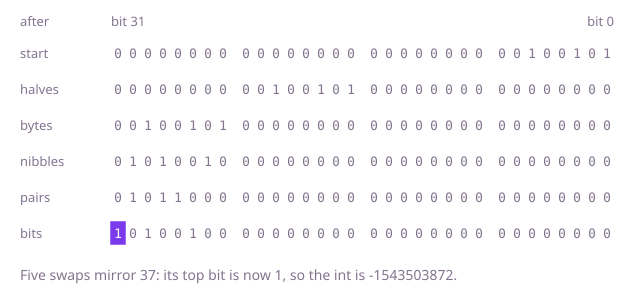

## The question

Given a 32-bit word as an `int`, return it with its bits in the opposite order: bit i moves to bit 31 - i. Every pattern is a valid input, and a word whose top bit is 1, before or after the mirroring, is a negative `int`.

What makes it harder than it looks: all 32 positions take part, including the 0 bits above the highest 1, so 6, which is 110, must become 011 followed by 29 zeros, not 011. A loop that runs "until the word is 0" mirrors only the bits up to the highest 1 and stops too soon, and with `>>` it never stops at all on a negative word, which only ever gets to -1. Through a string the same slips come back: `Integer.toBinaryString` leaves out the leading zeros, so its text must be padded to 32 characters first, and `Integer.parseInt(s, 2)` refuses 32 characters that start with a 1, since as a positive number that is larger than `Integer.MAX_VALUE`; `Integer.parseUnsignedInt(s, 2)` reads them as the pattern. And in the version with masks below, the first swap has no mask, so a `>>` there fills the top half with copies of the sign bit.

## How to think about it

The first idea is to do it as you would by hand: write all 32 bits as text, reverse the text and read it back. With the padding and the unsigned parse that is correct, but it builds several strings for one `int`. The same thing with arithmetic: take the lowest bit of the word, push it in at the bottom of the result by shifting the result left, shift the word right, and repeat exactly 32 times. Bit 0 of the word goes in first, and the 31 left shifts after it carry it up to bit 31; bit 31 of the word goes in last and stays at bit 0. Counting 32 steps, instead of waiting for the word to be 0, is what keeps the zeros above the highest 1.

That loop moves one bit per step, but bits can move in blocks. Mirroring a word is the same as swapping its two 16-bit halves and then mirroring each half on its own; each half is mirrored by swapping its two bytes and mirroring each byte, and so on through nibbles and pairs down to single bits. A mask such as `0x00ff00ff` picks out every other block, so one line does a whole level for every block in the word at once, and 32 = 2^5 means five lines.

Walk Example 1, `37`, which is 00000000 00000000 00000000 00100101. Swapping the 16-bit halves gives 00000000 00100101 00000000 00000000. Swapping the bytes in each half gives 00100101 00000000 00000000 00000000. Swapping the nibbles in each byte gives 01010010 in the top byte, swapping the pairs in each nibble gives 01011000, and swapping the neighbouring bits gives 10100100. The word is now 10100100 00000000 00000000 00000000, whose top bit is 1, so the result is the negative `int` -1543503872.



## Brute force

Pad `Integer.toBinaryString` to 32 characters, reverse the text, and read it back with `Integer.parseUnsignedInt`. It comes first because it is the hand method written down, and it fixes the answer every faster version must agree with. It is correct because the padded text is exactly the 32 bits, highest first, so the reversed text is the mirrored pattern, and the unsigned parse turns any 32-character pattern back into the `int` with those bits, including one whose top bit is 1.

```java
static int mirror(int word) {
    // toBinaryString leaves out leading zeros, so pad its text to all 32 bits first
    String bits = String.format("%32s", Integer.toBinaryString(word)).replace(' ', '0');
    String mirrored = new StringBuilder(bits).reverse().toString();
    return Integer.parseUnsignedInt(mirrored, 2); // parseInt would refuse a leading 1
}
```

**Complexity:** time O(w) for the w = 32 bits, extra space O(w) for the strings.

## Better: one bit at a time, 32 times

Shift the result left, put the lowest bit of the word in at its bottom, and shift the word right, exactly 32 times.

```java
static int mirror(int word) {
    int mirrored = 0;
    for (int step = 0; step < 32; step++) { // all 32 positions, not only up to the highest 1
        mirrored = (mirrored << 1) | (word & 1); // the lowest bit of word goes in at the bottom
        word >>>= 1;
    }
    return mirrored;
}
```

**Complexity:** time O(w), always 32 steps; extra space O(1).

**Prefer it when:** the width is not 32: run the same loop k times and it mirrors the lowest k bits into the lowest k bits of the result, where the masks below are built for exactly 32.

## Optimal: swap halves, then bytes, nibbles, pairs and bits

Swap the two 16-bit halves, then, with a mask for each level, the bytes in each half, the nibbles in each byte, the pairs in each nibble and the neighbouring bits in each pair. The first line swaps whole halves, and each of the last four keeps the blocks it moves apart with a mask; every line moves bit p to position p XOR s for its own block size s, so the order of the lines does not matter, as long as all five are there. This is the reference solution.

```java
static int mirror(int word) {
    // swap ever smaller halves: the two 16-bit halves, then bytes, nibbles, pairs, single bits
    word = (word >>> 16) | (word << 16); // >>>: with >> a set bit 31 would fill the top half
    word = ((word >>> 8) & 0x00ff00ff) | ((word & 0x00ff00ff) << 8);
    word = ((word >>> 4) & 0x0f0f0f0f) | ((word & 0x0f0f0f0f) << 4);
    word = ((word >>> 2) & 0x33333333) | ((word & 0x33333333) << 2);
    word = ((word >>> 1) & 0x55555555) | ((word & 0x55555555) << 1);
    return word;
}
```

In the last four lines the mask comes after the right shift, so even a `>>` would do no harm there; masking first and then shifting with `>>`, as in `(word & 0xff00ff00) >> 8`, would bring the sign bit back in.

**Complexity:** time O(log w), five lines of a few operations each; extra space O(1).

## Complexity

| Approach | Time | Extra space |
| --- | --- | --- |
| Brute force: reverse the padded binary string | O(w), w = 32 | O(w) for the strings |
| Better: one bit at a time, 32 times | O(w), always 32 steps | O(1) |
| Optimal: swap halves, then bytes, nibbles, pairs and bits | O(log w), five lines | O(1) |

## Where it shows up

No coding-round problem is linked to this question. Mirroring bits is the step that puts data into bit-reversed order for the fast Fourier transform, where element i of the input moves to the position whose index is i with its bits reversed. It also turns up between devices that disagree on bit order: a serial port sends each byte lowest bit first, while many other links send the highest bit first. And the common CRC-32 checksum is defined over bits taken lowest bit first, so the usual table-driven code for it works with the generator polynomial mirrored, `0xEDB88320` for `0x04C11DB7`.

## Follow-up answers

**Can you do it in fewer than 32 steps, without a loop over the bits?** Yes: the five swaps of the Optimal, one per level from 16-bit halves down to single bits. Each line moves every block of its level at once, so the word is mirrored in five lines with no loop, whatever its bits are.

**If the method is called on millions of words, how would you speed it up?** The five swaps are already a fixed handful of operations and need no memory. Another way is a table of the 256 bytes mirrored, built once: mirror each of the four bytes with a lookup and put them back in the opposite order, which is four lookups and a few shifts. The JDK's `Integer.reverse` combines the two ideas: it mirrors the bits within each byte with the same masks and then reverses the order of the bytes.

**How would you mirror only the lowest k bits of a word, leaving the bits above them as they are?** Mirror the whole word, then shift it right with `>>>` by 32 - k, which brings the mirrored lowest k bits down to the bottom with zeros above them; for k = 0 there is nothing to mirror and the word stays as it is. Then combine: `(word & ~mask) | thatValue`, where `mask` has the lowest k bits set. The loop of the Better does the first part directly when it runs k times instead of 32.
