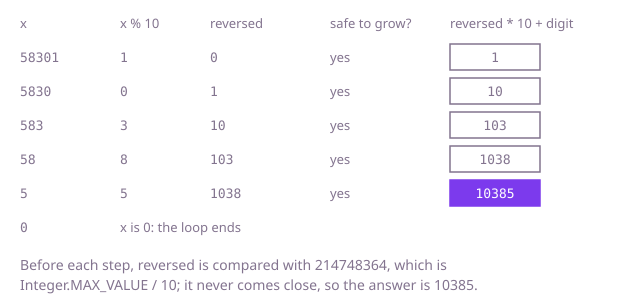

## The question

Return `x` with its decimal digits in reverse order and its sign kept, or 0 when that number does not fit in an `int`. Zeros at the end of `x` disappear, and every `int` is a valid input.

What makes it harder than it looks: the input always fits, but the result need not. 1563847412 reverses to 2,147,483,651, past `Integer.MAX_VALUE`, and in `int` arithmetic the step that goes past the limit wraps around silently to a negative number, so a check made after the multiplication, such as `reversed > Integer.MAX_VALUE`, can never fire. The negative side has a catch of its own: `Integer.MIN_VALUE` has no positive counterpart, so `Math.abs(Integer.MIN_VALUE)` is `Integer.MIN_VALUE` again, still negative, and code that takes the absolute value first and then works on its digits breaks on exactly that input. Through a string, the sign has to come off before the digits are reversed, or the minus sign ends up at the back; and `Integer.parseInt` throws on a reversed number that does not fit, where the answer is 0.

## How to think about it

The first idea is the text: write `x` as a string, set the sign aside, reverse the digits and read them back. Reading back needs room, since a reversed 10-digit number can be past `Integer.MAX_VALUE`, so read it as a `long` and compare it with the `int` limits. That works, with a few strings for one number.

The same with arithmetic: `x % 10` is the last digit and `x / 10` drops it, so a loop that takes the last digit of `x` and appends it to the result, `reversed = reversed * 10 + digit`, reverses the digits. Zeros at the end of `x` come out first, while the result is still 0, and vanish. For a negative `x`, Java's `%` and `/` round toward zero, so every digit comes out negative and the result grows negative: the sign takes care of itself, no absolute value is needed, and `Integer.MIN_VALUE` is no special case. The loop has to run while `x != 0`, not while `x > 0`. With a `long` for the result, the range check can wait until the end, since 10 digits always fit in a `long`.

Without a `long`, check before each step whether it would leave the `int` range. `reversed * 10 + digit` is at most `Integer.MAX_VALUE`, 2,147,483,647, exactly when `reversed` is below `Integer.MAX_VALUE / 10`, which is 214,748,364, or equal to it with a digit of at most 7. On the negative side the bound is `Integer.MIN_VALUE / 10`, -214,748,364, with a digit of at least -8. Compare first, and multiply only when it is safe.

Walk Example 1, `x = 58301`. The digits come out as 1, 0, 3, 8 and 5, and the result goes 1, 10, 103, 1038 and 10385. Each time, before the multiplication, the result is far below 214,748,364, so no check fires and the answer is 10385. In Example 3, `x = 1563847412`, the digits come out as 2, 1, 4, 7, 4, 8, 3, 6, 5 and 1; after nine of them the result is 214,748,365, above 214,748,364, so the tenth step would leave the range and the answer is 0.



## Brute force

Turn `x` into a string, drop the sign, reverse the digits, read them back as a `long` with the sign restored, and return 0 if that is outside the `int` range. It comes first because it is the hand method written down, and it fixes the answer the arithmetic versions must agree with. It is correct because the text without its sign is exactly the digits of `x`, the reversed text read as a number is the reversed value with any leading zeros gone, and a `long` holds every reversed 10-digit value, so the range check sees the true value.

```java
static int reverse(int x) {
    String digits = Integer.toString(x);
    boolean negative = x < 0;
    if (negative) {
        digits = digits.substring(1); // drop the '-' as text: Math.abs(Integer.MIN_VALUE) is negative
    }
    // a reversed 10-digit number can be past Integer.MAX_VALUE, so read it back as a long
    long value = Long.parseLong(new StringBuilder(digits).reverse().toString());
    if (negative) {
        value = -value;
    }
    return value < Integer.MIN_VALUE || value > Integer.MAX_VALUE ? 0 : (int) value;
}
```

**Complexity:** time O(d) for the d ≤ 10 digits, extra space O(d) for the strings.

## Better: digit by digit, in a long

Take the digits off the end with `% 10` and `/ 10`, build the result in a `long`, and check the range once at the end.

```java
static int reverse(int x) {
    long reversed = 0; // at most 10 digits, which always fit in a long
    while (x != 0) {
        reversed = reversed * 10 + x % 10; // % keeps the sign of x, so a negative x needs no abs
        x /= 10;
    }
    return reversed < Integer.MIN_VALUE || reversed > Integer.MAX_VALUE ? 0 : (int) reversed;
}
```

**Complexity:** time O(d), d ≤ 10 digits; extra space O(1).

**Prefer it when:** a `long` is available: one range check at the end replaces the two checks inside the loop, and there is no boundary digit to get right.

## Optimal: digit by digit, checking before each step

Keep the result in an `int` and test, before each multiplication, whether `reversed * 10 + digit` would leave the range, with the bounds above. No value outside the `int` range is ever computed, which is what the follow-up asks for. This is the reference solution.

```java
static int reverse(int x) {
    int reversed = 0;
    while (x != 0) {
        int digit = x % 10; // negative when x is: Java's % keeps the sign of x
        x /= 10;
        // reversed * 10 + digit must stay inside the int range: test that before computing it
        if (reversed > Integer.MAX_VALUE / 10 || (reversed == Integer.MAX_VALUE / 10 && digit > 7)) {
            return 0;
        }
        if (reversed < Integer.MIN_VALUE / 10 || (reversed == Integer.MIN_VALUE / 10 && digit < -8)) {
            return 0;
        }
        reversed = reversed * 10 + digit;
    }
    return reversed;
}
```

For an `int` input the digit half of each test never decides. The result can equal 214,748,364 or -214,748,364 with a digit still to come only when `x` has ten digits and no zero at the end, and then that digit is the first digit of `x`, which is 1 or 2. The test as written does not rely on that, so it is right for any digit, and the shorter test without the digit part passes too.

**Complexity:** time O(d), d ≤ 10 digits; extra space O(1).

## Complexity

| Approach | Time | Extra space |
| --- | --- | --- |
| Brute force: reverse the text | O(d), d ≤ 10 digits | O(d) for the strings |
| Better: digit by digit, in a long | O(d) | O(1) |
| Optimal: digit by digit, checking before each step | O(d) | O(1) |

## Where it shows up

No coding-round problem is linked to this question. The check before the multiplication is how `Integer.parseInt` refuses a number that is too large: it builds the value one digit at a time, as a negative number so that `Integer.MIN_VALUE` fits, and before each multiplication by the radix compares it with the limit divided by the radix, so it never computes a value that has wrapped around. Any code that turns digits into a fixed-width number, from a configuration parser to a protocol decoder, needs the same guard. Taking digits off the end with `% 10` and `/ 10` is also the first step of digit checks such as the Luhn checksum on card numbers, which works through the digits from the right.

## Follow-up answers

**Can you do it with `int` arithmetic only, never holding a value outside the `int` range?** Yes: the Optimal compares the result with `Integer.MAX_VALUE / 10` and `Integer.MIN_VALUE / 10` before each multiplication, so every value it computes is an `int` and no `long` is needed. The tests cannot see which types a solution uses, so the Better passes them too; the restriction is the follow-up's.

**How would you tell whether an `int` reads the same with its digits reversed, without any risk of overflow?** A negative number never does, because of its sign, and a number that ends in 0 does only if it is 0. Otherwise reverse only half of it: move digits from the end of `x` onto the reversed part until the reversed part is at least as large as what is left of `x`. The number reads the same both ways when the two are equal, or, for an odd number of digits, when the reversed part divided by 10 equals what is left. The reversed part has at most six digits, far from overflowing.

**How would you reverse a `long` the same way, when there is no wider type to check against?** The Optimal carries over unchanged with `Long.MAX_VALUE / 10` and `Long.MIN_VALUE / 10` as the bounds, and the boundary digits are again 7 and -8, since `Long.MAX_VALUE` ends in 7 and `Long.MIN_VALUE` in 8. The Better has nothing wider to fall back on, short of `BigInteger`. Another way is `Math.multiplyExact` and `Math.addExact`, which throw an `ArithmeticException` on overflow, to be caught and turned into 0: short to write, but throwing costs far more than a comparison when many inputs overflow.
