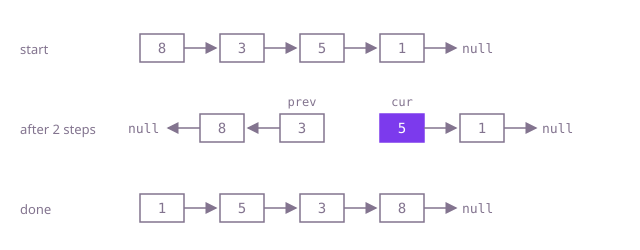

## The question

Given the head of a singly linked list, turn every link around and return the node that used to be last. The nodes stay the same objects; only their `next` fields change.

What makes it harder than it looks: the moment you point a node backwards you lose your only way to the rest of the list, so the order of the three assignments matters. The old head has to end with `next == null`, or the result loops between the first two nodes. And at 100,000 nodes the tidy recursive version runs out of stack.

## How to think about it

The first idea is to stop thinking in links: copy the nodes into an array, then walk the array backwards setting each node's `next` to the one before it. That is correct and linear, but it spends a whole array to remember where each node's predecessor is.

You only ever need one predecessor at a time. Walk the list with two references: `prev`, the head of the part already reversed, and `cur`, the next node to move. Save `cur.next` first, point `cur` at `prev`, then step both forward. When `cur` falls off the end, `prev` is the new head. Recursion expresses the same idea backwards (reverse the rest, then hang the current node on its end), but every node waits on the call stack.

Walk Example 1, `[8,3,5,1]`. Start with `prev = null`, `cur = 8`: save 3, point 8 at null, `prev = 8`, `cur = 3`. Save 5, point 3 at 8, `prev = 3`, `cur = 5`. Save 1, point 5 at 3. Save null, point 1 at 5. `cur` is null and `prev` is 1, the head of `[1,5,3,8]`.



## Brute force

Put the nodes in an array and relink them from the back. It comes first because it is what you say first, and it fixes the answer to compare against. It is correct because the array holds every node in its original order, so node `i` can point to node `i - 1` directly, and the old head is cleared explicitly.

```java
static ListNode reverse(ListNode head) {
    List<ListNode> nodes = new ArrayList<>();
    for (ListNode n = head; n != null; n = n.next) {
        nodes.add(n);
    }
    if (nodes.isEmpty()) {
        return null;
    }
    for (int i = nodes.size() - 1; i > 0; i--) {
        nodes.get(i).next = nodes.get(i - 1); // the array remembers every predecessor
    }
    nodes.get(0).next = null; // the old head is the new tail
    return nodes.get(nodes.size() - 1);
}
```

**Complexity:** time O(n), extra space O(n) for the array.

## Better: recursion

Reverse everything after the head, which returns the new head; the node right after the head is now the tail of that reversed part, so hang the head behind it and clear the head's link.

```java
static ListNode reverse(ListNode head) {
    if (head == null || head.next == null) {
        return head; // zero or one node is already reversed
    }
    ListNode newHead = reverse(head.next);
    head.next.next = head; // head.next is the tail of the reversed rest
    head.next = null; // head becomes the new tail
    return newHead;
}
```

**Complexity:** time O(n), extra space O(n) for the call stack, one frame per node; at 100,000 nodes that overflows Java's default stack and the test fails with `StackOverflowError`.

**Prefer it when:** the list is known to be short (a few thousand nodes) and the recursive form reads better, for example when it is part of a larger recursive routine.

## Optimal: iterate with prev and cur

Move nodes one at a time from the front of the original list to the front of the reversed list, saving the next node before overwriting the link. This is the reference solution.

```java
static ListNode reverse(ListNode head) {
    ListNode prev = null; // the reversed part so far
    ListNode cur = head;
    while (cur != null) {
        ListNode next = cur.next; // save it before the link is overwritten
        cur.next = prev;
        prev = cur;
        cur = next;
    }
    return prev;
}
```

**Complexity:** time O(n), extra space O(1).

## Complexity

| Approach | Time | Extra space |
| --- | --- | --- |
| Brute force | O(n) | O(n) |
| Better: recursion | O(n) | O(n) call stack, overflows at 100,000 nodes |
| Optimal: iterate with prev and cur | O(n) | O(1) |

## Where it shows up

No coding-round problem is linked to this question. Reversing links in place shows up when an undo log kept newest-first has to be replayed oldest-first, when a singly linked free list or bucket chain must be walked in insertion order, and as a step inside larger list routines such as reordering a list or checking whether it reads the same both ways.

## Follow-up answers

**Can you write it recursively, and what does that cost on a long list?** Yes: reverse the rest, then set `head.next.next = head` and `head.next = null`. It is still O(n) time, but it uses one stack frame per node, so it needs O(n) stack and overflows Java's default thread stack somewhere in the tens of thousands of nodes; the iterative loop needs O(1).

**How would you reverse only the nodes from position left to position right?** Walk to the node just before `left` (a dummy node in front of the head covers `left = 1`), run the same prev/cur loop for `right - left + 1` nodes, then reconnect: the node before `left` points to the new front of the section, and the old front of the section (now its end) points to the node after `right`.

**How would you reverse a doubly linked list?** Walk it once and swap each node's `next` and `prev` fields; the last node you visit is the new head. No extra references beyond the walk are needed, because each node already knows both neighbours.
