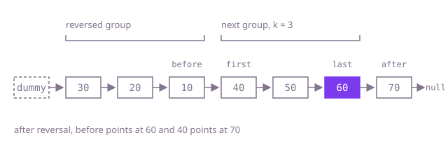

## The question

Cut a singly linked list into consecutive groups of `k` nodes from the head, reverse the nodes inside every full group, and leave a shorter last group in its order. The same node objects must come back, relinked.

What makes it harder than it looks: each reversed group has to be stitched to the group before it and the one after it, and the node that was first in a group becomes its last, so the stitch points move. You must also know that a full group exists before you start turning it around, or the short tail gets reversed too. And with `k = 2` on 100,000 nodes, a recursive version runs 50,000 calls deep.

## How to think about it

The first idea is to stop thinking in links: copy the nodes into an array, reverse each full block of `k` entries in the array, and relink the array in order. That is correct and linear, but it spends a whole array to know where each group starts and ends.

You only ever need four nodes at a time: the node before the group (`before`), the group's first and last nodes, and the node after it. Walk `k` steps from `before` to find `last`; if the list runs out first, the rest is a short group and you are done. Otherwise reverse the group with the usual `prev`/`cur` loop, but start `prev` at the node after the group, so the old first node ends up pointing past the group without a separate fix. Then point `before` at `last`, the group's new front, and the old first node becomes the `before` of the next group. A dummy node in front of the head gives the first group a `before` too.

Walk Example 1, `[10,20,30,40,50,60,70]` with `k = 3`. `before` is the dummy; three steps reach 30, so the group is 10..30 and the node after is 40. Reversing with `prev` starting at 40 gives 30→20→10→40; the dummy now points at 30, and 10 becomes `before`. Three steps from 10 reach 60; the group 40..60 becomes 60→50→40→70 and 10 points at 60. From 40, the list ends after one step, so 70 stays. The answer is `[30,20,10,60,50,40,70]`.



## Brute force

Collect the nodes in an array, reverse each full block of `k` in the array, then relink the nodes in array order. It comes first because it is what you say first, and it fixes the answer to compare against. It is correct because the array after the block reversals is exactly the wanted order, and relinking it end to end, with the last node's `next` cleared, builds that list from the same nodes.

```java
static ListNode reverse(ListNode head, int k) {
    List<ListNode> nodes = new ArrayList<>();
    for (ListNode n = head; n != null; n = n.next) {
        nodes.add(n);
    }
    for (int start = 0; start + k <= nodes.size(); start += k) { // only full groups turn around
        Collections.reverse(nodes.subList(start, start + k));
    }
    for (int i = 0; i + 1 < nodes.size(); i++) {
        nodes.get(i).next = nodes.get(i + 1);
    }
    nodes.get(nodes.size() - 1).next = null; // the new last node ends the list
    return nodes.get(0);
}
```

**Complexity:** time O(n), extra space O(n) for the array.

## Better: recursion per group

Check that `k` nodes exist; if not, return the head unchanged. Otherwise solve the rest of the list first, then reverse this group onto the solved rest, so the group's old first node points at the rest's new head.

```java
static ListNode reverse(ListNode head, int k) {
    ListNode last = head;
    for (int i = 1; i < k && last != null; i++) {
        last = last.next;
    }
    if (last == null) {
        return head; // fewer than k nodes: leave them
    }
    ListNode rest = reverse(last.next, k); // one call per group
    ListNode prev = rest;
    ListNode cur = head;
    for (int i = 0; i < k; i++) { // reverse this group onto the already-solved rest
        ListNode next = cur.next;
        cur.next = prev;
        prev = cur;
        cur = next;
    }
    return prev;
}
```

**Complexity:** time O(n), extra space O(n/k) for the call stack, one frame per group; with `k = 2` on 100,000 nodes that is 50,000 frames, which overflows Java's default stack, and the long test fails with `StackOverflowError`.

**Prefer it when:** `k` is large or the list is short, so there are only a few hundred groups, and the recursive form reads better.

## Optimal: reverse in place, group by group

Walk the list with `before`, the node in front of the next group; find the group's last node, reverse the group with `prev` starting at the node after it, and reconnect. This is the reference solution.

```java
static ListNode reverse(ListNode head, int k) {
    ListNode dummy = new ListNode(0, head);
    ListNode before = dummy; // the node just before the next group
    while (true) {
        ListNode last = before;
        for (int i = 0; i < k && last != null; i++) {
            last = last.next;
        }
        if (last == null) {
            return dummy.next; // fewer than k nodes left: they stay as they are
        }
        ListNode first = before.next;
        ListNode after = last.next;
        // reverse first..last; starting prev at after links the group's new end to the rest
        ListNode prev = after;
        ListNode cur = first;
        while (cur != after) {
            ListNode next = cur.next;
            cur.next = prev;
            prev = cur;
            cur = next;
        }
        before.next = last;
        before = first;
    }
}
```

**Complexity:** time O(n), every node is stepped over twice (once to find the group, once to reverse it), extra space O(1).

## Complexity

| Approach | Time | Extra space |
| --- | --- | --- |
| Brute force | O(n) | O(n) |
| Better: recursion per group | O(n) | O(n/k) call stack, overflows at 50,000 groups |
| Optimal: reverse in place, group by group | O(n) | O(1) |

## Where it shows up

No coding-round problem is linked to this question. Reversing fixed-size blocks in place is what byte-order conversion does to a buffer of multi-byte words (each 4- or 8-byte group is reversed, a partial word at the end is left alone), and the "find the block, reverse it, stitch it back" step is the general tool for reversing any section of a linked structure in place, such as a range of positions in a singly linked list.

## Follow-up answers

**How would you also reverse the last group when it has fewer than k nodes?** Drop the check that a full group exists. Walk at most `k` steps from `before` and stop early at the last real node, so `last` is never `null`; reverse from `first` to `last` exactly as before (for the final group `after` is simply `null`), and leave the loop once `before.next` is `null`.

**How would you reverse only every other group of k nodes?** Keep the same loop with a flag that flips after each group. On a reverse turn, do what the loop does now; on a skip turn, just walk `before` forward `k` nodes (or to the end) without changing any links. A short last group stays untouched either way.

**What does the recursive version cost on a long list with a small k?** Time is still O(n), but every full group adds a stack frame that waits for the rest of the list, so the stack holds n/k frames. With `k = 2` and 100,000 nodes that is 50,000 frames, enough to overflow Java's default thread stack; the iterative loop needs O(1) extra space regardless of `k`.
