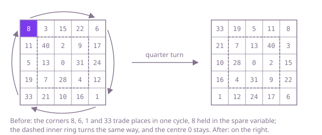

## The question

Given a square board of tiles as an `n x n` grid, turn it a quarter turn clockwise. The turn must happen in the array you were given: the method returns nothing, so the caller only sees what you write back into `grid`.

What makes it harder than it looks is the in-place rule. The tile at row `r`, column `c` moves to row `c`, column `n - 1 - r`, and writing it there overwrites a tile that has not moved yet. Building a turned copy and assigning it to the parameter changes nothing the caller can see. Two easy slips give a different picture that looks almost right: swapping rows and columns alone mirrors the board across its diagonal instead of turning it, and mirroring the wrong way after that turns it anticlockwise.

## How to think about it

The first idea is to write every tile into a fresh grid at its new place and then copy the rows back into `grid`. That is right and costs n² extra cells. To save them, follow one tile. The 8 in the top-left corner of Example 1 goes to the top-right corner, where the 6 was; the 6 goes to the bottom right, where the 1 was; the 1 to the bottom left; and the 33 there to the top left, where the 8 started. Four tiles, one cycle, and a single spare variable carries them round: hold the 8, move the other three one step each, and drop the 8 into its place.

Every tile belongs to such a cycle of four, one tile on each side of the same ring of the board, at the same distance along its side. So the turn is: for each ring from the outside in, for each position along its top side except the last one (that one is a corner, already moved with the first position), rotate the four tiles. An odd board's centre tile is a cycle of one and stays put. A second way to get there uses two simpler moves that are easier to check: mirroring the board across its main diagonal (swap row and column) and then mirroring each row left to right is the same as a quarter turn clockwise.

Walk Example 1. The outer ring has four cycles: the corners 8, 6, 1, 33; then 3, 17, 16, 19; then 15, 24, 10, 5; then 22, 12, 21, 11. The inner ring has two: 40, 9, 4, 7; then 2, 31, 28, 13. The centre, 0, stays. Six cycles move all 24 tiles that move.



## Brute force

Write each tile into a new grid at its turned place, then copy every row back into `grid`. It is what you say first, because it is the turn written down tile by tile, and it fixes the answer the in-place versions must agree with. It is correct because every tile is read from the untouched original before anything is written back, and the copy back is what makes the caller's array change.

```java
static void rotate(int[][] grid) {
    int n = grid.length;
    int[][] turned = new int[n][n];
    for (int r = 0; r < n; r++) {
        for (int c = 0; c < n; c++) {
            turned[c][n - 1 - r] = grid[r][c]; // row r becomes column n - 1 - r
        }
    }
    for (int r = 0; r < n; r++) {
        System.arraycopy(turned[r], 0, grid[r], 0, n); // the caller's array must hold the result
    }
}
```

**Complexity:** time O(n²), extra space O(n²) for the copy.

## Better: mirror across the diagonal, then mirror each row

Swap every tile above the main diagonal with its partner below it, so that row `r`, column `c` holds what row `c`, column `r` held. Then reverse each row. The first step puts the tile from row `r`, column `c` at row `c`, column `r`; the second moves it to row `c`, column `n - 1 - r`, which is exactly its place after the turn. The swaps only visit the tiles above the diagonal: visiting every pair would swap each one twice and leave the board as it was.

```java
static void rotate(int[][] grid) {
    int n = grid.length;
    for (int r = 0; r < n; r++) {
        for (int c = r + 1; c < n; c++) { // above the diagonal only, or every pair swaps back
            int held = grid[r][c];
            grid[r][c] = grid[c][r];
            grid[c][r] = held;
        }
    }
    for (int[] row : grid) {
        for (int lo = 0, hi = n - 1; lo < hi; lo++, hi--) { // mirror the row left to right
            int held = row[lo];
            row[lo] = row[hi];
            row[hi] = held;
        }
    }
}
```

**Complexity:** time O(n²), extra space O(1).

**Prefer it when:** you need other turns and mirror images too. Each one is a diagonal mirror, a row mirror or a column mirror, or two of them: reversing the order of the rows instead of each row gives the anticlockwise turn, and a row mirror plus a column mirror gives half a turn. Each step is easy to check on its own, where the four-way index arithmetic is not.

## Optimal: rotate four tiles at a time, ring by ring

For each ring from the outside in, and for each position along its top side except the last, hold the top tile, move the left, bottom and right tiles of that cycle one step clockwise, and put the held tile on the right side. Each tile is read and written once. This is the reference solution.

```java
static void rotate(int[][] grid) {
    int n = grid.length;
    for (int ring = 0; ring < n / 2; ring++) { // an odd board's centre tile stays put
        int last = n - 1 - ring;
        for (int i = 0; i < last - ring; i++) { // every tile of the top side but its last, a corner
            int top = grid[ring][ring + i];
            grid[ring][ring + i] = grid[last - i][ring]; // the left side moves up to the top
            grid[last - i][ring] = grid[last][last - i]; // the bottom moves to the left
            grid[last][last - i] = grid[ring + i][last]; // the right side moves to the bottom
            grid[ring + i][last] = top; // the top moves to the right
        }
    }
}
```

**Complexity:** time O(n²), extra space O(1). It writes each tile once, where the Better version swaps most tiles twice.

## Complexity

| Approach | Time | Extra space |
| --- | --- | --- |
| Brute force: a turned copy, written back | O(n²) | O(n²) |
| Better: mirror across the diagonal, then each row | O(n²) | O(1) |
| Optimal: rotate four tiles at a time, ring by ring | O(n²) | O(1) |

## Where it shows up

No coding-round problem is linked to this question. A quarter turn of a square grid is what an image editor does to a square picture or a square tile of a larger one, what a puzzle or board game does when the player turns a piece, and what a game of falling blocks does to a block stored as a small square grid. Doing it in place matters when the grid is large or the memory is tight, as on a device turning camera frames.

## Follow-up answers

**Can you do it with only a constant amount of extra memory?** Yes: both in-place versions above use a single spare variable. The four-way cycle moves each tile once; the two mirrors are simpler to get right and touch most tiles twice. Every tile still has to move, so O(n²) time cannot be beaten.

**How would you turn the board anticlockwise, or half a turn?** Anticlockwise: mirror across the main diagonal and then reverse the order of the rows, or run the four-way cycle in the other direction. Half a turn: reverse the order of the rows and then reverse each row, which swaps each tile with the one at row `n - 1 - r`, column `n - 1 - c`.

**What if the board were not square?** An `m x n` board turns into an `n x m` one, so it cannot stay in the same `int[][]`: the rows change length. Return a new array, built with the same rule, the tile at row `r`, column `c` going to row `c`, column `m - 1 - r`. In-place turning is possible only for a flat one-dimensional array, by following the cycles of positions, which is much harder to get right.
