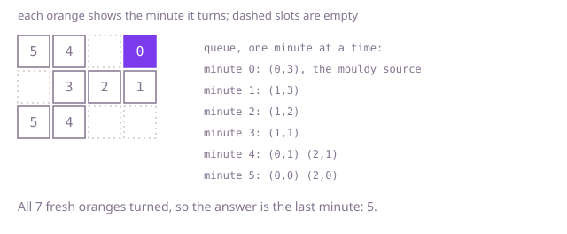

## The question

A crate is a grid of empty slots, fresh oranges and mouldy oranges, and once a minute mould moves from every mouldy orange to each fresh orange beside it. Return how many minutes pass until no fresh orange is left, or -1 if some orange is never reached.

What makes it harder than it looks is that all the mould moves at once. An orange that turns in a minute must not pass mould on in that same minute, so updating the crate in place during a scan gives answers that are too small. Several mouldy oranges spread together, so the answer is the time from the nearest source, not from any one of them. And a crate of a million slots can hold one winding chain of half a million oranges, which takes half a million minutes to spoil, so anything that looks at the whole crate once per minute is far too slow.

## How to think about it

The first idea is to play the clock: each minute, scan the whole crate, find every fresh orange next to a mouldy one, and turn them all at the end of the scan. Reading from this minute's crate and writing to the next keeps the minutes honest. It is correct, but it scans a million slots for every minute, and most of the crate did not change.

The only oranges that can spoil something new are the ones that turned in the previous minute. So keep those in a list: the next minute is just their fresh neighbours. That is a breadth-first search, and the minute an orange turns is its distance from the nearest mouldy orange at the start. Running one search from each mouldy orange and keeping the smallest time works but repeats the crate once per source. Putting every starting mouldy orange in the queue at once, at minute 0, gives the nearest-source time in one pass: the queue holds the cells of one minute, then the next.

Walk Example 1, `[[1,1,0,2],[0,1,1,1],[1,1,0,0]]`. The queue starts with the mouldy orange at (0,3). Minute 1 turns (1,3). Minute 2 turns (1,2); the slots above and below it are empty. Minute 3 turns (1,1). Minute 4 turns (0,1) and (2,1). Minute 5 turns (0,0) and (2,0). Seven fresh oranges turned, which is all of them, so the answer is 5.



## Brute force

Simulate the clock: each minute copy the crate, turn every fresh orange that has a mouldy side neighbour in the old copy, and stop when a minute changes nothing. It comes first because it is the rule written as code, and it fixes the answer the faster versions must match. It is correct because reading only from the old copy is exactly "all at the same moment".

```java
static int minutesUntilSpoiled(int[][] grid) {
    int height = grid.length;
    int width = grid[0].length;
    int[][] now = new int[height][];
    for (int r = 0; r < height; r++) {
        now[r] = grid[r].clone();
    }
    int minutes = 0;
    while (true) {
        int[][] next = new int[height][];
        for (int r = 0; r < height; r++) {
            next[r] = now[r].clone();
        }
        boolean changed = false;
        boolean anyFresh = false;
        for (int r = 0; r < height; r++) {
            for (int c = 0; c < width; c++) {
                if (now[r][c] != 1) {
                    continue;
                }
                // read neighbours from this minute's crate, write to the next one
                if ((r > 0 && now[r - 1][c] == 2) || (r + 1 < height && now[r + 1][c] == 2)
                        || (c > 0 && now[r][c - 1] == 2) || (c + 1 < width && now[r][c + 1] == 2)) {
                    next[r][c] = 2;
                    changed = true;
                } else {
                    anyFresh = true;
                }
            }
        }
        if (!changed) {
            return anyFresh ? -1 : minutes;
        }
        minutes++;
        now = next;
    }
}
```

**Complexity:** time O(T × R × C) for R rows, C columns and an answer of T minutes, which is O((R × C)²) when the oranges form one long chain; extra space O(R × C) for the two copies.

## Better: one search per mouldy orange

Search outwards from each mouldy orange in turn, writing into every fresh orange the earliest minute any source has reached it so far, and only going further from a cell when this source improved it. The answer is the largest of those minutes, or -1 if a fresh orange was never written. It looks only at the cells a source can still improve, instead of the whole crate every minute.

```java
static int minutesUntilSpoiled(int[][] grid) {
    int height = grid.length;
    int width = grid[0].length;
    int[][] steps = {{-1, 0}, {1, 0}, {0, -1}, {0, 1}};
    int[] best = new int[height * width];
    Arrays.fill(best, Integer.MAX_VALUE);
    int[] queue = new int[height * width];
    for (int source = 0; source < height * width; source++) {
        if (grid[source / width][source % width] != 2) {
            continue;
        }
        best[source] = 0;
        int head = 0;
        int tail = 0;
        queue[tail++] = source;
        while (head < tail) {
            int cell = queue[head++];
            for (int[] step : steps) {
                int r = cell / width + step[0];
                int c = cell % width + step[1];
                if (r < 0 || r >= height || c < 0 || c >= width || grid[r][c] != 1) {
                    continue;
                }
                int near = r * width + c;
                if (best[cell] + 1 < best[near]) {
                    best[near] = best[cell] + 1; // this source gets here sooner than any before it
                    queue[tail++] = near;
                }
            }
        }
    }
    int minutes = 0;
    for (int cell = 0; cell < height * width; cell++) {
        if (grid[cell / width][cell % width] == 1) {
            if (best[cell] == Integer.MAX_VALUE) {
                return -1; // no source ever reached this orange
            }
            minutes = Math.max(minutes, best[cell]);
        }
    }
    return minutes;
}
```

**Complexity:** time O(k × R × C) for k mouldy oranges at the start, since each source can improve most of the crate; extra space O(R × C).

**Prefer it when:** there is exactly one mouldy orange at the start, where it is the same search as the optimal one. With many sources it repeats the crate once per source, and a quarter of a million sources is far too slow.

## Optimal: breadth-first search from all sources at once

Put every mouldy orange in one queue, count the fresh oranges, and process the queue a minute at a time: the cells queued so far are this minute's mould, and every fresh neighbour they turn is queued for the next minute and marked at once so it is never queued twice. Stop when nothing is left to spread or no fresh orange remains, and return -1 if any are still fresh. This is the reference solution.

```java
static int minutesUntilSpoiled(int[][] grid) {
    int height = grid.length;
    int width = grid[0].length;
    int[] state = new int[height * width]; // a copy, so the caller's grid is left alone
    int[] queue = new int[height * width];
    int tail = 0;
    int fresh = 0;
    for (int r = 0; r < height; r++) {
        for (int c = 0; c < width; c++) {
            state[r * width + c] = grid[r][c];
            if (grid[r][c] == 2) {
                queue[tail++] = r * width + c; // every mouldy orange starts spreading at minute 0
            } else if (grid[r][c] == 1) {
                fresh++;
            }
        }
    }
    int minutes = 0;
    int head = 0;
    while (head < tail && fresh > 0) {
        int end = tail; // the oranges that turned in the previous minute
        minutes++;
        for (; head < end; head++) {
            int cell = queue[head];
            int r = cell / width;
            int c = cell % width;
            if (r > 0) tail = spread(state, queue, tail, cell - width);
            if (r + 1 < height) tail = spread(state, queue, tail, cell + width);
            if (c > 0) tail = spread(state, queue, tail, cell - 1);
            if (c + 1 < width) tail = spread(state, queue, tail, cell + 1);
        }
        fresh -= tail - end;
    }
    return fresh == 0 ? minutes : -1;
}

/** Turns a fresh orange mouldy and queues it; returns the new queue length. */
private static int spread(int[] state, int[] queue, int tail, int cell) {
    if (state[cell] == 1) {
        state[cell] = 2; // marked when queued, so it is counted once
        queue[tail++] = cell;
    }
    return tail;
}
```

**Complexity:** time O(R × C), since every slot is queued at most once and looked at from at most four neighbours; extra space O(R × C) for the copy and the queue. Nothing recurses, so the half-million-minute chain is no problem.

## Complexity

| Approach | Time | Extra space |
| --- | --- | --- |
| Brute force: simulate each minute | O(T × R × C), O((R × C)²) on one long chain | O(R × C) |
| Better: one search per mouldy orange | O(k × R × C) | O(R × C) |
| Optimal: breadth-first search from all sources | O(R × C) | O(R × C) |

R and C are the rows and columns, T the answer in minutes and k the number of mouldy oranges at the start.

## Where it shows up

Starting a breadth-first search from many sources at once answers "how far is each cell from the nearest X": the distance from every map tile to the nearest exit in a game, how many hops each machine is from an infected one when a worm spreads through a network, or how many rounds a rumour takes to reach everyone in a group when several people start it.

## Follow-up answers

**Can you avoid re-scanning the whole crate every minute?** Yes. Only the oranges that turned in the previous minute can spoil anything new, so keeping them in a queue and looking only at their neighbours costs work proportional to the crate once in total, not once per minute.

**How would you report the minute at which each orange spoils?** Store the minute in an array the moment an orange is queued; in the breadth-first search it is the current minute plus one. Unreached fresh oranges keep a marker such as -1.

**What if mould spreads to diagonal neighbours too?** Look at eight neighbours instead of four. The search, the minute counting and the -1 rule do not change.
