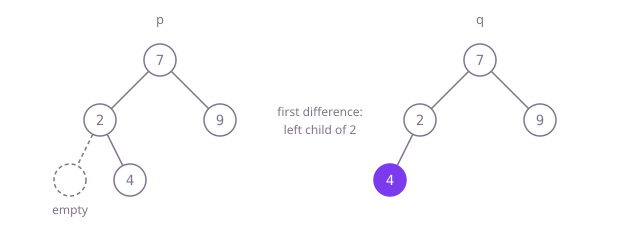

## The question

Given two binary trees, decide whether they hold the same values in the same shape. They are separate objects, so the question is about contents, not about whether the nodes are shared.

What makes it harder than it looks: equal values are not enough, positions matter. Example 2's trees both read 7, 2, 4, 9 in preorder; only the side 4 hangs on differs. So any comparison of value lists has to record where children are missing. The other trap is the empty side: two missing children match, one missing and one present do not, and the code must not read a field of `null` while finding that out.

## How to think about it

The first idea is to write each tree down in a form that keeps its shape, then compare the two writings. Preorder with a marker for every empty child does that: the markers pin down where each value sits, so two trees have the same writing exactly when they are the same tree. It is correct and linear, but it writes out both trees completely even when the roots already differ.

Comparing while walking avoids that. Walk both trees in step, one pair of positions at a time: two empty positions match, one empty is a difference, two nodes must hold equal values and then their left pair and their right pair must match too. A stack of pairs does this without recursion; recursion says it in three lines, one stack frame per level, which is safe with the depth capped at 1,000. Both stop at the first difference.

Walk Example 2, `p = [7,2,9,null,4]` and `q = [7,2,9,4]`. The roots hold 7 and 7. Their left children hold 2 and 2. The left children of those are empty in `p` but hold 4 in `q`: a difference, so the answer is `false` without looking at 9 at all.



## Brute force

Write both trees in preorder with a marker for each empty child, then compare the two lists. It comes first because "write both down and compare" is what you say first, and it fixes the answer to compare against. It is correct because preorder with empty markers can be read back into exactly one tree, so equal lists mean equal trees and different trees give different lists.

```java
static boolean isSame(TreeNode p, TreeNode q) {
    List<Integer> a = new ArrayList<>();
    List<Integer> b = new ArrayList<>();
    write(p, a);
    write(q, b);
    return a.equals(b);
}

private static void write(TreeNode node, List<Integer> out) {
    if (node == null) {
        out.add(null); // the marker that keeps the shape
        return;
    }
    out.add(node.val);
    write(node.left, out);
    write(node.right, out);
}
```

**Complexity:** time O(n + m) for trees of n and m nodes, always reading both whole; extra space O(n + m) for the lists plus O(h) call stack.

## Better: walk both with a stack of pairs

Push the pair of roots. Pop a pair: both empty is fine, one empty or different values is a difference, otherwise push the two right children and the two left children as pairs.

```java
static boolean isSame(TreeNode p, TreeNode q) {
    ArrayDeque<TreeNode[]> pairs = new ArrayDeque<>();
    pairs.push(new TreeNode[] {p, q});
    while (!pairs.isEmpty()) {
        TreeNode[] pair = pairs.pop();
        TreeNode a = pair[0], b = pair[1];
        if (a == null || b == null) {
            if (a != b) return false; // exactly one side is missing
            continue;
        }
        if (a.val != b.val) return false;
        pairs.push(new TreeNode[] {a.right, b.right});
        pairs.push(new TreeNode[] {a.left, b.left});
    }
    return true;
}
```

**Complexity:** time O(min(n, m)), stopping at the first difference; extra space O(h) for the stack of pairs, on the heap.

**Prefer it when:** depth is not capped. The pairs live on the heap, so a path of 100,000 nodes is no problem, where one call per level would overflow Java's stack.

## Optimal: recursion

If either side is empty, they match only when both are. Otherwise the values must be equal and the left subtrees and right subtrees must match. This is the reference solution.

```java
static boolean isSame(TreeNode p, TreeNode q) {
    if (p == null || q == null) {
        return p == q; // equal only when both are missing
    }
    return p.val == q.val && isSame(p.left, q.left) && isSame(p.right, q.right);
}
```

**Complexity:** time O(min(n, m)), stopping at the first difference; extra space O(h) for the call stack, at most 1,000 frames here, but a path of tens of thousands of nodes would overflow Java's default stack.

## Complexity

| Approach | Time | Extra space |
| --- | --- | --- |
| Brute force | O(n + m) | O(n + m) lists plus O(h) call stack |
| Better: walk both with a stack of pairs | O(min(n, m)) | O(h) on the heap |
| Optimal: recursion | O(min(n, m)) | O(h) call stack, safe for depth up to 1,000, overflows on paths of tens of thousands |

## Where it shows up

No coding-round problem is linked to this question. Comparing two trees node by node is how a virtual-DOM library decides which parts of a page changed, how a test framework checks a parsed syntax tree against the expected one, and how a sync tool compares two folder trees before copying only the differences.

## Follow-up answers

**Why does comparing the preorder value lists without markers give wrong answers?** Because many shapes give the same list. In Example 2 both trees read 7, 2, 4, 9: preorder visits a node before its children whichever side they hang on, so nothing in the list says whether 4 was a left or a right child. With a marker for each empty child the list can be read back into exactly one tree, and the comparison becomes correct.

**How would you check whether one tree is the mirror image of the other?** Cross the comparison over: the roots must hold equal values, the left subtree of one must mirror the right subtree of the other, and the right of one must mirror the left of the other. Same cost, O(min(n, m)) time; called with a tree's two children it checks whether that tree is symmetric.

**How would you find out quickly whether many stored trees contain a duplicate?** Give each tree a canonical form once, either its preorder writing with empty markers or a structural hash built bottom-up from each node's value and its children's hashes, and put the forms in a hash set. Two trees collide only when the forms are equal (or, for hashes, on a rare collision you then confirm with a direct comparison). That is linear in the total size instead of comparing every pair of trees.
