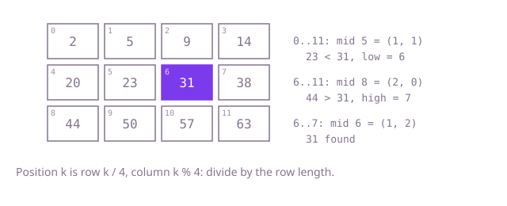

## The question

Given a grid whose values strictly increase when read row by row, and a target, say whether the target is in the grid. The tests ask tens of thousands of times on a thousand-by-thousand grid.

What makes it harder than it looks: the grid looks two-dimensional, which invites two searches or a walk, but it is one sorted list folded into rows. Unfolding it means turning a position into a row and a column, and the common slip is dividing by the number of rows instead of the row length: on a square grid that slip is invisible, and on a grid of one row or one column it reads outside the array.

## How to think about it

The first idea is to look at every cell. It is correct and it ignores both orderings. A step up uses the fact that each row and column is sorted: start in the top-right corner, where a value larger than the target rules out its column and a smaller one rules out its row. That walk is at most m + n steps.

The stronger observation is the row-to-row rule: each row starts above the end of the one before it, so reading the cells row after row gives a single sorted list of m * n values. Binary search on that list needs only a way to read its k-th value, and with n columns the k-th value is at row `k / n`, column `k % n`. The search never builds the list; it converts each middle position to a cell and reads it there.

Walk Example 1, a grid of 3 rows and 4 columns with `target = 31`. Positions run 0 to 11. The middle of 0 to 11 is 5, which is row 1, column 1, holding 23: smaller, so `low = 6`. The middle of 6 to 11 is 8, row 2, column 0, holding 44: larger, so `high = 7`. The middle of 6 to 7 is 6, row 1, column 2, holding 31: found.



## Brute force

Look at every cell. It comes first because it needs no thought about the ordering at all, and it fixes the answer to compare against. It is correct because it checks every value the grid holds.

```java
static boolean contains(int[][] matrix, int target) {
    for (int[] row : matrix) {
        for (int value : row) {
            if (value == target) {
                return true;
            }
        }
    }
    return false;
}
```

**Complexity:** time O(m * n) per call, extra space O(1).

## Better: walk from the top-right corner

Start at the end of the first row. If the value there is larger than the target, every value below it in that column is larger still, so step left. If it is smaller, every value to its left in that row is smaller still, so step down. Each step discards a whole row or column.

```java
static boolean contains(int[][] matrix, int target) {
    int row = 0;
    int column = matrix[0].length - 1; // the top-right corner
    while (row < matrix.length && column >= 0) {
        int value = matrix[row][column];
        if (value == target) {
            return true;
        }
        if (value > target) {
            column--; // the rest of this column, below, is larger still
        } else {
            row++; // the rest of this row, to the left, is smaller still
        }
    }
    return false;
}
```

**Complexity:** time O(m + n) per call, extra space O(1).

**Prefer it when:** rows and columns are each sorted but a row may start below the end of the row above. The walk needs only those two orderings, while the flat search below needs the row-to-row rule.

## Optimal: binary search on the flattened grid

Treat positions 0 to m * n - 1 as one sorted array and binary search it, reading position k from row `k / n` and column `k % n`. This is the reference solution.

```java
static boolean contains(int[][] matrix, int target) {
    int columns = matrix[0].length;
    int low = 0;
    int high = matrix.length * columns - 1; // flat positions, read row by row
    while (low <= high) {
        int middle = (low + high) >>> 1;
        int value = matrix[middle / columns][middle % columns]; // divide by the row length, not the row count
        if (value == target) {
            return true;
        }
        if (value < target) {
            low = middle + 1;
        } else {
            high = middle - 1;
        }
    }
    return false;
}
```

**Complexity:** time O(log(m * n)) per call, extra space O(1).

## Complexity

| Approach | Time | Extra space |
| --- | --- | --- |
| Brute force | O(m * n) per call | O(1) |
| Better: walk from the top-right corner | O(m + n) per call | O(1) |
| Optimal: binary search on the flattened grid | O(log(m * n)) per call | O(1) |

## Where it shows up

Paged storage, where a sorted file is split into fixed-size pages and position k lives on page `k / pageSize` at offset `k % pageSize`; row-major images and tensors, whose flat buffers are addressed with the same division; and range lookups over sorted chunks, such as the blocks of a sorted log segment.

## Follow-up answers

**What if each row and each column is sorted, but a row may start below the end of the row above?** The values no longer form one sorted list, so the flat search can miss. The top-right walk still works, because it relies only on each row and each column being sorted, and it runs in O(m + n).

**How would you return the row and column of the target instead of true or false?** On a match, return `middle / columns` and `middle % columns`, the same conversion the search already uses to read the cell.

**What if the rows have different lengths?** The division no longer maps a position to a cell. Binary search the first values of the rows to find the last row that starts at or below the target, then binary search inside that row: O(log m + log n).
