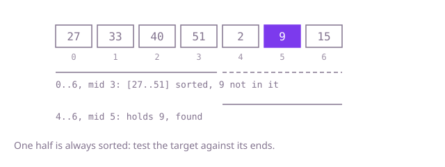

## The question

A strictly increasing array had some unknown number of its leading values moved to the end. Given that array and a target, return the target's index or -1, fast enough for tens of thousands of calls on half-million-value arrays.

What makes it harder than it looks: comparing the target with the middle no longer tells you which side it is on, because the order breaks once somewhere in the array. The fix is to decide first which half is in order, and that test has an edge: when the range holds two values, the middle is the range's first index, so the left half is one value, and a strict `nums[low] < nums[middle]` calls it unsorted and searches the wrong half.

## How to think about it

The first idea is to scan for the target. It is correct and ignores that the array is almost sorted. A second idea uses the two-run structure directly: find where the lower run starts with a binary search, then binary search the one run whose range of values covers the target. That is two searches.

One search is enough. Cut the range at the middle: the drop can be in at most one of the two halves, so at least one half is sorted, and I can tell which by its end values: `nums[low] <= nums[middle]` means the left half `[low, middle]` is in order. For a sorted half, "is the target inside?" is two comparisons with its ends. If it is inside, keep that half; otherwise the target can only be in the other half. Each step halves the range, as in a plain binary search. The `<=` matters: when `low == middle` the left half is one value, which is sorted.

Walk Example 1, `nums = [27, 33, 40, 51, 2, 9, 15]`, `target = 9`. The range is 0 to 6, the middle is 3, holding 51. The left half, 27 to 51, is in order and 9 is not between 27 and 51, so the target is to the right: `low = 4`. The middle of 4 to 6 is 5, holding 9: found, answer 5.



## Brute force

Check every index from the left. It comes first because it is what you say first, and it fixes the answer to compare against. It is correct because it looks at every position.

```java
static int indexOf(int[] nums, int target) {
    for (int i = 0; i < nums.length; i++) {
        if (nums[i] == target) {
            return i;
        }
    }
    return -1;
}
```

**Complexity:** time O(n) per call, extra space O(1).

## Better: find the rotation point, then search one run

First find where the lower run starts, by comparing middles with the last value of the range. The lower run holds the values from `nums[start]` to the last value; if the target is in that range, search there, otherwise search the upper run before it. `Arrays.binarySearch` does the second search on a slice.

```java
static int indexOf(int[] nums, int target) {
    int low = 0;
    int high = nums.length - 1;
    while (low < high) { // find where the lower run starts
        int middle = (low + high) >>> 1;
        if (nums[middle] > nums[high]) {
            low = middle + 1;
        } else {
            high = middle;
        }
    }
    int start = low;
    boolean inLowerRun = target >= nums[start] && target <= nums[nums.length - 1];
    int found = inLowerRun
            ? Arrays.binarySearch(nums, start, nums.length, target)
            : Arrays.binarySearch(nums, 0, start, target); // an empty slice when not rotated
    return found >= 0 ? found : -1;
}
```

**Complexity:** time O(log n) per call (two searches), extra space O(1).

**Prefer it when:** you need the rotation point anyway, or you would rather combine two plain, well-tested searches than reason about which half is sorted.

## Optimal: one binary search on the sorted half

At each step, find the sorted half from its end values, check whether the target is inside it, and keep that half or the other. This is the reference solution.

```java
static int indexOf(int[] nums, int target) {
    int low = 0;
    int high = nums.length - 1; // if the target is present, it lies in [low, high]
    while (low <= high) {
        int middle = (low + high) >>> 1;
        if (nums[middle] == target) {
            return middle;
        }
        if (nums[low] <= nums[middle]) { // [low, middle] is sorted; <= because low may be middle
            if (nums[low] <= target && target < nums[middle]) {
                high = middle - 1;
            } else {
                low = middle + 1;
            }
        } else { // [middle, high] is sorted
            if (nums[middle] < target && target <= nums[high]) {
                low = middle + 1;
            } else {
                high = middle - 1;
            }
        }
    }
    return -1;
}
```

**Complexity:** time O(log n) per call, extra space O(1).

## Complexity

| Approach | Time | Extra space |
| --- | --- | --- |
| Brute force | O(n) per call | O(1) |
| Better: find the rotation point, then search one run | O(log n) per call, two searches | O(1) |
| Optimal: one binary search on the sorted half | O(log n) per call | O(1) |

## Where it shows up

Lookups in a circular buffer kept in sorted order, such as a ring of time-stamped samples that has wrapped, without first copying it into order; and sorted data split at an unknown point, such as a sorted log that was cut and rejoined at a rollover, or a sorted ring of hash positions in consistent hashing whose smallest position is not at index 0.

## Follow-up answers

**Can you find it in O(log n) time with a single binary search?** Yes: at each step one half of the range is sorted, which its end values show. Check whether the target lies within that half's ends; keep it if so, otherwise keep the other half.

**What if values could repeat?** When `nums[low]`, `nums[middle]` and `nums[high]` are all equal you cannot tell which half is sorted. Shrink both ends by one (`low++`, `high--`) and try again; nothing is lost, because those two ends hold the middle's value, which was just found not to be the target. The worst case becomes O(n).

**How would you return the target's position in the original sorted order?** Find the rotation point `start` as in the Better approach. A value at index `i` was at sorted position `(i - start + n) % n`.
