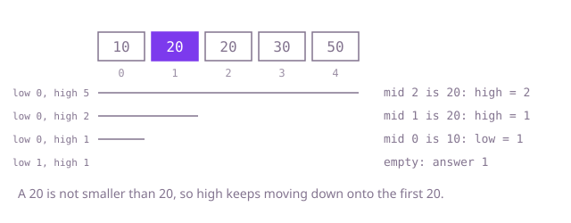

## The question

Given a sorted array that may contain repeated values and a target, return the smallest index whose element is at least the target, which is the length of the array when every element is smaller. That is the place where the target would have to go to keep the array sorted, in front of any equal elements already there.

What makes it harder than it looks: with repeated values, "found it" is not good enough, because the answer is the first equal element and not any of them. A binary search that stops at the first match returns whichever equal element the midpoint happens to land on. The boundary after the last element, and the empty array, need the same loop to give the right answer without special cases. And with a million elements and many calls, a scan from the left is too slow.

## How to think about it

The first idea is to walk from the left until an element is not smaller than the target. That is correct and obvious, and it costs a pass over the array for every call.

What is worth noticing? The answer is a boundary: every element to its left is smaller than the target and every element from it on is not. In a sorted array that split is clean, so a single comparison with the middle element tells me which side of the middle the boundary is on. If the middle is smaller than the target, the boundary is after it. Otherwise the middle could be the boundary itself, or the boundary is further left. Halving the range each time reaches the boundary in about log n steps.

I keep a half-open range `[low, high)` that starts as the whole array, with `high = length` meaning "past the end", which is a legal answer when everything is smaller. When the range is empty, `low` is the answer. Equal elements need no extra case: an element equal to the target is not smaller, so the search keeps moving left until it sits on the first of them.

Walk Example 1, `sorted = [10, 20, 20, 30, 50]`, `target = 20`. The range is `[0, 5)`; the middle is index 2, which holds 20, not smaller, so `high = 2`. The range `[0, 2)` has middle 1, which holds 20, so `high = 1`. The range `[0, 1)` has middle 0, which holds 10, smaller, so `low = 1`. The range `[1, 1)` is empty and the answer is 1, the first 20.



## Brute force

Walk from the left and stop at the first element that is not smaller than the target. It comes first because it is the definition restated as a loop, and it fixes the answer the faster versions must agree with. It is correct because the first element that is not smaller is, by definition, the smallest index with `sorted[i] >= target`, and running off the end gives the length.

```java
static int insertAt(int[] sorted, int target) {
    int i = 0;
    while (i < sorted.length && sorted[i] < target) { // stops at the first element that is not smaller
        i++;
    }
    return i; // sorted.length when every element is smaller
}
```

**Complexity:** time O(n) per call, extra space O(1).

## Better: the library search, then step left over equals

`Arrays.binarySearch` already halves the range. It returns the index of a match, or `-(insertion point) - 1` when there is none. When there is no match, the insertion point is the answer, because no element equals the target. When there is a match, it may be any of the equal elements, so walk left while the previous element is also equal.

```java
static int insertAt(int[] sorted, int target) {
    int found = Arrays.binarySearch(sorted, target);
    if (found < 0) {
        return -found - 1; // no equal element: the insertion point is the answer
    }
    while (found > 0 && sorted[found - 1] == target) {
        found--; // the library may land on any equal element; step to the first
    }
    return found;
}
```

**Complexity:** time O(log n + d) per call, where d is how many equal elements sit before the one the search landed on; O(n) in the worst case, when the whole array is the target. Extra space O(1).

**Prefer it when:** you want the standard library to do the search and equal values are rare or short runs. It is not safe for data with long runs of repeats, since the walk is linear in the run.

## Optimal: binary search on the boundary

Keep the range `[low, high)`. If the middle element is smaller than the target, the boundary is after it, so `low = middle + 1`. Otherwise the middle may be the boundary, so `high = middle`, not `middle - 1`. Stop when the range is empty and return `low`. The middle is computed with `(low + high) >>> 1`, which cannot overflow when the length is large. This is the reference solution.

```java
static int insertAt(int[] sorted, int target) {
    int low = 0;
    int high = sorted.length; // the answer always lies in [low, high]
    while (low < high) {
        int middle = (low + high) >>> 1;
        if (sorted[middle] < target) {
            low = middle + 1; // the boundary is after the middle
        } else {
            high = middle; // the middle may itself be the boundary
        }
    }
    return low;
}
```

**Complexity:** time O(log n) per call, extra space O(1).

## Complexity

| Approach | Time | Extra space |
| --- | --- | --- |
| Brute force | O(n) per call | O(1) |
| Better: library search, then step left | O(log n + d) per call, O(n) worst case | O(1) |
| Optimal: binary search on the boundary | O(log n) per call | O(1) |

## Where it shows up

`shift-roster-lookup` runs this search over start minutes. `RosterLookup.lastStartAtOrBefore` calls `Collections.binarySearch` on a ward's sorted list of shift starts, and when the minute is not a start the result is `-(insertion point) - 1`, the insertion point being the answer to this question. The shift just before that insertion point (index `-found - 2`) is the last one starting at or before the minute, which is what `onDutyAt`, `nextHandover` and `uncovered` need. This question asks for the insertion point itself, with the first of several equal elements, which `Collections.binarySearch` does not promise when there are repeats.

Outside the coding round, the same boundary search places a new entry into a sorted list, finds the price tier for an amount in a sorted list of thresholds, and finds where a timestamp falls in a sorted log.

## Follow-up answers

**How would you find the position after the last equal element instead?** Change the test to `sorted[middle] <= target` to move right. The boundary is then between elements that are at most the target and elements that are greater.

**How would you count how many times a value occurs?** Run both searches: the first index with an element at least `target`, and the first index with an element greater than `target`. Their difference is the count, in O(log n).

**What if the array is too large to load, and you can only read a position at a time from disk?** The search touches only O(log n) positions, so it still works: each probe is a seek and a read of one value. Keeping the top levels of probes (the first middle, the quarters and so on) in memory removes most of the reads.
