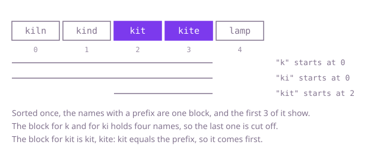

## The question

Given a catalogue of product names, a word being typed and a number `limit`, return for every prefix of the typed word, after each letter, up to `limit` catalogue names that start with that prefix, smallest first in dictionary order. A prefix with no match gets an empty list.

What makes it harder than it looks: the answer has one list per typed letter, so a plan that works over the whole catalogue for every letter pays for it up to 1,000 times. A name equal to the prefix is a match and comes before its longer relatives, which is easy to get wrong by searching for the next-larger name. And names can be 1,000 letters long and share a long start, so a comparison is not free either.

## How to think about it

The first idea follows the sentence: for each prefix, keep the names that start with it, sort them, and take the first `limit`. That is correct, and it repeats the filter and the sort for every letter, though the names of a longer prefix are a subset of the names of the shorter one.

Two structures remove the repetition, and I would say both aloud before choosing. A trie holds every name letter by letter, so walking down it with the typed letters lands on the prefix, and I can store at each node the first `limit` names that pass through it, which makes every answer a lookup. A sorted array does the same job with less code: in dictionary order, the names with a given prefix are one unbroken block, so the first `limit` matches are the first `limit` names of the block. Finding where the block begins is the question "where would the prefix be inserted", the first name not smaller than it, and that is a binary search. The block of a longer prefix lies inside the block of the shorter one, so each search can start where the previous block started.

I go with the sorted array. Walk Example 1, `products = ["kiln", "kind", "kit", "kite", "lamp"]`, `typed = "kit"`, `limit = 3`. The array is already sorted. The prefix `k` begins at index 0, and the block holds `kiln, kind, kit, kite`; the first three are the answer. The prefix `ki` begins at 0 again, same block, same answer. The prefix `kit` begins at index 2 and its block is `kit, kite`; `kit` equals the prefix so it comes first. The answer is `[["kiln", "kind", "kit"], ["kiln", "kind", "kit"], ["kit", "kite"]]`.



## Brute force

For each prefix, collect every name that starts with it, sort the matches, and take the first `limit`. It comes first because it is the sentence restated as code, and it fixes the answer the faster versions must agree with. It is correct because it looks at every name for every prefix, and sorting the matches puts the dictionary-smallest first.

```java
static List<List<String>> suggest(String[] products, String typed, int limit) {
    List<List<String>> answer = new ArrayList<>();
    for (int length = 1; length <= typed.length(); length++) {
        String prefix = typed.substring(0, length);
        List<String> matches = new ArrayList<>();
        for (String product : products) {
            if (product.startsWith(prefix)) matches.add(product);
        }
        Collections.sort(matches); // dictionary order, so the smallest are first
        answer.add(new ArrayList<>(matches.subList(0, Math.min(limit, matches.size()))));
    }
    return answer;
}
```

**Complexity:** time O(L × (n + m log m)) name comparisons for L typed letters, n products and up to m matches per prefix, so up to O(L × n log n); each comparison reads up to the length of the common start. Extra space O(n).

## Better: a trie that remembers the first names at each node

Sort the names once, then insert them in that order into a trie. Every node a name passes through adds the name to its own list if the list holds fewer than `limit` names, so each list ends up holding the smallest names under that node, in order. A name equal to a prefix ends exactly at that prefix's node and, being first in sorted order, lands first in its list. The typed letters then walk down the trie, and each step's answer is the list at the node reached; once a letter has no child, every later answer is empty.

```java
static List<List<String>> suggest(String[] products, String typed, int limit) {
    String[] sorted = products.clone();
    Arrays.sort(sorted); // inserted in dictionary order, so each node's list fills with its smallest names
    Node root = new Node();
    for (String name : sorted) {
        Node node = root;
        for (int i = 0; i < name.length(); i++) {
            int letter = name.charAt(i) - 'a';
            if (node.next[letter] == null) node.next[letter] = new Node();
            node = node.next[letter];
            if (node.best.size() < limit) node.best.add(name);
        }
    }
    List<List<String>> answer = new ArrayList<>(typed.length());
    Node node = root;
    for (int i = 0; i < typed.length(); i++) {
        if (node != null) node = node.next[typed.charAt(i) - 'a']; // null once no name goes this way
        answer.add(node == null ? List.of() : node.best);
    }
    return answer;
}

private static class Node {
    final Node[] next = new Node[26];
    final List<String> best = new ArrayList<>();
}
```

**Complexity:** time O(n log n) comparisons to sort, plus O(total letters) to build and O(L) to answer; extra space O(total letters) in the worst case, up to 5 × 10^7 nodes for 50,000 names of 1,000 letters each, where the sorted array holds 50,000 references.

**Prefer it when:** the same catalogue serves many typed words, since the trie is built once and each lookup is a walk of the typed letters. The code as shown builds the trie inside `suggest`, so for that use the sort and the build would move out into a field or a constructor and only the walk would stay in the method.

## Optimal: sort once and binary search each prefix

Sort a copy of the names once. For each prefix of the typed text, binary search for the first name that is not smaller than the prefix, starting at the previous prefix's start because a longer prefix never begins before a shorter one. From there take names while they still start with the prefix, at most `limit` of them. A name equal to the prefix is not smaller, so it is found first. This is the reference solution.

```java
static List<List<String>> suggest(String[] products, String typed, int limit) {
    String[] sorted = products.clone();
    Arrays.sort(sorted);
    List<List<String>> answer = new ArrayList<>(typed.length());
    int start = 0; // a longer prefix never begins before the shorter one's block
    for (int length = 1; length <= typed.length(); length++) {
        String prefix = typed.substring(0, length);
        start = firstAtLeast(sorted, prefix, start);
        List<String> found = new ArrayList<>(limit);
        for (int i = start; i < sorted.length && found.size() < limit && sorted[i].startsWith(prefix); i++) {
            found.add(sorted[i]);
        }
        answer.add(found);
    }
    return answer;
}

/** First index at or after from whose name is not smaller than the prefix. */
private static int firstAtLeast(String[] sorted, String prefix, int from) {
    int low = from;
    int high = sorted.length;
    while (low < high) {
        int middle = (low + high) >>> 1;
        if (sorted[middle].compareTo(prefix) < 0) {
            low = middle + 1;
        } else {
            high = middle;
        }
    }
    return low;
}
```

**Complexity:** time O(n log n) name comparisons to sort, plus O(L × (log n + limit)) comparisons for the L typed letters; each comparison reads up to the length of the common start of the two names. Extra space O(n) for the sorted copy, plus the answer.

## Complexity

| Approach | Time | Extra space |
| --- | --- | --- |
| Brute force | O(L × n log n) comparisons | O(n) |
| Better: trie with first names at each node | O(n log n) to sort, O(total letters) to build, O(L) to answer | O(total letters) |
| Optimal: sort, then binary search per prefix | O(n log n) to sort, O(L × (log n + limit)) to answer | O(n) |

Here n is the number of products and L the length of the typed text. Times count name comparisons; a comparison reads up to the length of the common start.

## Where it shows up

`merchant-suggest` is this question with a ranking rule on top; suggestions are its second phase. Its reference `Suggester` builds one entry per word of each normalised merchant name (the rest of the name from that word on), sorts the entries, and finds the contiguous range of entries starting with the typed text by the same lower-bound binary search as `firstAtLeast`. It does not use a trie. The dictionary order of this question is replaced there by popularity: it scans the whole range and keeps the best few merchants by transaction count, busier first, and when counts tie the merchant listed earlier in the directory's list wins. It also remembers each typed text's answer until the directory changes.

Outside the coding round, the same boundary search sits behind a search box suggesting catalogue items, a shell completing a command from its sorted list, or a contact picker narrowing as you type.

## Follow-up answers

**What if the best suggestions are ranked by popularity instead of dictionary order?** The block is still contiguous, but the best of it are no longer its first. Scan the block and keep the best `limit` in a small sorted array or a heap, as `merchant-suggest` does, or store the top names at each trie node when answers must be instant.

**What if the user can also delete a letter, so the typed text goes back one step?** With the array version each prefix is independent, so go back to the previous prefix's block. Keep the start indexes in a stack, one per typed letter, and pop on a delete. With a trie, keep the path of nodes and pop one.

**How would you serve this for a catalogue of millions of words that changes during the day?** Keep the sorted array or trie in memory for reads and put new words in a small side list that is merged in at each answer, then rebuild the main structure in the background. Cache the answers of short prefixes, which are asked most often.
