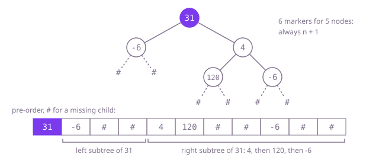

## The question

Write a class that turns a binary tree into a string and a second method that rebuilds the same tree from that string, with new nodes. The format is free, but the text for `n` nodes may be at most `20 * (n + 1)` characters long.

What makes it harder than it looks: a list of values in one traversal order does not fix the shape. `[7,7]` and `[7,null,7]` give the same values in pre-order, in-order and level order, and values may repeat, so even two orders together do not help. The text must say where the children are missing. The size rule rules out the other easy idea, numbering every slot of a complete tree, which grows with 2 to the power of the depth.

## How to think about it

The first idea comes from heaps: give the root slot 0 and a node in slot i its children in slots 2i + 1 and 2i + 2, then write every slot, filled or empty. The decoder needs nothing but the slot arithmetic. It is correct, and fine for a full tree, but a path of 18 nodes leaning right reaches slot 2^18 - 2, so the text holds 262,143 slots for 18 values, and a path of 1,000 cannot be written at all.

The fix is to pay for missing children only where they are: write a marker for each missing child next to the values. A tree of n nodes has exactly n + 1 missing children, so the text stays linear. Level order with markers works with a queue on both sides. Pre-order with markers is shorter still to code: write the node, then its left subtree, then its right subtree, and a marker for every `null`. The decoder reads the tokens in the same order with one shared position: a value makes a node whose left subtree is read next, then its right; a marker ends that side.

Walk Example 1, `[31,-6,4,120,null,null,-6]`. Pre-order with `#` for a missing child gives `31,-6,120,#,#,#,4,#,-6,#,#,`, 27 characters, well under the 120 allowed. Decoding: 31 is the root; its left subtree starts with -6, whose left is 120 (two `#`s) and whose right is the next `#`; then 31's right subtree starts with 4, whose left is `#` and whose right is -6 (two `#`s). Every token is used exactly once.



## Brute force

Numbered slots: the root in slot 0, a node's children in slots 2i + 1 and 2i + 2, every slot up to the last filled one written out, `#` for an empty one. It comes first because the heap layout is the first array picture of a tree most people have, and it shows why a format has to record missing children cheaply. It is correct as a mapping, since each slot names one position in the tree, while the depth stays small.

```java
String serialize(TreeNode root) {
    List<String> slots = new ArrayList<>();
    fill(root, 0, slots);
    return String.join(",", slots);
}

private static void fill(TreeNode node, int slot, List<String> slots) {
    if (node == null) {
        return;
    }
    while (slots.size() <= slot) {
        slots.add("#"); // every slot up to this one, filled or not
    }
    slots.set(slot, String.valueOf(node.val));
    fill(node.left, 2 * slot + 1, slots); // children of slot i live at 2i + 1 and 2i + 2
    fill(node.right, 2 * slot + 2, slots);
}

TreeNode deserialize(String data) {
    return data.isEmpty() ? null : build(data.split(","), 0);
}

private static TreeNode build(String[] slots, int slot) {
    if (slot >= slots.length || slots[slot].equals("#")) {
        return null;
    }
    return new TreeNode(Integer.parseInt(slots[slot]), build(slots, 2 * slot + 1), build(slots, 2 * slot + 2));
}
```

**Complexity:** time and extra space O(2^h), where h is the depth: the text has a slot for every position of a complete tree that deep. The slot numbers also overflow `int` past depth 31. It breaks this question's size rule on any path longer than a few nodes and cannot finish on a path of 1,000.

## Better: level order with markers

Walk the tree breadth-first and write each node's two children, a value or `#`, as the node leaves the queue. The decoder keeps the same queue: each node it takes off gets the next two tokens as its children.

```java
String serialize(TreeNode root) {
    if (root == null) {
        return "";
    }
    StringBuilder out = new StringBuilder().append(root.val);
    ArrayDeque<TreeNode> queue = new ArrayDeque<>(List.of(root));
    while (!queue.isEmpty()) {
        TreeNode node = queue.poll();
        for (TreeNode child : new TreeNode[] {node.left, node.right}) {
            if (child == null) {
                out.append(",#"); // a missing child still takes its place
            } else {
                out.append(',').append(child.val);
                queue.add(child);
            }
        }
    }
    return out.toString();
}

TreeNode deserialize(String data) {
    if (data.isEmpty()) {
        return null;
    }
    String[] tokens = data.split(",");
    TreeNode root = new TreeNode(Integer.parseInt(tokens[0]));
    ArrayDeque<TreeNode> queue = new ArrayDeque<>(List.of(root));
    int next = 1;
    while (!queue.isEmpty()) {
        TreeNode node = queue.poll(); // its two children are the next two tokens
        node.left = child(tokens[next++], queue);
        node.right = child(tokens[next++], queue);
    }
    return root;
}

private static TreeNode child(String token, ArrayDeque<TreeNode> queue) {
    if (token.equals("#")) {
        return null;
    }
    TreeNode node = new TreeNode(Integer.parseInt(token));
    queue.add(node);
    return node;
}
```

**Complexity:** time O(n) for each method; extra space O(n) for the token array, and the queue holds O(w) nodes, w the widest level (at most two adjacent levels at once).

**Prefer it when:** the tree may be deeper than the call stack allows, since neither method recurses; or when people read the text, since it is the level order this statement writes trees in, with `#` for `null`.

## Optimal: pre-order with markers

Write each node's value, then its left subtree, then its right subtree, and `#` for every missing child. Decode with one shared position: take the next token; a marker means an empty subtree, a value makes a node whose left and then right subtrees are read the same way. Same cost as level order, with less code on both sides. This is the reference solution.

```java
String serialize(TreeNode root) {
    StringBuilder out = new StringBuilder();
    write(root, out);
    return out.toString();
}

private static void write(TreeNode node, StringBuilder out) {
    if (node == null) {
        out.append("#,"); // the marker records the shape
        return;
    }
    out.append(node.val).append(',');
    write(node.left, out);
    write(node.right, out);
}

TreeNode deserialize(String data) {
    return read(data.split(","), new int[1]);
}

private static TreeNode read(String[] tokens, int[] next) {
    String token = tokens[next[0]++];
    if (token.equals("#")) {
        return null; // a missing child ends this side
    }
    TreeNode node = new TreeNode(Integer.parseInt(token));
    node.left = read(tokens, next);
    node.right = read(tokens, next);
    return node;
}
```

The shared position is created inside `deserialize`, not kept in a field, so the codec keeps nothing between calls. The text is at most 12 characters per value plus 2 per marker, about 14 per node.

**Complexity:** time O(n) for each method; extra space O(n) for the token array plus O(h) for the call stack, at most 1,001 frames here; a path of tens of thousands of nodes would overflow Java's default stack.

## Complexity

| Approach | Time | Extra space |
| --- | --- | --- |
| Brute force | O(2^h) | O(2^h), slot numbers overflow `int` past depth 31 |
| Better: level order with markers | O(n) per method | O(n) tokens, queue of O(w) nodes for the widest level w, no recursion |
| Optimal: pre-order with markers | O(n) per method | O(n) tokens plus O(h) call stack, overflows on paths of tens of thousands |

## Where it shows up

No coding-round problem is linked to this question. Writing a tree as a flat list with markers for empty places is how syntax trees, file-system snapshots and scene graphs are saved and sent: JSON's nested brackets and `null`, a database index written to disk, a game's level tree in a save file. The rule is the same everywhere: the encoding must carry the shape, not only the values.

## Follow-up answers

**How would you make the encoded text smaller?** Write values in binary instead of decimal text, four bytes each, or with a variable-length encoding so small values take one byte. The markers can shrink to one bit per child: a bitmap saying which children exist, next to the values in pre-order. Compressing the text afterwards also helps when values repeat.

**How would you decode a tree too deep for the call stack?** Use the level-order version, which has no recursion, or keep pre-order and replace the recursion with an explicit stack of nodes waiting for their right child. In pre-order, each value becomes the left child of the node on top until a marker says to switch to the right side and pop.

**If the tree were a binary search tree, what could you leave out of the text?** The markers. A binary search tree's pre-order alone fixes its shape, when values are distinct: the first value is the root, the following values smaller than it form the left subtree and the rest the right. The decoder rebuilds it with lower and upper bounds, in linear time.
