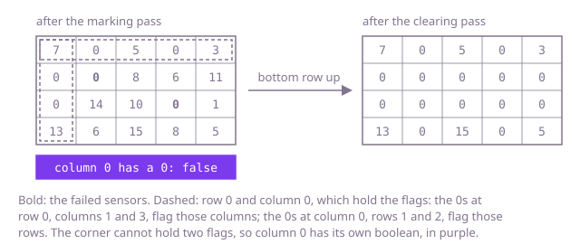

## The question

Given a grid of readings, set to 0 every reading whose row or column held a 0 at the start, and do it in the array you were given. The method returns nothing, so the caller only sees what you write into `grid`.

What makes it harder than it looks is that the zeros you write look exactly like failed sensors. Clearing a row and a column the moment you meet a 0 creates new zeros further on, and the scan then clears their rows and columns too: in Example 1 only the 7 in the top-left corner would survive. Marking the cells to clear with a special value instead does not work either, because a reading can be any `int`, -1 and the smallest `int` included, so no value is free to mean "clear me later". And at 1000 x 1000 with most sensors failed, wiping a row and a column for every 0 costs about two billion writes.

## How to think about it

The first idea is to copy the grid, and for every 0 in the copy wipe its row and its column in `grid`. Reading the copy keeps the cleared cells from spreading, so it is right. But look at what it repeats: a row with ten failed sensors is wiped ten times, and so is a column. All the answer depends on is which rows hold a 0 and which columns do, m + n yes-or-no facts. Find them in one pass into two boolean arrays, then clear in a second pass: every reading is looked at twice, and nothing spreads, because the flags are fixed before anything is written.

To drop the two arrays, notice where the flags could live. If row r holds a 0, then the reading at row r, column 0 ends up 0 anyway, so writing a 0 there early to say "row r fails" loses nothing. The same goes for row 0, column c and "column c fails". So the first column holds the row flags and the first row holds the column flags. Two details make it work. The corner, row 0 column 0, would have to be both row 0's flag and column 0's flag, so column 0 gets one boolean of its own. And the flags must be read before they are cleared: clear the rows from the bottom up, so row 0, whose cells are the column flags, goes last, and in each row clear the other cells before the one in column 0, which is that row's flag.

Walk Example 1. The failed sensors are at row 1, column 1 and at row 2, column 3, and column 0 holds no 0, so its boolean stays false. The marking pass writes 0s at row 1, column 0 and row 0, column 1 for the first, and at row 2, column 0 and row 0, column 3 for the second. Clearing from the bottom up: row 3's flag is 13, so only columns 1 and 3, whose flags are 0, are cleared, giving `[13,0,15,0,5]`. Rows 2 and 1 have 0 flags and are cleared right of column 0. Row 0's flag, the corner, is 7, so it keeps 7, 5 and 3. Column 0 keeps 7 and 13, since its boolean is false.



## Brute force

Copy the grid, then for every 0 in the copy set its whole row and its whole column in `grid` to 0. It is what you say first, because it is the rule written down, and it fixes the answer the faster versions must agree with. It is correct because the zeros come from the untouched copy, so a reading cleared on the way never counts as a failed sensor.

```java
static void clearFailed(int[][] grid) {
    int m = grid.length, n = grid[0].length;
    int[][] start = new int[m][];
    for (int r = 0; r < m; r++) {
        start[r] = grid[r].clone(); // the readings before any clearing
    }
    for (int r = 0; r < m; r++) {
        for (int c = 0; c < n; c++) {
            if (start[r][c] == 0) { // a failed sensor in the copy, never a reading cleared here
                Arrays.fill(grid[r], 0);
                for (int i = 0; i < m; i++) {
                    grid[i][c] = 0;
                }
            }
        }
    }
}
```

**Complexity:** time O(m·n + z·(m + n)) for z failed sensors, so O(m·n·(m + n)) when most of them fail; extra space O(m·n) for the copy.

## Better: a flag per row and per column

Scan once and record, in one boolean per row and one per column, whether it holds a 0. Then scan again and set a reading to 0 when its row's flag or its column's flag is set. The flags are complete before the first write, so nothing spreads, and each reading is visited twice however many sensors failed.

```java
static void clearFailed(int[][] grid) {
    int m = grid.length, n = grid[0].length;
    boolean[] rowFails = new boolean[m];
    boolean[] columnFails = new boolean[n];
    for (int r = 0; r < m; r++) {
        for (int c = 0; c < n; c++) {
            if (grid[r][c] == 0) {
                rowFails[r] = true;
                columnFails[c] = true;
            }
        }
    }
    for (int r = 0; r < m; r++) {
        for (int c = 0; c < n; c++) {
            if (rowFails[r] || columnFails[c]) { // flags fixed before any write, so nothing spreads
                grid[r][c] = 0;
            }
        }
    }
}
```

**Complexity:** time O(m·n), extra space O(m + n).

**Prefer it when:** you want the version that is hard to get wrong. The flags live apart from the readings, so the second pass can clear the cells in any order, where the in-place version has an order that must be right. Here m + n is at most 2,000 booleans.

## Optimal: keep the flags in the first row and column

Mark a failed row with a 0 in its first-column cell and a failed column with a 0 in its first-row cell, with one extra boolean for column 0, whose flag the corner cannot also hold. Then clear from the last row up, each row's other cells before its first-column cell, so every flag is read before it is overwritten. This is the reference solution.

```java
static void clearFailed(int[][] grid) {
    int m = grid.length, n = grid[0].length;
    boolean firstColumnHasZero = false; // grid[0][0] is row 0's flag, so column 0 needs its own
    for (int r = 0; r < m; r++) {
        if (grid[r][0] == 0) {
            firstColumnHasZero = true;
        }
        for (int c = 1; c < n; c++) {
            if (grid[r][c] == 0) {
                grid[r][0] = 0; // flag row r in column 0
                grid[0][c] = 0; // flag column c in row 0
            }
        }
    }
    for (int r = m - 1; r >= 0; r--) { // bottom up, so row 0's flags are read before row 0 is cleared
        for (int c = 1; c < n; c++) {
            if (grid[r][0] == 0 || grid[0][c] == 0) {
                grid[r][c] = 0;
            }
        }
        if (firstColumnHasZero) {
            grid[r][0] = 0; // after the row's other cells, which read this flag
        }
    }
}
```

**Complexity:** time O(m·n), extra space O(1).

## Complexity

| Approach | Time | Extra space |
| --- | --- | --- |
| Brute force: wipe from a copy | O(m·n + z·(m + n)), O(m·n·(m + n)) when most fail | O(m·n) |
| Better: a flag per row and per column | O(m·n) | O(m + n) |
| Optimal: flags in the first row and column | O(m·n) | O(1) |

## Where it shows up

No coding-round problem is linked to this question. Dropping every row and column that touches a missing or broken value is a data-cleaning step for tables and sensor matrices, and masking the row and column of a dead pixel is how some displays and camera sensors hide a faulty line. The trick of storing flags in cells whose fate is already decided is the same one in-place algorithms use when they mark visited entries inside the input instead of in a second array.

## Follow-up answers

**Can you do it with only a constant amount of extra memory?** Yes: keep the row flags in the first column and the column flags in the first row, plus one boolean for column 0, and clear from the bottom row up, each row's first-column cell last. The cells that carry a flag are ones that end up 0 anyway, so borrowing them loses nothing.

**What if the grid arrives one row at a time, as a stream?** A 0 in the last row clears that column in every earlier row, so no row can be written out before the whole grid has been seen. With two passes over the stream, the first records the m + n flags and the second writes each row as it arrives. With a single pass you must hold every row back until the end, which is the whole grid in memory.

**What if a failed sensor cleared only its four neighbours instead of its whole row and column?** The rule against spreading is the same: only the zeros present at the start count. Record their positions in a first pass, or keep a copy, then clear the neighbours of each recorded position in a second pass; that is O(m·n) time and O(z) extra space for z failed sensors. The first-row trick no longer applies, because the cells that would carry the marks are not the ones being cleared.
