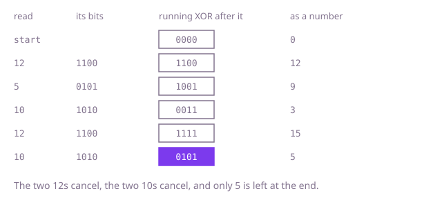

## The question

Every value in an array appears exactly twice, except one value that appears once; return that one. The two copies of a value can be anywhere, so the array is not a row of neighbouring pairs.

What makes it harder than it looks: comparing neighbours only works after sorting, and then the lone value can be the last one, with no partner after it. A count array indexed by the value breaks on the first negative value unless the index is shifted by 30,000. Counting each value's copies with a fresh scan of the array costs up to about 10^10 comparisons at 10^5 values. And the follow-up asks for O(n) time with only a constant amount of extra memory, which rules out a set, a map and a count array.

## How to think about it

The first idea is to count: for each value, scan the array, count its copies, and return the value counted once. That reads the whole array again for every value. What is worth remembering instead is which values are still waiting for their second copy: a value goes into a set at its first copy and comes out at its second. After one pass only the lone value is left. That is one pass, but up to half the values can be waiting at once, so the set costs O(n) memory.

To drop the set, look for an operation on a single `int` that does what the set does: take a value in, and cancel it when its copy comes. Exclusive or does exactly that. `x ^ x` is 0, `x ^ 0` is `x`, and XOR gives the same result in any order, so the XOR of the whole array is the XOR of every pair, each of them 0, and of the lone value. Negative values are no exception, since XOR works on the 32 bits whatever number they stand for.

Walk Example 1, `nums = [12, 5, 10, 12, 10]`, in four bits. Start from 0000. After 12 (1100) the running value is 1100; after 5 (0101) it is 1001; after 10 (1010) it is 0011; after the second 12 it is 1111; after the second 10 it is 0101, which is 5. The running value in between is not any value of the array: it is the XOR of everything read so far, and only after the last value has every pair cancelled.



## Brute force

For each value, count its copies with a scan of the whole array, and return the first value with one copy. It comes first because it is the question read literally, and it fixes the answer every faster version must agree with. It is correct because it counts every copy of every value, so the only value it can count once is the lone one.

```java
static int find(int[] nums) {
    for (int value : nums) {
        int copies = 0;
        for (int other : nums) { // count every copy of value, wherever it is
            if (other == value) {
                copies++;
            }
        }
        if (copies == 1) {
            return value;
        }
    }
    return 0; // unreachable when exactly one value appears once
}
```

Stopping each scan as soon as a second copy turns up, or skipping copies already matched, does not change the bound: a copy can be half the array away from its partner, and the lone value can sit in the middle, so on such an input each of these still makes on the order of n² comparisons, from whichever end it starts, before it reaches the lone value.

**Complexity:** time O(n²), extra space O(1).

## Better: a set of values waiting for their copy

Walk the array once. A value that is not in the set goes in; a value that is already there has met its copy and comes out. At the end the set holds the lone value and nothing else. Since the values lie between -30,000 and 30,000, a `boolean[60001]` indexed by `value + 30000` can stand in for the set; indexed by the value alone, it fails on the first negative one.

```java
static int find(int[] nums) {
    Set<Integer> waiting = new HashSet<>();
    for (int value : nums) {
        if (!waiting.remove(value)) { // remove is false at a value's first copy
            waiting.add(value);
        }
    }
    return waiting.iterator().next(); // only the lone value never meets its copy
}
```

**Complexity:** time O(n) on average, O(n log n) in the worst case (Java's `HashSet` turns a crowded bucket of `Integer` keys into a tree), extra space O(n), since up to half the values can wait at once.

**Prefer it when:** the items are not numbers, such as strings or records: they have equality and a hash code but no XOR, and the set works on them unchanged.

## Optimal: XOR of every value

XOR every value into one `int` that starts at 0. Each pair cancels, wherever its copies are, and what is left is the lone value. This is the reference solution.

```java
static int find(int[] nums) {
    int lone = 0;
    for (int value : nums) {
        lone ^= value; // the two copies of a value cancel, in any order, and 0 changes nothing
    }
    return lone;
}
```

**Complexity:** time O(n), extra space O(1).

## Complexity

| Approach | Time | Extra space |
| --- | --- | --- |
| Brute force: count each value's copies | O(n²) | O(1) |
| Better: a set of values waiting for their copy | O(n) average, O(n log n) worst | O(n) |
| Optimal: XOR of every value | O(n) | O(1) |

## Where it shows up

No coding-round problem is linked to this question. XOR cancelling is how RAID 5 rebuilds a lost disk: the parity block is the XOR of the data blocks, so the XOR of the parity and the surviving blocks is the block that is gone. The same idea finds the one unmatched record when every entry should appear twice, such as a transfer logged once by the sender and once by the receiver, or the one id missing from a list compared with a full list, by XOR-ing both and keeping what does not cancel.

## Follow-up answers

**Can you do it in O(n) time with only a constant amount of extra memory?** Yes: the XOR of every value, one `int`, as above. Sorting and comparing neighbours is no better: sorting a copy needs O(n) memory for the copy, and sorting the array itself takes O(n log n) time and changes the caller's array.

**What if every value appears three times except one, which appears once?** XOR no longer cancels, since three copies XOR to the value itself. Count bit by bit instead: for each of the 32 positions, count the values that have that bit set; the copies of the other values add a multiple of 3, so the count modulo 3 is the lone value's bit. That is O(32 · n) time and O(1) memory, and it works for negative values too, since bit 31 is counted like any other.

**What if two values appear once and every other value twice: how do you find both?** XOR everything: the pairs cancel and what is left is `a ^ b`, which is not 0 because `a` and `b` differ. Pick one bit where they differ, such as the lowest set bit, `x & -x`, and XOR the values that have that bit into one `int` and the others into a second: each pair falls on one side and cancels there, and `a` and `b` fall on different sides. That is two passes, O(n) time and O(1) memory.
