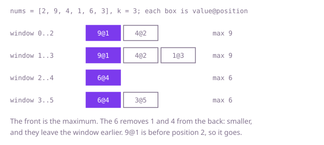

## The question

A window of `k` consecutive elements slides along an array one step at a time. For every position of the window, report the largest element inside it.

What makes it harder than it looks: windows overlap almost completely, yet the obvious code rescans all `k` elements for each one. With a million elements and `k` near half a million, that is hundreds of billions of comparisons. Tracking only the current maximum fails too, because when it leaves the window you need the next largest, and you did not keep it.

## How to think about it

The first idea is to take the maximum of each window by scanning it. It repeats a lot, since consecutive windows share `k - 1` elements. A better memory is a heap of everything in the window: the top is the maximum, and an element that has left the window can be thrown away lazily, only when it reaches the top. That costs a logarithm per element. Look at what the heap keeps that it never needs: when a larger element arrives, every smaller element before it can never be a maximum again, because it will leave the window before the larger one does. So only a decreasing line of candidates matters. Keep positions in a deque, values falling from front to back. A new element removes every smaller candidate from the back, then joins the back. The front is the maximum; it leaves from the front when its position falls out of the window.

Walk Example 1, `nums = [2, 9, 4, 1, 6, 3]`, `k = 3`. Read 2: the deque holds 2. Read 9: 2 is smaller, so it goes, and the deque holds 9. Read 4: 9 is bigger, so 4 joins behind it; the first window is full and the front is 9. Read 1: it joins behind 4 and the front is still 9. Read 6: it removes 1 and 4 from the back; the front, 9 at position 1, is outside the window that starts at position 2 and leaves; the deque holds 6 and the front is 6. Read 3: it joins behind 6 and the front is 6. The answers are `[9, 9, 6, 6]`.



## Brute force

For each window, scan its `k` elements for the largest. It is what you say first, and it fixes the answer every faster version must agree with. It is correct because it looks at every element of every window, so it cannot miss the maximum.

```java
static int[] maxima(int[] nums, int k) {
    int[] result = new int[nums.length - k + 1];
    for (int start = 0; start < result.length; start++) {
        int best = nums[start];
        for (int i = start + 1; i < start + k; i++) { // rescan the whole window
            if (nums[i] > best) {
                best = nums[i];
            }
        }
        result[start] = best;
    }
    return result;
}
```

**Complexity:** time O(n * k) for n elements, extra space O(1) beyond the result array.

## Better: a max-heap with lazy removal

Push each element with its position into a max-heap. Once the first window is full, look at the top: while its position is outside the window, discard it, and then the top is the maximum. Elements that left the window but sit below the top stay in the heap until they surface, which is harmless because they are never read before they are discarded.

```java
static int[] maxima(int[] nums, int k) {
    int[] result = new int[nums.length - k + 1];
    // each entry is {value, position}; the largest value is on top
    PriorityQueue<int[]> heap = new PriorityQueue<>((a, b) -> Integer.compare(b[0], a[0]));
    for (int i = 0; i < nums.length; i++) {
        heap.add(new int[] {nums[i], i});
        if (i >= k - 1) {
            while (heap.peek()[1] <= i - k) {
                heap.poll(); // the top left the window: discard it now, the rest later
            }
            result[i - k + 1] = heap.peek()[0];
        }
    }
    return result;
}
```

**Complexity:** time O(n log n), extra space O(n) (the heap can hold every element), beyond the result array.

**Prefer it when:** the window is not a simple slide, for example when elements leave in an order other than arrival. The heap asks only for the largest element and a test of whether it is still in range; the code shown fixes the range at the last `k` positions, and that test is the line to change.

## Optimal: a deque of decreasing candidates

Keep a deque of positions whose values decrease from front to back. For each new element, remove from the back every position whose value is not larger than the new one (they can never win again), then add the new position at the back. If the front position is now outside the window, remove it from the front. Once the first window is full, the front is the maximum. Removing values equal to the new one is deliberate: the newer copy leaves later, so it dominates. This is the reference solution.

```java
static int[] maxima(int[] nums, int k) {
    int n = nums.length;
    int[] result = new int[n - k + 1];
    int[] deque = new int[n]; // positions; values decrease from front to back
    int front = 0;
    int back = 0; // the deque holds deque[front .. back - 1]
    for (int i = 0; i < n; i++) {
        while (back > front && nums[deque[back - 1]] <= nums[i]) {
            back--; // smaller or equal values before a new one can never win again
        }
        deque[back++] = i;
        if (deque[front] <= i - k) {
            front++; // the front left the window
        }
        if (i >= k - 1) {
            result[i - k + 1] = nums[deque[front]]; // the front is the window maximum
        }
    }
    return result;
}
```

**Complexity:** time O(n), extra space O(n) for the position array beyond the result array (a circular buffer of `k` slots would make it O(k)). Each position is added once and removed at most once, so the total work over all steps is at most 2n deque operations.

## Complexity

| Approach | Time | Extra space |
| --- | --- | --- |
| Brute force | O(n * k) | O(1) |
| Better: max-heap with lazy removal | O(n log n) | O(n) |
| Optimal: deque of decreasing candidates | O(n) | O(n) |

## Where it shows up

`rate-limiter-audit` uses the same sliding-window shape in `RateAudit.rejections`: it keeps the times of accepted requests in an `ArrayDeque`, drops from the front every time that has fallen out of the window (`accepted.peekFirst() <= at - windowMs`), and adds the new time at the back, so each time enters and leaves once and the whole replay is linear. It does not drop from the back, since every accepted time counts toward the limit, so it is a plain window queue rather than a decreasing one. Real-world uses of the decreasing version: the peak latency or load over the last minute of samples, the highest price over the last N ticks, or the loudest moment in a sliding stretch of an audio signal.

## Follow-up answers

**Why is each element pushed and popped at most once?** Every position is added to the deque exactly once, at the back. It can leave only once, either from the back when a larger element arrives or from the front when it leaves the window. The inner loop looks like it could be slow, but its total number of iterations over the whole run is bounded by the number of elements added, so the work is at most about 2n deque operations.

**How would you solve it with a heap, and what does that cost?** Push every element with its position into a max-heap, and before reading the top discard it while its position is outside the window. That is the Better solution: O(n log n) time and O(n) space, because the heap can hold elements that have left the window until they reach the top.

**What changes if you need the minimum, or the median, of each window?** The minimum is the same code with the comparison flipped, so the deque holds increasing values and the front is the smallest. The median has no such shortcut: use two heaps with lazy deletion, or a balanced tree or sorted structure from which you can remove a given element, at O(log k) per step.
