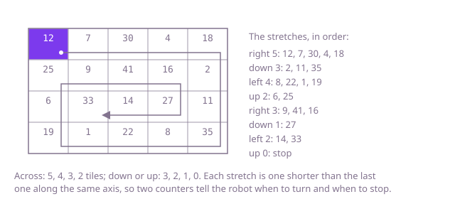

## The question

Given a rectangular floor as an `m x n` grid of dust readings, list the readings in the order a robot vacuum cleans the tiles: right along the top row from the top-left tile, and a clockwise turn whenever the next tile is off the floor or already cleaned. Every tile is cleaned exactly once, so the list has `m × n` readings, and `grid` must be the same when the method returns.

What makes it harder than it looks is the end of the walk. Once the outer rings are used up, what is left in the middle may be a single row or a single column rather than a ring. A walk written ring by ring, four sides at a time, then goes along that row and comes straight back over it, listing its tiles twice. The other slip is remembering the cleaned tiles by writing a marker into `grid`, which changes the caller's floor.

## How to think about it

The statement already describes an algorithm: walk with a direction, and before each step check whether the next tile is off the floor or cleaned. That needs a record of the cleaned tiles, one flag per tile. To drop it, look at the straight stretches the robot walks. On Example 1, a floor 4 rows by 5 columns, the robot goes 5 tiles right, 3 down, 4 left, 2 up, 3 right, 1 down and 2 left, and then the next stretch, up, would be 0 tiles long, so it stops.

The horizontal stretches run 5, 4, 3, 2, and the vertical ones 3, 2, 1, 0. Each stretch is one tile shorter than the previous one along the same axis, because the stretch in between used up one row or one column. So the robot only needs two counters: how long the next horizontal stretch is, starting at `n`, and how long the next vertical one is, starting at `m - 1` (the first tile of the right-hand column was cleaned on the top row). Walk a stretch, shorten its counter by one, turn, and stop when the stretch you are about to walk has length 0.



The leftover row or column needs no special case in this form. On a floor of 3 rows and 5 columns, the robot walks right 5, down 2, left 4, up 1, and then right 3 along the middle row; the next stretch, down, has length 0, so it stops there instead of coming back.

## Brute force

Do exactly what the statement says. Keep a `cleaned` flag for every tile in a separate array, walk with a direction, and turn clockwise whenever the next tile is off the floor or already cleaned. It is what you say first, because it is the statement turned into code, and it gets the leftover row and column right without thinking about them: the turn after the row is used up faces a cleaned tile, and so does the one after it. Since the walk takes exactly `m × n` steps, there is no need to detect the end.

```java
static List<Integer> spiralOrder(int[][] grid) {
    int m = grid.length;
    int n = grid[0].length;
    boolean[][] cleaned = new boolean[m][n]; // a separate record, so grid is not changed
    int[] dr = {0, 1, 0, -1}; // right, down, left, up
    int[] dc = {1, 0, -1, 0};
    List<Integer> order = new ArrayList<>(m * n);
    int r = 0;
    int c = 0;
    int d = 0;
    for (int i = 0; i < m * n; i++) {
        order.add(grid[r][c]);
        cleaned[r][c] = true;
        int nr = r + dr[d];
        int nc = c + dc[d];
        if (nr < 0 || nr >= m || nc < 0 || nc >= n || cleaned[nr][nc]) {
            d = (d + 1) % 4; // one clockwise turn always finds the next tile
            nr = r + dr[d];
            nc = c + dc[d];
        }
        r = nr;
        c = nc;
    }
    return order;
}
```

**Complexity:** time O(m × n), extra space O(m × n) for the flags.

## Better: four boundaries, ring by ring

Keep the rows and columns that are not used up yet as four boundaries, `top`, `bottom`, `left` and `right`. While they enclose at least one tile, walk the ring they describe: the top row left to right, the right column down, the bottom row right to left and the left column up. Then move all four boundaries one step in. The bottom and left sides need a guard. When the ring is a single row (`top == bottom`) or a single column (`left == right`), the first two sides have already listed all its tiles, and walking the other two would list them again.

```java
static List<Integer> spiralOrder(int[][] grid) {
    int top = 0;
    int bottom = grid.length - 1;
    int left = 0;
    int right = grid[0].length - 1;
    List<Integer> order = new ArrayList<>(grid.length * grid[0].length);
    while (top <= bottom && left <= right) {
        for (int c = left; c <= right; c++) {
            order.add(grid[top][c]); // the top row, left to right
        }
        for (int r = top + 1; r <= bottom; r++) {
            order.add(grid[r][right]); // the right column, down
        }
        if (top < bottom && left < right) { // a ring one row or one column thick has no way back
            for (int c = right - 1; c >= left; c--) {
                order.add(grid[bottom][c]); // the bottom row, right to left
            }
            for (int r = bottom - 1; r > top; r--) {
                order.add(grid[r][left]); // the left column, up
            }
        }
        top++;
        bottom--;
        left++;
        right--;
    }
    return order;
}
```

**Complexity:** time O(m × n), extra space O(1) besides the list that is returned.

**Prefer it when:** the work is about the rings themselves, such as turning each ring of a grid by one place or adding up each ring. The four boundaries name the ring you are on, which the stretch counters do not.

## Optimal: shrinking stretches

Walk stretch by stretch with two counters, one for the next horizontal stretch and one for the next vertical one. Start one step to the left of the top-left tile, facing right, with the counters at `n` and `m - 1`. Walk the stretch for the current direction, shorten that counter by one, turn clockwise, and stop when the next stretch has length 0. There is no record of cleaned tiles and no guard for the leftover row or column: the counters reach 0 exactly when the floor is used up. This is the reference solution.

```java
static List<Integer> spiralOrder(int[][] grid) {
    int m = grid.length;
    int n = grid[0].length;
    int[] dr = {0, 1, 0, -1}; // right, down, left, up
    int[] dc = {1, 0, -1, 0};
    int[] legs = {n, m - 1}; // tiles on the next horizontal and the next vertical stretch
    List<Integer> order = new ArrayList<>(m * n);
    int r = 0;
    int c = -1; // one step left of the first tile
    for (int d = 0; legs[d % 2] > 0; d = (d + 1) % 4) {
        for (int step = 0; step < legs[d % 2]; step++) {
            r += dr[d];
            c += dc[d];
            order.add(grid[r][c]);
        }
        legs[d % 2]--; // the next stretch along this axis is one tile shorter
    }
    return order;
}
```

**Complexity:** time O(m × n), extra space O(1) besides the list that is returned. It does the same work as the Better version with one loop and no special case.

## Complexity

| Approach | Time | Extra space |
| --- | --- | --- |
| Brute force: walk and remember the cleaned tiles | O(m × n) | O(m × n) |
| Better: four boundaries, ring by ring | O(m × n) | O(1) |
| Optimal: shrinking stretches | O(m × n) | O(1) |

## Where it shows up

No coding-round problem is linked to this question. A spiral over a grid is the path of a robot vacuum or a robot mower that covers a room from the walls inwards, and of a drill or a printer head that clears a pocket from its edge to its centre. Reading a grid ring by ring is also how a picture's border is processed before its inside, and the stretch counters are the same trick as an expanding-square search pattern, run backwards.

## Follow-up answers

**How would you produce the spiral one reading at a time, for a caller that may stop early?** Turn the Optimal walk into an `Iterator<Integer>`. Keep its state in fields: the position, the direction, the two stretch counters and the steps left on the current stretch. `next()` takes one step, and when the stretch is used up it shortens that axis's counter and turns; `hasNext()` is true while the current stretch has steps left. Each reading costs O(1) time and the iterator holds O(1) state, so a caller that stops after `k` readings pays for `k` steps, not for the whole floor.

**How would you write the numbers 1 to m × n into an empty grid in spiral order?** Run the same walk and write instead of reading: keep a counter, and at each step do `grid[r][c] = ++k`. The stretch lengths do not depend on the values, so the Optimal loop works unchanged, and so does the Brute force, testing for an empty cell (0) instead of a flag.

**What if the robot spiralled anticlockwise, going down the left-hand column first?** Change the order of the directions to down, right, up, left, and start the counters at `m` for the first stretch, now vertical, and `n - 1` for the next one, horizontal, starting one step above the top-left tile. Equivalently, the anticlockwise spiral of `grid` is the clockwise spiral of `grid` mirrored across its main diagonal.
