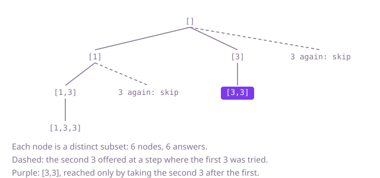

## The question

Given an array that may repeat values, list every distinct subset once, where two subsets are the same if they hold the same values the same number of times. The order of the subsets, and inside them, does not matter.

What makes it harder than it looks is that the plain subset search treats equal values at different positions as different, so `[3]` comes out once per copy of 3. Cleaning up afterwards with a set gives the right answer, but the work is still 2^n: 24 values made of three kinds have 16.7 million choices of positions and only 729 distinct subsets. The usual fix, skipping a value equal to the one before it, only works after sorting, and only when the skip is limited to the same step of the search.

## How to think about it

The first idea is to list every choice of positions, as in Subsets, sort each result and keep it in a set. It is correct and fixes the answer to compare against, but it spends almost all its time rebuilding subsets it already has.

What decides a distinct subset is how many copies of each value it takes. So build subsets in a way that can only make each count once. Sort the array so equal values sit together, then grow a subset by choosing which value comes next, from the current position on. At one step, choosing the first 3 or the second 3 as the next value leads to exactly the same subsets, so try only the first copy and skip the rest. Taking the second 3 after the first is still allowed: that happens one step deeper, where it is the first choice offered. Every node of this search is a distinct subset, so the work follows the size of the answer, not 2^n.

Walk Example 1, `nums = [3, 1, 3]`, sorted to `[1, 3, 3]`. Save `[]`. Next value 1: save `[1]`; then 3: save `[1, 3]`; then the second 3: save `[1, 3, 3]`. Back at `[1]`, the second 3 is equal to the 3 just tried at this step, so skip it. Back at `[]`, next value 3: save `[3]`; then the second 3: save `[3, 3]`. Back at `[]`, the second 3 is skipped. Six saves, six distinct subsets.



## Brute force

Sort a copy, run through every choice of positions with a bitmask, and add each resulting list to a set. It comes first because it reuses the plain subset listing and needs no new idea, and it fixes the answer the faster versions must agree with. It is correct because every distinct subset comes from at least one choice of positions, and on the sorted copy equal subsets are equal lists, so the set keeps each once. With `n <= 24` the shift `1 << n` does not overflow.

```java
static List<List<Integer>> all(int[] nums) {
    int[] sorted = nums.clone();
    Arrays.sort(sorted); // equal subsets then come out as equal lists
    Set<List<Integer>> seen = new LinkedHashSet<>();
    for (int mask = 0; mask < (1 << sorted.length); mask++) { // every choice of positions
        List<Integer> subset = new ArrayList<>();
        for (int i = 0; i < sorted.length; i++) {
            if ((mask & (1 << i)) != 0) {
                subset.add(sorted[i]);
            }
        }
        seen.add(subset); // a repeat of a subset already seen is dropped here
    }
    return new ArrayList<>(seen);
}
```

**Complexity:** time O(n · 2^n) average, whatever the number of distinct subsets; worse if many lists share a hash bucket (a `List` is not `Comparable`, so a treeified bucket is still scanned in O(S) for S stored subsets). Extra space O(n) for the list being built plus the set, which holds every distinct subset.

## Better: choose a count for each distinct value

Count the copies of each value, then recurse over the distinct values: for a value with c copies, take 0, 1, …, c of them and go on to the next value. Each distinct subset is one choice of counts, so each is built exactly once, and nothing needs sorting by position or removing.

```java
static List<List<Integer>> all(int[] nums) {
    TreeMap<Integer, Integer> copies = new TreeMap<>();
    for (int v : nums) {
        copies.merge(v, 1, Integer::sum);
    }
    List<Map.Entry<Integer, Integer>> groups = new ArrayList<>(copies.entrySet());
    List<List<Integer>> result = new ArrayList<>();
    take(groups, 0, new ArrayList<>(), result);
    return result;
}

// Chooses how many copies of groups[g] onward go into chosen.
private static void take(List<Map.Entry<Integer, Integer>> groups, int g, List<Integer> chosen, List<List<Integer>> result) {
    if (g == groups.size()) {
        result.add(new ArrayList<>(chosen));
        return;
    }
    int value = groups.get(g).getKey();
    int count = groups.get(g).getValue();
    take(groups, g + 1, chosen, result); // no copy of this value
    for (int k = 1; k <= count; k++) {
        chosen.add(value); // k copies
        take(groups, g + 1, chosen, result);
    }
    for (int k = 1; k <= count; k++) {
        chosen.remove(chosen.size() - 1);
    }
}
```

**Complexity:** time O(n log n) to count plus O(n · S) for the search, where S is the number of distinct subsets; extra space O(n) for the counts, the working list and a recursion depth of at most n distinct values, beyond the output.

**Prefer it when:** the input already comes as values with counts, such as stock levels per item; the search then never touches individual copies.

## Optimal: sort and skip equal values at the same step

Sort a copy. Save the current subset, then try each later position as the next value, skipping any value equal to the one just before it at this same step. This is the reference solution.

```java
static List<List<Integer>> all(int[] nums) {
    int[] sorted = nums.clone();
    Arrays.sort(sorted); // equal values side by side, so a repeat is the value just before
    List<List<Integer>> result = new ArrayList<>();
    extend(sorted, 0, new ArrayList<>(), result);
    return result;
}

// chosen is one distinct subset; extends it with one more value from sorted[start] onward.
private static void extend(int[] sorted, int start, List<Integer> chosen, List<List<Integer>> result) {
    result.add(new ArrayList<>(chosen));
    for (int i = start; i < sorted.length; i++) {
        if (i > start && sorted[i] == sorted[i - 1]) {
            continue; // the same value in the same slot would rebuild subsets already listed
        }
        chosen.add(sorted[i]);
        extend(sorted, i + 1, chosen, result);
        chosen.remove(chosen.size() - 1);
    }
}
```

**Complexity:** time O(n log n) to sort plus O(n · S), where S is the number of distinct subsets, since every node of the search saves one; extra space O(n) for the sorted copy, the working list and a recursion depth of at most n, beyond the output. At `n <= 24` the depth is no risk.

## Complexity

| Approach | Time | Extra space (beyond the output) |
| --- | --- | --- |
| Brute force: every choice of positions, then a set | O(n · 2^n) average, worse with crowded hash buckets | O(n) plus the set of all distinct subsets |
| Better: a count per distinct value | O(n log n + n · S) | O(n) |
| Optimal: sort, skip equal values at the same step | O(n log n + n · S) | O(n), recursion depth up to n |

Here S is the number of distinct subsets, at most 5,000 by the constraints, against 2^n choices of positions.

## Where it shows up

No coding-round problem is linked to this question. Distinct selections from a multiset come up when listing the different baskets that can be built from stock with repeated items, the different hands from a deck with repeated cards, or the different test configurations when several options share a setting. The skip-equal-values-at-one-step rule is the general tool for removing repeats from any backtracking search over sorted input.

## Follow-up answers

**Can the running time depend on the number of distinct subsets rather than on 2^n?** Yes, and both the Better and the Optimal versions do: every node they visit is a distinct subset, so after the O(n log n) sort or count they cost O(n) per answer. The brute force cannot, because it looks at every choice of positions before throwing repeats away.

**How would you count the distinct subsets without listing them?** Each value with c copies contributes c + 1 choices, 0 to c copies, independently of the others, so the count is the product of (c + 1) over the distinct values. Counting copies with a map takes O(n) average time.

**How would you list only the distinct subsets whose values add up to a given target?** Run the same sorted search and save a subset only when its sum equals the target. With only positive values, the search can also stop a branch, and the rest of that loop, as soon as the next value would pass the target; that is the question Combination Sum II.
