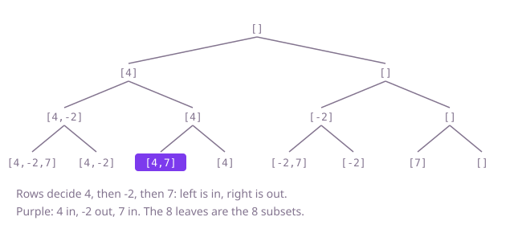

## The question

Given an array of distinct numbers, list every subset of it exactly once, from the empty subset to the whole array. The order of the subsets, and of the values inside each, does not matter.

What makes it harder than it looks is not speed, since the answer itself has 2^n entries and no method can beat writing them down, but bookkeeping. The empty subset is easy to forget, and an empty array must return one empty subset, not nothing. The usual recursive code builds every subset in one shared list, and adding that list to the result without copying it leaves every entry pointing at the same list, which ends up empty.

## How to think about it

Every value is either in a subset or out of it, independently of the others, so n values give 2 × 2 × … × 2 = 2^n subsets, and each subset is one string of n in-or-out choices. The first idea follows directly: count from 0 to 2^n − 1 and read each number's bits as those choices. That is correct and as fast as anything can be, and it fixes the answer to compare against.

The step worth learning is to make the choices one value at a time instead. The answer for the first k values, doubled by adding value k + 1 to a copy of each, is the answer for k + 1 values; that gives an iterative version with no bit tricks. Written as a recursion, the same choices form a tree: each level decides one value, left for in and right for out, and each leaf is one finished subset. Walking that tree depth-first needs only one working list: add the value before going left, take it back before going right, and save a copy at each leaf. That walk is the backtracking template, and it is the version to know, because the rest of this group (sums, repeats, orderings) only changes which branches it walks.

Walk Example 1, `nums = [4, -2, 7]`. Start with `[]`. Take 4: `[4]`. Take -2: `[4, -2]`. Take 7: leaf `[4, -2, 7]`. Back out of 7: leaf `[4, -2]`. Back out of -2, then take 7: leaf `[4, 7]`; skip it: leaf `[4]`. Back out of 4 and repeat on the right: `[-2, 7]`, `[-2]`, `[7]`, `[]`. Eight leaves, eight subsets.



## Brute force

Count from 0 to 2^n − 1 and treat bit i of the count as "value i is in". It is what you say first because it is the definition of a subset written as code, and it fixes the answer the other versions must agree with. It is correct because the 2^n numbers are exactly the 2^n strings of in-or-out choices, each once. With `n <= 12` the shift `1 << n` cannot overflow.

```java
static List<List<Integer>> all(int[] nums) {
    int n = nums.length;
    List<List<Integer>> result = new ArrayList<>();
    for (int mask = 0; mask < (1 << n); mask++) { // one mask per subset; mask 0 is the empty one
        List<Integer> subset = new ArrayList<>();
        for (int i = 0; i < n; i++) {
            if ((mask & (1 << i)) != 0) { // bit i set: nums[i] is in
                subset.add(nums[i]);
            }
        }
        result.add(subset);
    }
    return result;
}
```

**Complexity:** time O(n · 2^n), extra space O(n) for the subset being built, beyond the output.

## Better: grow the list one value at a time

Start with the answer for no values, a list holding the empty subset. For each value, copy every subset you have so far, add the value to the copy, and append it. After the last value the list holds every subset. It drops the bit arithmetic and builds each new subset from an existing one instead of from scratch.

```java
static List<List<Integer>> all(int[] nums) {
    List<List<Integer>> result = new ArrayList<>();
    result.add(new ArrayList<>()); // the subsets of no values: just the empty one
    for (int value : nums) {
        int before = result.size(); // only the subsets that existed before this value
        for (int k = 0; k < before; k++) {
            List<Integer> grown = new ArrayList<>(result.get(k));
            grown.add(value);
            result.add(grown);
        }
    }
    return result;
}
```

**Complexity:** time O(n · 2^n), extra space O(1) beyond the output.

**Prefer it when:** you want no recursion and no bit limits at all; it works the same for any n that fits in memory, where the bitmask needs a wider type past 31 values.

## Optimal: backtracking over in-or-out choices

Decide the values in order. At each value, add it to the working list and recurse, then remove it and recurse again. When every value is decided, save a copy of the working list. This is the reference solution. It costs the same as the two above, because nothing can cost less than the output, but it is the shape that the harder questions of this group extend: stop a branch early when it cannot lead to an answer, or skip a branch that would repeat one.

```java
static List<List<Integer>> all(int[] nums) {
    List<List<Integer>> result = new ArrayList<>();
    decide(nums, 0, new ArrayList<>(), result);
    return result;
}

// Decides in or out for nums[i] onward; chosen holds the values taken so far.
private static void decide(int[] nums, int i, List<Integer> chosen, List<List<Integer>> result) {
    if (i == nums.length) {
        result.add(new ArrayList<>(chosen)); // a copy: chosen keeps changing after this
        return;
    }
    chosen.add(nums[i]); // nums[i] in
    decide(nums, i + 1, chosen, result);
    chosen.remove(chosen.size() - 1); // take it back, then nums[i] out
    decide(nums, i + 1, chosen, result);
}
```

**Complexity:** time O(n · 2^n), extra space O(n) for the working list and a recursion depth of n beyond the output; at `n <= 12` the depth is no risk.

## Complexity

| Approach | Time | Extra space (beyond the output) |
| --- | --- | --- |
| Brute force: bitmask | O(n · 2^n) | O(n) |
| Better: grow one value at a time | O(n · 2^n) | O(1) |
| Optimal: backtracking | O(n · 2^n) | O(n), recursion depth n |

## Where it shows up

No coding-round problem is linked to this question. Listing every subset is how small exhaustive searches start: trying every combination of feature flags in a test matrix, every set of optional add-ons when pricing a bundle, or every group of servers that could hold a quorum. Bitmask subsets also index dynamic programming over small sets, such as the shortest route that visits every one of a dozen delivery stops.

## Follow-up answers

**How would you produce the subsets one at a time, without holding them all in memory?** Keep only a counter from 0 to 2^n − 1 and turn the current count into a subset when the caller asks for the next one, which is the bitmask version behind an `Iterator`. The backtracking version can do the same by handing each leaf to a callback instead of storing it. Either way the memory is O(n) and only the time grows with 2^n.

**How would you list only the subsets of exactly k values?** In the backtracking version, stop a branch as soon as it has taken k values, saving it, or as soon as there are too few values left to reach k. That walks only the branches that lead to the C(n, k) answers, instead of all 2^n leaves.

**What changes if the array may hold repeated values?** Two different choices of positions can then give the same subset, such as either of two equal values alone. Sort the array so equal values sit together, and when the backtracking leaves a value out, leave out its equal neighbours too, so each count of that value is chosen once; this is the question Subsets II.
