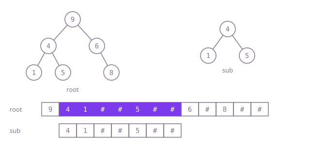

## The question

Given two binary trees, `root` and `sub`, decide whether some node of `root`, with everything below it, is identical to `sub`. A node whose subtree starts out like `sub` but has extra nodes underneath does not count.

What makes it harder than it looks: the obvious answer, "try an equality check at every node", is right but can be slow. When `root` and `sub` are long runs of the same value, every attempt walks a long way before the last node gives it away, and the cost grows towards n times m. And the classic speed-up, writing both trees as strings and searching, has two traps of its own: empty children must be marked, and values must be separated so that `2` is not found inside `12`.

## How to think about it

The first idea is to walk `root` and, at every node, check whether the subtree there equals `sub`. That is correct, because a match has to start at some node. What it repeats is the comparison itself: when `root` holds many long runs of the value `sub` is made of, an attempt starts at almost every node and each one walks up to m nodes before the last one gives it away.

Two observations cut that down. First, a subtree can only equal `sub` if it has the same number of nodes, and subtrees of the same size never overlap (neither can contain the other), so comparing only at nodes whose subtree size equals `sub`'s size costs O(n) in total. That version is short and needs only the call stack. Second, a tree written in preorder with a marker for every empty child is a sequence from which the tree can be rebuilt, and every subtree is a block of consecutive entries in it. So `sub` occurs in `root` exactly when `sub`'s sequence occurs as a block inside `root`'s sequence. Writing both trees out and searching with KMP, which never re-reads the text, gives O(n + m) whatever the values are, with nothing on the call stack.

Walk Example 1, `root = [9,4,6,null,7,2,8]` and `sub = [6,2,8]`. With `#` for an empty child, `root` writes as `9 4 # 7 # # 6 2 # # 8 # #` and `sub` as `6 2 # # 8 # #`. The seven tokens of `sub` appear in a row starting at the seventh token of `root`, which is the node 6, so the answer is `true`. In Example 2 the same spot reads `6 2 3 # # # 8 # #`: the 3 breaks the block, and nothing else starts with 6.



## Brute force

At every node of `root`, compare the subtree there with `sub`. It comes first because it is what you say first, and it fixes the answer to compare against. It is correct because a match has to start at some node of `root`, every node is tried, and the comparison checks every position, empty children included.

```java
static boolean isSubtree(TreeNode root, TreeNode sub) {
    if (root == null) {
        return false;
    }
    return same(root, sub) || isSubtree(root.left, sub) || isSubtree(root.right, sub); // a match starts at some node
}

private static boolean same(TreeNode a, TreeNode b) {
    if (a == null || b == null) {
        return a == b; // equal only when both are missing
    }
    return a.val == b.val && same(a.left, b.left) && same(a.right, b.right);
}
```

**Complexity:** time O(n·min(m, h)) for `root` of n nodes and depth h and `sub` of m nodes: each comparison stops within m nodes and within the size of the subtree it starts at, and those sizes add up to at most n·h; extra space O(h) for the call stack, at most about 1,000 frames here.

## Better: compare only where the sizes match

Compute subtree sizes bottom-up and compare with `sub` only at nodes whose size equals `sub`'s. A size of `-1` means "found" and is passed straight up.

```java
static boolean isSubtree(TreeNode root, TreeNode sub) {
    return sizeOrFound(root, sub, size(sub)) < 0;
}

private static int size(TreeNode node) {
    return node == null ? 0 : 1 + size(node.left) + size(node.right);
}

/** Returns the size of node's subtree, or -1 once a subtree of sub's size equals sub. */
private static int sizeOrFound(TreeNode node, TreeNode sub, int m) {
    if (node == null) {
        return 0;
    }
    int left = sizeOrFound(node.left, sub, m);
    if (left < 0) return -1;
    int right = sizeOrFound(node.right, sub, m);
    if (right < 0) return -1;
    int size = 1 + left + right;
    return size == m && same(node, sub) ? -1 : size; // only equal sizes can be equal trees
}

private static boolean same(TreeNode a, TreeNode b) {
    if (a == null || b == null) {
        return a == b;
    }
    return a.val == b.val && same(a.left, b.left) && same(a.right, b.right);
}
```

**Complexity:** time O(n + m): subtrees of size m never overlap, so all the comparisons together read at most n nodes of `root`; extra space O(h) for the call stack, where h is the depth, at most 1,000 frames here; a path of tens of thousands of nodes would overflow Java's default stack.

**Prefer it when:** memory is tight or the code should stay short. It needs no extra memory beyond the stack and is shorter than the optimal version.

## Optimal: write both in preorder and search with KMP

Write each tree as a sequence of int tokens in preorder, with a marker that no value can take for every empty child, using an explicit stack. Then search for `sub`'s sequence inside `root`'s with Knuth-Morris-Pratt: precompute, for each prefix of the pattern, the longest proper prefix that is also its suffix, and on a mismatch fall back to it instead of re-reading the text. This is the reference solution.

```java
private static final int MISSING = Integer.MIN_VALUE; // outside the value range: an empty child

static boolean isSubtree(TreeNode root, TreeNode sub) {
    int[] text = preorder(root);
    int[] pattern = preorder(sub);
    int[] border = new int[pattern.length]; // border[i]: longest proper prefix of pattern[0..i] that is also its suffix
    for (int i = 1, k = 0; i < pattern.length; i++) {
        while (k > 0 && pattern[i] != pattern[k]) k = border[k - 1];
        if (pattern[i] == pattern[k]) k++;
        border[i] = k;
    }
    for (int i = 0, k = 0; i < text.length; i++) {
        while (k > 0 && text[i] != pattern[k]) k = border[k - 1]; // fall back, never re-read text
        if (text[i] == pattern[k]) k++;
        if (k == pattern.length) return true;
    }
    return false;
}

private static int[] preorder(TreeNode root) {
    List<TreeNode> stack = new ArrayList<>(); // a list, because empty children are pushed as null
    stack.add(root);
    List<Integer> out = new ArrayList<>();
    while (!stack.isEmpty()) {
        TreeNode n = stack.remove(stack.size() - 1);
        if (n == null) {
            out.add(MISSING);
            continue;
        }
        out.add(n.val);
        stack.add(n.right); // pushed first, so the left side comes out first
        stack.add(n.left);
    }
    return out.stream().mapToInt(Integer::intValue).toArray();
}
```

Why a block match is a real subtree: `sub` is not empty, so its sequence starts with a value, and a block starting at a node's value reads exactly that node's subtree, since a preorder writing with markers is complete at one precise point and cannot stop early or run on. Int tokens keep values apart, so `2` can never match the end of `12`.

**Complexity:** time O(n + m): writing is linear, and KMP moves forward through the text once, with fall-backs paid for by earlier steps forward; extra space O(n + m) for the two token arrays and the border table, all on the heap, so any depth is fine.

## Complexity

| Approach | Time | Extra space |
| --- | --- | --- |
| Brute force | O(n·min(m, h)) | O(h) call stack |
| Better: compare only where the sizes match | O(n + m) | O(h) call stack, at most 1,000 frames here |
| Optimal: write both in preorder and search with KMP | O(n + m) | O(n + m) on the heap |

## Where it shows up

No coding-round problem is linked to this question. Finding one tree inside another is how a refactoring tool spots a repeated block of code (the same syntax subtree in two places), how a plagiarism checker compares program structure rather than text, and how a build cache recognises a subtree of files it has already processed. Turning a tree into a flat sequence and running a string search is the general trick behind all three.

## Follow-up answers

**When is comparing at every node really O(n·m), and when is it fast?** It is slow when many nodes of `root` start a long partial match, which needs long runs of equal values in matching shapes, like the broom in the tests: 100 bristles of 990 nodes of 3s, where almost every bristle node starts a comparison that runs to the bottom. The total is bounded by n·min(m, h), about 5 x 10^7 steps there, since each comparison stops within m nodes and within the subtree it starts at. On trees with varied values most comparisons fail at the first node or two, and it runs in close to O(n). The worst case is what makes it unsafe, not the typical one.

**Why must the written-out form mark empty children and separate the values?** Without markers, different shapes write the same sequence: 8 with a left child 1 and 8 with a right child 1 both read `8 1`, so a search finds matches that are not subtrees, and an extra node below a match can be hidden. Without separators, the text `12` contains `2`, and `-7` contains `7`. Int tokens with an out-of-range marker solve both; with strings, put a separator before every token, as in `,12,#,#`.

**How would you count how many times sub occurs inside root?** Keep searching after a match instead of returning: in KMP, after a full match set `k = border[k - 1]` and continue, counting matches. Each match starts at a different node, so the count is the number of occurrences. It is still O(n + m).
