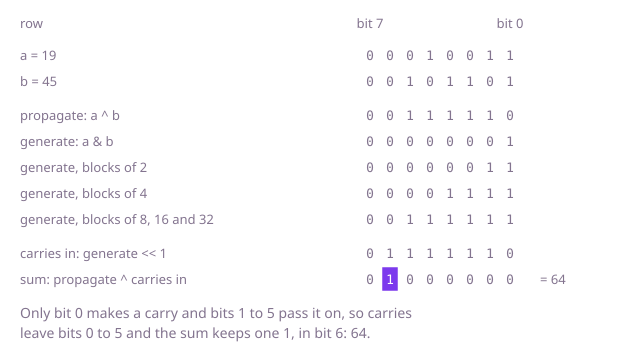

## The question

Add two `int`s without `+` or `-`, using only bitwise operations, and return what Java's `+` would, wrap-around included. Every pair of `int`s is a valid input, negative ones too.

What makes it harder than it looks: the carries. A carry made in one column can run through many columns before it stops, as in Example 1, where the carry made in bit 0 ends in bit 6. In a language whose integers have no fixed width, the usual carry loop can run forever when an operand is negative, as in -16 + 16, because the carry moves left without end; a Java `int` has 32 bits, a carry falls off bit 31, and the loop always ends. The slips that do bite in Java: testing `b > 0` instead of `b != 0`, which skips the loop when `b` is negative and stops early once a carry reaches bit 31, the sign bit; computing the carry from `a` after `a` has already become `a ^ b`; and a column-by-column loop that shifts the operands right until both are 0, which with `>>` never ends on a negative operand, since `-1 >> 1` is still -1, and with `>>>` drops a last carry that outlives both operands, as in Example 1. And `i++` is an addition too, so a loop over the 32 columns has to count some other way.

## How to think about it

The first idea is the paper method: go through the columns from bit 0 to bit 31, and in each one combine the two bits with the carry coming in. The sum bit is 1 when one or three of those three are 1, which is their XOR, and a carry goes out when at least two of them are 1. Keeping the current column as a one-bit mask, `bit`, and shifting it left until it falls off bit 31 gives exactly 32 columns without a counter. The carry out of bit 31 has no column to go to and is dropped, which is exactly Java's wrap-around, and two's complement needs nothing more for negative numbers: adding the patterns gives the pattern of the sum.

That is one column per step, but all 32 columns can go at once. `a ^ b` is every column's sum bit as if no carry came in, and `(a & b) << 1` moves each carry, made where both bits are 1, into the column to its left. What remains is to add those carries to the partial sum, which is the same problem again, so repeat until no carry is left. It ends because each round's lowest carry sits at least one column above the last round's, so within 32 rounds every carry has fallen off bit 31. But a carry that travels far costs a round for every column it moves into: Example 1 takes 7 rounds, the first one and then one each for the carry in bits 1 to 6, and -16 + 16, whose carry runs from bit 4 off the top, takes 28.

The last step is to work out every carry without waiting for it to travel. A column passes on a carry that comes in when exactly one of its bits is 1, which is `a ^ b`, called propagate, and makes a carry of its own when both are, which is `a & b`, called generate. Blocks of columns combine the same way: a carry leaves a block when its upper half makes one, or when its upper half passes on one that its lower half makes; and a block passes a carry through when both halves do. Starting from blocks of one column and doubling five times, to 2, 4, 8, 16 and 32, gives for every column whether a carry leaves it, made anywhere below. Shifted left by one, that is the carry into every column, and the sum is `(a ^ b) ^ (generate << 1)`.

Walk Example 1, 19 + 45, in eight bits: `a` is 00010011 and `b` is 00101101. Propagate, `a ^ b`, is 00111110, and generate, `a & b`, is 00000001: only bit 0 makes a carry. With blocks of 2, generate becomes 00000011; with blocks of 4, 00001111; with blocks of 8, 00111111; blocks of 16 and 32 add nothing. So carries leave bits 0 to 5, the carries coming in are 01111110, and the sum is 00111110 ^ 01111110 = 01000000, which is 64.



## Brute force

Add as on paper, from bit 0 to bit 31, with one carry bit moving up. It comes first because it is the method everyone learnt for adding by hand, and it fixes the answer the faster versions must agree with. It is correct because each column gets the sum bit and the carry that adding three bits gives, from bit 0 up, and dropping the carry out of bit 31 is exactly Java's wrap-around.

```java
static int add(int a, int b) {
    int sum = 0;
    int carry = 0; // the carry into the current column, kept at that column's position
    for (int bit = 1; bit != 0; bit <<= 1) { // 32 columns: the shift after bit 31 leaves 0
        int x = a & bit, y = b & bit; // this column of each operand, either 0 or bit
        sum |= x ^ y ^ carry; // the sum bit is 1 when one or three of them are 1
        carry = ((x & y) | (x & carry) | (y & carry)) << 1; // a carry when two or three are 1
    }
    return sum; // the carry out of bit 31 has no column to go to: that is the wrap-around
}
```

**Complexity:** time O(w), always w = 32 columns; extra space O(1).

## Better: add without carries, then add the carries

XOR gives the sum of every column without its carry, AND shifted left gives the carries, and the carries are added the same way until there are none.

```java
static int add(int a, int b) {
    while (b != 0) { // b holds the carries still to be added
        int carry = (a & b) << 1; // a column where both have a 1 sends a carry one column left
        a ^= b; // each column's sum bit, ignoring the carries
        b = carry;
    }
    return a;
}
```

**Complexity:** time O(w) rounds in the worst case, up to w = 32, more the farther a carry travels; extra space O(1).

**Prefer it when:** the carries are short, as they are for most pairs: it stops as soon as no carry is left, after one round when `a` and `b` have no 1 bit in common, where the Optimal always does all five rounds. It is also four lines that are easy to argue for in an interview.

## Optimal: every carry at once, by doubling blocks

Compute generate and propagate for single columns, then double the blocks five times. In each round the generate line uses the propagate of the blocks before the doubling, so it has to come before that round's propagate line; and the final shift by one moves each carry from the column it leaves to the column it enters. This is the reference solution.

```java
static int add(int a, int b) {
    int generate = a & b; // columns that make a carry on their own
    int propagate = a ^ b; // columns that pass on a carry coming in from below
    // double the blocks from 1 column to 2, 4, 8, 16 and 32: each generate line must use
    // the propagate of the blocks before this round's doubling, so it comes first
    generate |= propagate & (generate << 1);
    propagate &= propagate << 1;
    generate |= propagate & (generate << 2);
    propagate &= propagate << 2;
    generate |= propagate & (generate << 4);
    propagate &= propagate << 4;
    generate |= propagate & (generate << 8);
    propagate &= propagate << 8;
    generate |= propagate & (generate << 16); // now: a carry leaves this column
    return (a ^ b) ^ (generate << 1); // the carry out of each column goes into the next
}
```

All five rounds are needed: after four, generate looks only 16 columns down, too few for Example 3, where the carry that reaches bit 31 is made in bit 8 and leaves every column from 8 to 30.

**Complexity:** time O(log w), five rounds whatever the operands; extra space O(1).

## Complexity

| Approach | Time | Extra space |
| --- | --- | --- |
| Brute force: column by column | O(w), always w = 32 columns | O(1) |
| Better: add without carries, then add the carries | O(w) rounds worst case, up to 32 | O(1) |
| Optimal: every carry at once, by doubling blocks | O(log w), five rounds | O(1) |

## Where it shows up

No coding-round problem is linked to this question. These are the adders inside a processor. The column-by-column loop is a ripple-carry adder, in which each column waits for the carry from the one below, so its delay grows with the width; fast adders compute every carry at once from the same generate and propagate signals with a parallel-prefix network, and the Optimal's doubling spans are those of the Kogge–Stone adder. The same doubling computes running totals of an array in log n rounds of parallel steps, the Hillis–Steele scan, one of the ways prefix sums are computed on GPUs.

## Follow-up answers

**Can you do it in the same small number of steps for every pair, even when a carry has to run through all 32 bits?** Yes: the Optimal finds every carry in five rounds of doubling blocks, whatever the operands, where the carry loop of the Better takes more rounds the farther a carry travels, 32 when a carry made in bit 0 runs off the top.

**How would you subtract `b` from `a` under the same rule?** In two's complement the negation of `b` is `~b` plus 1, so `a - b` is `add(a, add(~b, 1))`; for `b = Integer.MIN_VALUE` that negation is `Integer.MIN_VALUE` again, and the result still matches Java's `-`, which wraps the same way. Or run the loop with borrows instead of carries: `a ^ b` is each column's difference, and `(~a & b) << 1` puts a borrow one column left of every column where `a` has a 0 and `b` a 1; repeat until no borrow is left.

**How would you multiply two `int`s without `*`, `+` or `-`?** Shift and add: for each 1 bit of `b`, add `a` shifted left to that bit's position, with the adder above. Walk the bits of `b` with `>>>`, so that a negative `b` runs out after 32 steps instead of never reaching 0. The result wraps around exactly as Java's `*` does, negative operands included, because the low 32 bits of a product are the same whether the operands are read as signed or unsigned. That is at most 32 additions.
