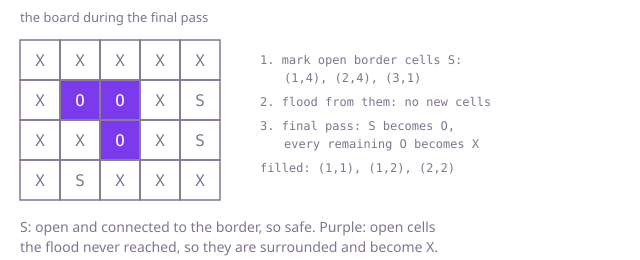

## The question

Given a board of `X` and `O` cells, fill with `X` every region of side-connected `O` cells that has no cell on the border of the board, and leave every other cell as it is. The change is made in place.

What makes it harder than it looks is deciding a cell by its whole region. A cell's own neighbours say nothing: an open cell deep inside the board is safe if a long winding path of open cells leads from it to the border. Checking that separately for each cell is correct but searches a big enclosed region once per cell. And only sides connect: an open cell that touches an open border cell at a corner is still surrounded.

## How to think about it

The first idea is to take each open cell and search its region for a border cell; if none turns up, the cell is surrounded. It is correct and it is what you say first, but every cell of a region repeats the same search, so an enclosed region of 40,000 cells costs about 40,000 squared steps.

The next step is to search each region once: when the scan meets an open cell that no search has visited, flood its region, collect its cells and note whether any is on the border; fill the collected cells if none was. Every cell is visited once, so this is linear.

The neater view turns the question around. A region is safe exactly when it contains an open border cell, so start from the open border cells and flood inwards, marking everything reached as safe. Whatever open cell is left unmarked afterwards is surrounded. No region needs to be collected, and the safe mark can live in the board itself as a third character, which a final pass turns back into `O` while turning the unmarked `O` cells into `X`. The flood can recurse, but on an all-open 200 by 200 board a depth-first search from the border chains through all 40,000 cells and overflows the call stack; an explicit stack does not.

Walk Example 1, `["XXXXX", "XOOXO", "XXOXO", "XOXXX"]`. The open border cells are (1,4), (2,4) and (3,1). The flood from (1,4) and (2,4) reaches only each other, and (3,1) has no open neighbour. So three cells are marked safe. The final pass finds (1,1), (1,2) and (2,2) still open and unmarked and fills them, and turns the three safe cells back into `O`.



## Brute force

For every open cell, search its region breadth first for a cell on the border, with a fresh visited grid. Record the cells whose search fails, and fill them only after all cells are decided. It comes first because it applies the definition cell by cell, and it fixes the answer the faster versions must agree with. It is correct because each search explores the cell's whole region unless it finds a border cell first.

```java
static void surround(char[][] board) {
    int rows = board.length;
    int cols = board[0].length;
    boolean[][] surrounded = new boolean[rows][cols];
    for (int r = 0; r < rows; r++) {
        for (int c = 0; c < cols; c++) {
            if (board[r][c] == 'O') {
                surrounded[r][c] = !reachesBorder(board, r, c); // a fresh search from every open cell
            }
        }
    }
    for (int r = 0; r < rows; r++) { // change the board only after every cell has been decided
        for (int c = 0; c < cols; c++) {
            if (surrounded[r][c]) {
                board[r][c] = 'X';
            }
        }
    }
}

// Searches the open cells connected to (r, c) until one on the border turns up.
private static boolean reachesBorder(char[][] board, int r, int c) {
    int rows = board.length;
    int cols = board[0].length;
    boolean[][] seen = new boolean[rows][cols];
    ArrayDeque<int[]> queue = new ArrayDeque<>();
    queue.add(new int[] {r, c});
    seen[r][c] = true;
    int[][] steps = {{1, 0}, {-1, 0}, {0, 1}, {0, -1}};
    while (!queue.isEmpty()) {
        int[] cell = queue.poll();
        if (cell[0] == 0 || cell[1] == 0 || cell[0] == rows - 1 || cell[1] == cols - 1) {
            return true;
        }
        for (int[] step : steps) {
            int nr = cell[0] + step[0];
            int nc = cell[1] + step[1];
            if (!seen[nr][nc] && board[nr][nc] == 'O') { // in range: cell is not on the border
                seen[nr][nc] = true;
                queue.add(new int[] {nr, nc});
            }
        }
    }
    return false;
}
```

**Complexity:** time O((m × n)²) in the worst case for an m by n board, since each open cell may search a region of nearly m × n cells and clears a fresh visited grid; extra space O(m × n).

## Better: one flood per region

Scan the board; at an open cell no flood has visited yet, flood its region with a stack, collecting its cells and noting whether any lies on the border. If none does, fill the collected cells. Each region is flooded once.

```java
static void surround(char[][] board) {
    int rows = board.length;
    int cols = board[0].length;
    boolean[][] seen = new boolean[rows][cols];
    int[] region = new int[rows * cols]; // the cells of the current region; also its stack
    for (int r = 0; r < rows; r++) {
        for (int c = 0; c < cols; c++) {
            if (board[r][c] != 'O' || seen[r][c]) {
                continue;
            }
            int size = 0;
            int next = 0;
            region[size++] = r * cols + c;
            seen[r][c] = true;
            boolean touchesBorder = false;
            while (next < size) { // the array keeps every cell, so the region can be filled afterwards
                int cr = region[next] / cols;
                int cc = region[next++] % cols;
                touchesBorder |= cr == 0 || cc == 0 || cr == rows - 1 || cc == cols - 1;
                int[][] around = {{cr + 1, cc}, {cr - 1, cc}, {cr, cc + 1}, {cr, cc - 1}};
                for (int[] nb : around) {
                    if (nb[0] >= 0 && nb[1] >= 0 && nb[0] < rows && nb[1] < cols
                            && !seen[nb[0]][nb[1]] && board[nb[0]][nb[1]] == 'O') {
                        seen[nb[0]][nb[1]] = true;
                        region[size++] = nb[0] * cols + nb[1];
                    }
                }
            }
            for (int i = 0; !touchesBorder && i < size; i++) {
                board[region[i] / cols][region[i] % cols] = 'X'; // the whole region is surrounded
            }
        }
    }
}
```

**Complexity:** time O(m × n), since every cell joins one region once and is filled at most once; extra space O(m × n) for the visited grid and the region array, with no recursion.

**Prefer it when:** you need something per region as well, such as how many regions were filled or how large each was, since each region is in hand as a list of cells when it is decided.

## Optimal: flood inwards from the border, marking in place

Push every open border cell, marking it `S` for safe. Pop cells and push their open neighbours, marking them `S` as they are pushed. Then one pass turns `S` back into `O` and every remaining `O` into `X`. This is the reference solution.

```java
static void surround(char[][] board) {
    int rows = board.length;
    int cols = board[0].length;
    int[] stack = new int[rows * cols];
    int top = 0;
    for (int r = 0; r < rows; r++) {
        for (int c = 0; c < cols; c++) {
            if ((r == 0 || c == 0 || r == rows - 1 || c == cols - 1) && board[r][c] == 'O') {
                board[r][c] = 'S'; // safe: on the border
                stack[top++] = r * cols + c;
            }
        }
    }
    while (top > 0) { // spread "safe" from the border to every open cell connected to it
        int cell = stack[--top];
        int r = cell / cols;
        int c = cell % cols;
        if (r > 0) top = mark(board, stack, top, r - 1, c);
        if (r + 1 < rows) top = mark(board, stack, top, r + 1, c);
        if (c > 0) top = mark(board, stack, top, r, c - 1);
        if (c + 1 < cols) top = mark(board, stack, top, r, c + 1);
    }
    for (char[] row : board) {
        for (int c = 0; c < cols; c++) {
            row[c] = row[c] == 'S' ? 'O' : 'X'; // open and unmarked means surrounded
        }
    }
}

/** Marks an open cell safe and pushes it; returns the new stack size. */
private static int mark(char[][] board, int[] stack, int top, int r, int c) {
    if (board[r][c] == 'O') {
        board[r][c] = 'S'; // marked on push, so no cell is pushed twice
        stack[top++] = r * board[0].length + c;
    }
    return top;
}
```

**Complexity:** time O(m × n), since every cell is marked at most once and the final pass reads each cell once; extra space O(m × n) for the stack, and no visited grid because the marks live in the board.

## Complexity

| Approach | Time | Extra space |
| --- | --- | --- |
| Brute force: search from every open cell | O((m × n)²) worst case | O(m × n) |
| Better: one flood per region | O(m × n) | O(m × n) |
| Optimal: flood inwards from the border | O(m × n) | O(m × n) stack, no visited grid |

A recursive flood from the border has the same time but a recursion depth of up to m × n, which overflows the call stack on a 200 by 200 all-open board.

## Where it shows up

No coding-round problem is linked to this question. Flooding from the border to find what is enclosed is how a paint program fills the holes in a shape, how a board game such as Go finds stones with no path to an empty edge, and how a map tool finds lakes, the water cells with no connection to the sea.

## Follow-up answers

**Can you do it without a separate visited grid?** Yes, as the reference does: mark safe cells in the board with a third character while flooding from the border, then restore them in the final pass. The marks double as the visited set, so only the stack of pending cells is extra.

**What changes if diagonal neighbours also connect open cells?** Push eight neighbours instead of four in the flood. A region then reaches the border more easily, so fewer cells are filled; nothing else changes.

**How would you report how many regions were filled and how many cells each had?** Use the one-flood-per-region version: each region is decided with its cells collected, so when it is filled, record one more region and its size. The border flood does not see regions one at a time; it would need a second flood over the unmarked cells to count them.
