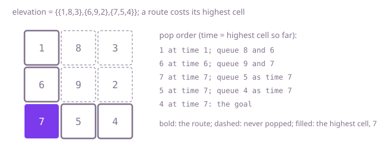

## The question

Water rises one unit per unit of time over a square grid of floor heights, and a swimmer may only be in cells already under water, moving freely between side-by-side ones. Return the earliest time the swimmer can get from the top-left corner to the bottom-right one.

What makes it harder than it looks is that time here is not distance. Moving is free, so a route is ready the moment its highest cell is covered, and the answer is the smallest "highest cell" over all routes, a minimax path rather than a shortest one. The route may wind left and up as well as right and down, so a grid DP that only moves right and down is wrong. And the grid has up to 90,000 cells with heights up to a million, so trying every time one by one is far too slow.

## How to think about it

The first idea follows the story: for t = 0, 1, 2, and so on, flood-fill from the start through the cells at most t and stop at the first t that reaches the goal. Nothing below the higher of the two corners can work, so start there. It is correct, and it repeats a whole flood fill for every time step, up to a million of them.

Reachability only gets easier as t grows: if the swimmer can cross at time t, they can at any later time. A yes/no question that flips once can be binary searched, so about 20 flood fills over the range of heights find the first t that works.

Dijkstra removes the guessing. Keep a region of cells the swimmer can reach and a priority queue of the cells bordering it, keyed by the time each would become reachable: the larger of its own height and the time of the cell it is reached from. Always add the bordering cell with the smallest time. No cell outside the region can be reached sooner, because any route to it leaves the region through a bordering cell whose time is at least as large. So the time at which the goal is popped is the answer.

Walk Example 1, `{{1,8,3},{6,9,2},{7,5,4}}`. Pop the start at time 1 and queue 8 and 6. Pop 6 at time 6 and queue 9 and 7. Pop 7 at time 7; its neighbour 5 is queued at time 7, since the swimmer needed 7 to get there. Pop 5 at 7, queue the goal 4 at 7, and pop it: the answer is 7, and the 8 and 9 were never needed.



## Brute force

Try each time in turn, starting from the higher corner, and flood-fill to see whether the goal is reached. It comes first because it is the story played out, and it fixes the answers to compare against. It is correct because the first time at which a flood fill reaches the goal is, by definition, the earliest crossing.

```java
static int earliestCrossing(int[][] elevation) {
    int n = elevation.length;
    // nothing earlier can work: both corners must be under water
    for (int t = Math.max(elevation[0][0], elevation[n - 1][n - 1]); ; t++) {
        if (canCross(elevation, t)) {
            return t;
        }
    }
}

private static final int[][] SIDES = {{1, 0}, {-1, 0}, {0, 1}, {0, -1}};

/** Breadth-first search through the cells under water at time t. */
private static boolean canCross(int[][] elevation, int t) {
    int n = elevation.length;
    boolean[][] seen = new boolean[n][n];
    int[] queue = new int[n * n]; // cells as row * n + column
    int head = 0;
    int tail = 0;
    queue[tail++] = 0;
    seen[0][0] = true;
    while (head < tail) {
        int r = queue[head] / n;
        int c = queue[head++] % n;
        if (r == n - 1 && c == n - 1) {
            return true;
        }
        for (int[] side : SIDES) {
            int nr = r + side[0];
            int nc = c + side[1];
            if (nr >= 0 && nr < n && nc >= 0 && nc < n && !seen[nr][nc] && elevation[nr][nc] <= t) {
                seen[nr][nc] = true;
                queue[tail++] = nr * n + nc;
            }
        }
    }
    return false;
}
```

**Complexity:** time O(H × n²), where H is the largest height (up to 10^6), one flood fill per time step; extra space O(n²). The search is breadth-first with its own queue, so it does not recurse.

## Better: binary search on the time

Crossing at time t is possible for every t from the answer on and for none before it, so binary search the time between the higher corner and the highest cell, using the same flood fill as the test.

```java
static int earliestCrossing(int[][] elevation) {
    int n = elevation.length;
    int low = Math.max(elevation[0][0], elevation[n - 1][n - 1]); // nothing earlier can work
    int high = 0;
    for (int[] row : elevation) {
        for (int h : row) {
            high = Math.max(high, h); // everything is under water by then
        }
    }
    while (low < high) {
        int mid = (low + high) >>> 1;
        if (canCross(elevation, mid)) {
            high = mid; // mid works, so the answer is mid or earlier
        } else {
            low = mid + 1;
        }
    }
    return low;
}
```

`canCross` is the breadth-first search from the brute force.

**Complexity:** time O(n² log H), about 20 flood fills for heights up to 10^6; extra space O(n²).

**Prefer it when:** you already have a flood fill, or you only need a yes or no for a given time. It uses no priority queue, and in practice it runs about as fast as the optimal one at this size, because log H is about 20 and each flood fill is cheap; the timed tests do not separate the two.

## Optimal: Dijkstra on the highest cell

Grow the reachable region from the start with a priority queue keyed by the time each bordering cell becomes reachable, and return the time at which the goal comes out. A cell is queued once: times leave the queue in increasing order, so a later offer for the same cell can never be earlier.

```java
private static final int[][] SIDES = {{1, 0}, {-1, 0}, {0, 1}, {0, -1}};

static int earliestCrossing(int[][] elevation) {
    int n = elevation.length;
    boolean[][] queued = new boolean[n][n];
    // entries are {time the cell becomes reachable, row, column}, earliest first
    PriorityQueue<int[]> frontier = new PriorityQueue<>((a, b) -> Integer.compare(a[0], b[0]));
    frontier.add(new int[] {elevation[0][0], 0, 0});
    queued[0][0] = true;
    while (true) {
        int[] cell = frontier.poll(); // no cell outside the region is reachable sooner
        if (cell[1] == n - 1 && cell[2] == n - 1) {
            return cell[0];
        }
        for (int[] side : SIDES) {
            int r = cell[1] + side[0];
            int c = cell[2] + side[1];
            // queuing once is enough: times leave the queue in order, so a later offer is never earlier
            if (r >= 0 && r < n && c >= 0 && c < n && !queued[r][c]) {
                queued[r][c] = true;
                frontier.add(new int[] {Math.max(cell[0], elevation[r][c]), r, c});
            }
        }
    }
}
```

**Complexity:** time O(n² log n), each cell queued once and each queue operation logarithmic; extra space O(n²). The queue is a binary heap, not a hash map, so this is the worst case.

## Complexity

| Approach | Time | Extra space |
| --- | --- | --- |
| Brute force | O(H × n²), H the largest height | O(n²) |
| Better: binary search on the time | O(n² log H) | O(n²) |
| Optimal: Dijkstra on the highest cell | O(n² log n) | O(n²) |

## Where it shows up

Minimax paths come up wherever a route is only as good as its worst part: the lowest bridge clearance on a truck's route (maximise the minimum instead), the widest-bandwidth path through a network, or the lowest pass over a mountain range on a terrain map. The same "smallest highest edge" also explains why such paths always lie on a minimum spanning tree, which is the union-find follow-up.

## Follow-up answers

**How would you also return the route the swimmer takes?** When a cell is queued, record the cell it was queued from. When the goal is popped, follow those records back to the start and reverse the list. Every cell on that route has height at most the answer, because each was queued with a time no larger than the goal's.

**Can you solve it with a union-find instead of a priority queue?** Sort the cells by height and add them one at a time, uniting each with its neighbours already added. The height of the cell whose addition first puts both corners in the same set is the answer. That is O(n² log n) for the sort plus nearly constant time per union, and it is Kruskal's algorithm stopped early.

**What if the swimmer could also move diagonally?** Use eight neighbours instead of four in the flood fill or in the queue; nothing else changes, because the cost of a route is still its highest cell. Diagonal moves can only lower the answer or leave it the same.
