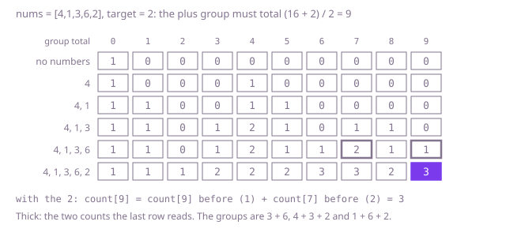

## The question

Given a row of non-negative numbers and a target, put a plus or minus sign in front of each number and count the choices of signs whose total is the target. A 0 counts both ways, since `+0` and `-0` are different choices.

What makes it harder than it looks is the size and the edges. Sixty numbers have 2^60 choices, so trying them all is out, and the count itself can pass the `int` range: 30 twos and 30 thirty-ones reach 0 in about 2.4 × 10^16 ways. Every 0 doubles the count, so code that skips zeros, or gives a 0 only one sign, undercounts. A target beyond the sum of the numbers, in either direction, or of the wrong parity, cannot be reached, and the neat rewrite into a subset count below turns such a target into a group total that is negative or half a unit, which must be caught before it is used as an index.

## How to think about it

The first idea is to try both signs for each number in turn and count the choices that end on the target. It is correct, and it repeats itself: once the first `i` signs are chosen, the rest only needs the running total so far, not the signs that made it. The running total always lies between minus the sum and plus the sum, at most 2,001 values, so there are at most 61 × 2,001 different questions, and storing each answer makes the search fast.

The structure can be simplified further. Call P the total of the numbers signed plus and M the total of those signed minus. Then P − M is the target and P + M is the sum of all the numbers, so P must be (sum + target) / 2. That has to be a whole number between 0 and the sum, or there is no way at all. Otherwise every choice of signs is exactly one group of positions that adds up to P, and counting groups by total is a one-array table: start with one empty group, and for each number add `groups[s - x]` into `groups[s]`, running the totals downwards so that a number joins each group at most once. A 0 runs down to `s = 0` and doubles every count, which is exactly its two signs.

Walk Example 1, `nums = [4,1,3,6,2]`, `target = 2`. The sum is 16, so the plus group must total 9. With no numbers only total 0 has a group. The 4 adds total 4; the 1 adds 1 and 5; the 3 makes 3, 7 and 8 and gives 4 a second group, 1 + 3; the 6 adds 6, 9 and a second group for 7. The 2 makes the count for 9 its old count, 1 (that is 3 + 6), plus the old count for 7, 2 (4 + 3 and 1 + 6): 3 groups, which are the three choices of signs.



## Brute force

Give each number a plus and then a minus and count the choices that end on the target. It comes first because it is the question written as code, and it fixes the answers the faster versions must match. It is correct because each path through the recursion is one choice of signs, every choice is one path, and a 0 takes both branches like any other number.

```java
static long ways(int[] nums, int target) {
    return from(nums, 0, 0, target);
}

/** Choices of signs for the numbers from position i on that bring total to target. */
private static long from(int[] nums, int i, int total, int target) {
    if (i == nums.length) {
        return total == target ? 1 : 0;
    }
    // both signs, even for a 0: +0 and -0 are different choices
    return from(nums, i + 1, total + nums[i], target) + from(nums, i + 1, total - nums[i], target);
}
```

**Complexity:** time O(2^n), about 2^61 calls at 60 numbers; extra space O(n) for the recursion, at most 60 deep.

## Better: memoised search on the running total

The same search, with the answer for each position and running total stored the first time it is worked out. Running totals go from minus the sum to plus the sum, so they are shifted by the sum to index the memo.

```java
static long ways(int[] nums, int target) {
    int sum = 0;
    for (int x : nums) {
        sum += x;
    }
    long[][] memo = new long[nums.length][2 * sum + 1]; // memo[i][total + sum]
    for (long[] row : memo) {
        Arrays.fill(row, -1); // -1: not worked out yet; counts are 0 or more
    }
    return from(nums, 0, 0, target, sum, memo);
}

private static long from(int[] nums, int i, int total, int target, int sum, long[][] memo) {
    if (i == nums.length) {
        return total == target ? 1 : 0;
    }
    if (memo[i][total + sum] < 0) {
        memo[i][total + sum] = from(nums, i + 1, total + nums[i], target, sum, memo)
                + from(nums, i + 1, total - nums[i], target, sum, memo);
    }
    return memo[i][total + sum];
}
```

**Complexity:** time O(n × S), where S is the sum of the numbers, at most 1,000; extra space O(n × S) for the memo, about 120,000 entries, plus the recursion, at most 60 deep.

**Prefer it when:** you need to list the choices that work, or pick one at random, not only count them. The memo holds, for each position and running total, how many ways the rest can still reach the target, so a walk from the first number can follow only the signs whose count is not 0.

## Optimal: count the groups for the plus total

Check that (sum + target) / 2 is a whole number between 0 and the sum, then count the groups of positions that add up to it with one array, totals running downwards. This is the reference solution.

```java
static long ways(int[] nums, int target) {
    int sum = 0;
    for (int x : nums) {
        sum += x;
    }
    // the plus group P and the minus group M satisfy P - M = target and P + M = sum
    if (Math.abs(target) > sum || (sum + target) % 2 != 0) {
        return 0; // out of reach, or the plus group would need half a unit
    }
    int plus = (sum + target) / 2;
    long[] groups = new long[plus + 1]; // groups[s]: groups of the numbers so far, by position, totalling s
    groups[0] = 1; // the empty group
    for (int x : nums) {
        // downwards, so groups[s - x] does not yet include x and each number joins at most once;
        // a 0 runs down to s = 0 and doubles every count, in the group or not
        for (int s = plus; s >= x; s--) {
            groups[s] += groups[s - x];
        }
    }
    return groups[plus];
}
```

**Complexity:** time O(n × S), extra space O(S), where S is the sum, at most 1,000. Every count in the array is a number of groups of the first few numbers, at most 2^60, so a `long` never overflows.

## Complexity

| Approach | Time | Extra space |
| --- | --- | --- |
| Brute force | O(2^n) | O(n) recursion, at most 60 deep |
| Better: memoised search on the running total | O(n × S) | O(n × S), recursion at most 60 deep |
| Optimal: count the groups for the plus total | O(n × S) | O(S) |

## Where it shows up

Splitting a set into two sides with a given difference has this shape: dividing weights between two pans so that one is heavier by an exact amount, assigning tasks to two machines with a given gap in load, or counting the debit and credit patterns of a ledger that net to a known balance. The rewrite from signs to one group with a fixed total is the step that turns those into the subset-sum count, the counting version of the 0/1 knapsack.

## Follow-up answers

**What if each number could also be left out, so that it counted as plus, minus or nothing?** Each number then has three branches, so the memoised search adds a third call for "nothing" and the running total still stays within plus or minus the sum. The rewrite into one group no longer fits, but a table over running totals works, three updates per number. The count can reach 3^60, which is past a `long`, so it would need `BigInteger` or a modulus.

**What if the numbers could be negative?** A minus sign in front of −5 is a plus in front of 5, so the two signs on a number give the same pair of values as on its size. Replace every number by its absolute value and solve as before; the count does not change.

**What if there were only 40 numbers but each could be as large as 10^9?** The sum is then far too large for a table. Split the numbers into two halves of 20, list the 2^20 signed totals of each half, and count the pairs, one total from each half, that add up to the target, with a hash map of the counts for one half. That is about a million entries per half, O(2^(n/2)) time and space instead of O(n × S).
