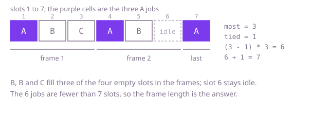

## The question

Given a list of jobs, each of some kind, and a cool-down `gap`, find the fewest time slots in which all jobs can run when two jobs of the same kind must have at least `gap` slots between them. Slots may be left idle, and the jobs can run in any order.

What makes it harder than it looks is that it reads like a scheduling puzzle but the order of the jobs hardly matters: the answer is set by the busiest kind. The other trap is size: `gap` goes up to 3000, so with 100,000 identical jobs the answer is over 300 million slots, and a program that walks the schedule slot by slot does that much work for an answer that only needs a few counts.

## How to think about it

The first idea is to build the schedule one slot at a time: in each slot run the kind with the most jobs left that is allowed to run, otherwise leave the slot idle. Running the busiest ready kind is the right greedy choice, because the busiest kind is the one in danger of being stuck waiting at the end. Written naively it costs a look at all 26 kinds for every slot, and the number of slots can be about `n × gap`.

Two improvements follow. First, keep the kinds that are ready to run in a max-heap by remaining count, and the kinds that are cooling down in a queue, each with the slot when it may run again. Then a slot costs a heap operation, and an idle stretch can be skipped by jumping straight to the slot when the next kind returns. That is where the heap fits: it is the structure that answers "which ready kind is busiest?" quickly, and it gives you the actual schedule if you want it.

Second, if only the length is wanted, notice what the heap's choices add up to. Let `most` be the highest count and `tied` the number of kinds that have it. The busiest kind's jobs sit `gap + 1` slots apart at best, which forms `most - 1` frames of `gap + 1` slots and a last slot for each tied kind: at least `(most - 1) * (gap + 1) + tied` slots. Every other job drops into an empty slot of those frames. If there are more other jobs than empty slots, they simply lengthen the schedule and nothing is idle, so the answer is the number of jobs. The answer is the larger of the two numbers.

Walk Example 1, `jobs = {'A','A','A','B','B','C'}`, `gap = 2`. A is the busiest kind with `most = 3` and nothing else has 3, so `tied = 1`. Two frames of 3 slots plus one final slot is 7. The other three jobs, B, B and C, fit in the four empty slots of the frames, and 7 is more than the 6 jobs, so the answer is 7.



## Brute force

Simulate the printer slot by slot. In each slot, among the kinds that still have jobs and last ran more than `gap` slots ago, run the one with the most jobs left; if none is allowed, the slot is idle. It comes first because it is the rule restated as code, and it fixes the answer the faster versions must agree with. It is correct because the busiest-ready-kind choice is optimal, and the loop only stops when every job has run.

```java
static int minSlots(char[] jobs, int gap) {
    int[] left = new int[26];
    for (char job : jobs) {
        left[job - 'A']++;
    }
    int[] lastSlot = new int[26];
    Arrays.fill(lastSlot, Integer.MIN_VALUE / 2); // far in the past: every kind may run at first
    int remaining = jobs.length;
    int slot = 0;
    while (remaining > 0) {
        slot++;
        int pick = -1;
        for (int kind = 0; kind < 26; kind++) { // the busiest kind that is allowed to run now
            if (left[kind] > 0 && slot - lastSlot[kind] > gap && (pick < 0 || left[kind] > left[pick])) {
                pick = kind;
            }
        }
        if (pick >= 0) {
            left[pick]--;
            lastSlot[pick] = slot;
            remaining--;
        } // otherwise the slot stays idle
    }
    return slot;
}
```

**Complexity:** time O(answer × 26), and the answer can be about `n × gap`, here 300 million slots; extra space O(1).

## Better: a max-heap of ready kinds and a queue of cooling kinds

Keep the ready kinds in a max-heap of remaining counts. When a kind runs, put it in a first-in first-out queue with the slot when it may run again. Each slot, if the front of the queue is due, move that kind back into the heap, and run the top of the heap. When the heap is empty but kinds are cooling, jump to the slot when the first returns instead of counting idle slots one by one. The queue stays in order because every kind runs in a different slot, so the return slots are increasing.

```java
static int minSlots(char[] jobs, int gap) {
    int[] count = new int[26];
    for (char job : jobs) {
        count[job - 'A']++;
    }
    PriorityQueue<Integer> ready = new PriorityQueue<>(Comparator.reverseOrder()); // remaining counts, largest first
    for (int c : count) {
        if (c > 0) {
            ready.add(c);
        }
    }
    Deque<int[]> cooling = new ArrayDeque<>(); // {slot when it may run again, remaining count}
    int slot = 0;
    while (!ready.isEmpty() || !cooling.isEmpty()) {
        slot++;
        if (ready.isEmpty()) {
            slot = cooling.peekFirst()[0]; // nothing can run: skip the idle stretch
        }
        if (!cooling.isEmpty() && cooling.peekFirst()[0] <= slot) {
            ready.add(cooling.pollFirst()[1]); // at most one kind returns per slot
        }
        int left = ready.poll() - 1; // run the busiest ready kind
        if (left > 0) {
            cooling.addLast(new int[] {slot + gap + 1, left});
        }
    }
    return slot;
}
```

**Complexity:** time O(n log 26), which is O(n), since each job is one heap step and the heap holds at most 26 counts; extra space O(1).

**Prefer it when:** the schedule itself is needed. The loop already decides which kind runs in every slot, so recording that kind, and an idle marker for each skipped slot, writes the order out. It is also the base to extend when kinds have their own cool-downs, where the formula no longer applies.

## Optimal: count the kinds and use the frame formula

Only the busiest kind's count and how many kinds share it matter. Count each kind, find `most` and `tied`, and return the larger of the frame length and the number of jobs. This is the reference solution.

```java
static int minSlots(char[] jobs, int gap) {
    int[] count = new int[26];
    int most = 0;
    for (char job : jobs) {
        most = Math.max(most, ++count[job - 'A']);
    }
    int tied = 0; // how many kinds have the highest count
    for (int c : count) {
        if (c == most) {
            tied++;
        }
    }
    if (most == 0) {
        return 0;
    }
    // The busiest kind forms (most - 1) full frames of gap + 1 slots, plus a last partial frame.
    long frame = (long) (most - 1) * (gap + 1) + tied;
    return (int) Math.max(frame, jobs.length); // with enough other jobs there is no idle slot
}
```

**Complexity:** time O(n), extra space O(1), 26 counters.

## Complexity

| Approach | Time | Extra space |
| --- | --- | --- |
| Brute force | O(answer × 26), and the answer can be about n × gap | O(1) |
| Better: max-heap and cooling queue | O(n log 26), so O(n) | O(1) |
| Optimal: count and frame formula | O(n) | O(1) |

## Where it shows up

`courier-load-balancer` makes the same kind of greedy choice with a heap: its `plan` keeps a `PriorityQueue` of couriers ordered by load and then index, takes the lightest courier for each parcel (heaviest parcel first), updates its load and puts it back. Here the heap holds remaining counts and the thing taken is the busiest ready kind, but the shape is the same: repeatedly take the best candidate, change it, and put it back where its new key belongs. Elsewhere, the same rule appears in rate-limited work, such as sending requests to several services that each allow one call per interval, or rotating similar-looking ads so the same one is not shown twice in a row.

## Follow-up answers

**How would you output an actual schedule, not just its length?** Use the heap version. Keep a max-heap of remaining counts with their kinds and a queue of kinds that have just run. Each slot, release from the queue any kind whose gap is over, take the busiest from the heap and run it, then queue it with its new count. If the heap is empty and the queue is not, the slot is idle. Appending the kind (or an idle marker) each slot, instead of jumping, writes the order out.

**What if each job kind had its own cool-down?** The closed formula no longer holds, because the frames differ in length. Fall back to the heap version: a heap of ready kinds and a time-ordered queue of cooling kinds, each with its own release slot. The queue is then no longer in order of insertion, so use a second heap keyed by release slot.

**What changes if the jobs must run in the order given?** Then there is nothing to choose. Walk the list, remember the last slot used by each kind, and when the next job is too soon, wait. The total is a single pass.
