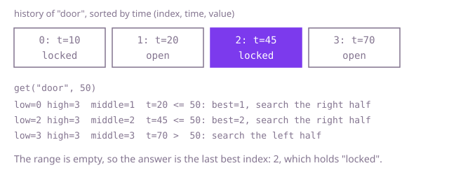

## The question

Design a store where `set(key, value, timestamp)` records what a key held from that moment, and `get(key, timestamp)` returns the value of the latest record at or before the asked time, or the empty string when there is none. For each key, records arrive in increasing time order.

What makes it harder than it looks is that the asked time is rarely an exact match: you want the nearest record at or before it, not the one equal to it, so a plain map from time to value does not answer it. And with 300,000 records on one key and 300,000 queries, looking through the whole history on every `get` is about 90 billion comparisons.

## How to think about it

The first idea is to keep each key's records in a list and scan it for every `get`, remembering the last record whose time is not above the query. It works, and it repeats effort: every query looks at records it has no reason to look at. The records of one key were added in increasing time order, so the list is already sorted, and a sorted list can be searched by halving. The question to ask of the middle record is "is its time at or before the query?". If yes, it is a candidate and anything better lies to its right; if no, the answer lies to its left. Keep the best candidate seen so far, and when the range is empty that candidate is the answer, or there is none.

Walk Example 1. The history of `"door"` is times 10, 20, 45, 70 at indexes 0 to 3, and the query is 50. The middle of indexes 0 to 3 is 1, whose time 20 is at most 50, so index 1 is a candidate and the search moves right to indexes 2 to 3. The middle is 2, time 45 is at most 50, so index 2 becomes the candidate and the search moves right to index 3. Time 70 is above 50, so the search moves left and the range is empty. The candidate is index 2, and the answer is `"locked"`. For the query 5, no middle record ever qualifies, the candidate stays unset, and the answer is `""`.



## Brute force

Keep two lists per key, times and values, appended on each `set`. On `get`, walk the whole history from the oldest record and remember the value of the last one whose time is at most the query. It comes first because it needs no thought, and it fixes the answer the faster versions must match. It is correct because every record is checked, and the last qualifying one in time order is the latest at or before the query.

```java
private final Map<String, List<Integer>> times = new HashMap<>();
private final Map<String, List<String>> values = new HashMap<>();

void set(String key, String value, int timestamp) {
    times.computeIfAbsent(key, k -> new ArrayList<>()).add(timestamp);
    values.computeIfAbsent(key, k -> new ArrayList<>()).add(value);
}

String get(String key, int timestamp) {
    List<Integer> stamps = times.get(key);
    if (stamps == null) {
        return ""; // the key was never set
    }
    List<String> history = values.get(key);
    String found = "";
    for (int i = 0; i < stamps.size(); i++) { // look at every record from the oldest
        if (stamps.get(i) <= timestamp) {
            found = history.get(i); // later qualifying records overwrite earlier ones
        }
    }
    return found;
}
```

**Complexity:** with h records on the queried key and m distinct keys: `set` O(1) amortized on average, O(log m) worst case for the key lookup (Java's `HashMap` turns a crowded bucket of `String` keys into a tree); `get` O(h) on average, O(h + log m) worst case; extra space O(n) for n records.

## Better: a sorted map per key

Store each key's history in a `TreeMap` from time to value. A `TreeMap` keeps its keys sorted and has `floorEntry`, which returns the entry with the greatest time at or before a given one. That is the whole question, answered by a library call.

```java
private final Map<String, TreeMap<Integer, String>> histories = new HashMap<>();

void set(String key, String value, int timestamp) {
    histories.computeIfAbsent(key, k -> new TreeMap<>()).put(timestamp, value); // any order is fine
}

String get(String key, int timestamp) {
    TreeMap<Integer, String> history = histories.get(key);
    if (history == null) {
        return "";
    }
    Map.Entry<Integer, String> entry = history.floorEntry(timestamp); // greatest time <= timestamp
    return entry == null ? "" : entry.getValue();
}
```

**Complexity:** `set` O(log h) on average, O(log h + log m) worst case; `get` the same; extra space O(n), with a tree node per record.

**Prefer it when:** records for a key may arrive out of order, which the follow-up asks about. `put` places each record by its time, so the history stays sorted whatever the order of calls, and a second `put` at the same time replaces the value. It is no longer than the list version, but heavier: every record costs a tree node, and each `set` is a tree insertion.

## Optimal: parallel lists and a binary search

Because `set` timestamps for a key only increase, appending to a list keeps it sorted at no cost. Keep two parallel lists per key and binary search the times, remembering the last index that qualified. This is the reference solution.

```java
/** The history of one key: parallel lists, sorted by time because sets arrive in time order. */
private static final class History {
    final List<Integer> times = new ArrayList<>();
    final List<String> values = new ArrayList<>();
}

private final Map<String, History> histories = new HashMap<>();

void set(String key, String value, int timestamp) {
    History history = histories.computeIfAbsent(key, k -> new History());
    history.times.add(timestamp);
    history.values.add(value);
}

String get(String key, int timestamp) {
    History history = histories.get(key);
    if (history == null) {
        return "";
    }
    int low = 0;
    int high = history.times.size() - 1;
    int best = -1; // rightmost index whose time is at most the query
    while (low <= high) {
        int middle = (low + high) >>> 1;
        if (history.times.get(middle) <= timestamp) {
            best = middle;
            low = middle + 1;
        } else {
            high = middle - 1;
        }
    }
    return best < 0 ? "" : history.values.get(best);
}
```

**Complexity:** `set` O(1) amortized on average, O(log m) worst case for the key lookup; `get` O(log h) on average, O(log h + log m) worst case; extra space O(n), with no tree node per record (the lists still box each `Integer`).

## Complexity

With h records on the queried key and m distinct keys. Every row pays one `HashMap` lookup of the key: O(1) on average, O(log m) worst case.

| Approach | `set` | `get` | Extra space |
| --- | --- | --- | --- |
| Brute force | O(1) amortized average, O(log m) worst | O(h) average, O(h + log m) worst | O(n) |
| Better: sorted map per key | O(log h) average, O(log h + log m) worst | O(log h) average, O(log h + log m) worst | O(n), a node per record |
| Optimal: parallel lists and binary search | O(1) amortized average, O(log m) worst | O(log h) average, O(log h + log m) worst | O(n) |

## Where it shows up

`shift-roster-lookup` asks who was on duty at a given minute. Its `onDutyAt` binary searches the sorted shift start minutes for the last start at or before the minute, using `Collections.binarySearch` and the not-found result `-found - 2` to land on that shift, and then checks that the shift has not already ended. `nextHandover` uses the same floor index plus one. That floor search is the `get` of this question. The same lookup answers "which price was in effect at time t", "which version of a setting was live when the error happened", and "what did the sensor last report before this moment".

## Follow-up answers

**What if timestamps for a key may be set out of order?** Appending no longer keeps a list sorted. Use the sorted map per key, with `put` and `floorEntry`, at O(log h) per call. Or keep the append-only list and sort it lazily before the first `get` after a change, which pays off when sets come in bursts.

**How would you delete or expire old values?** Records older than the retention time can be dropped from the front of each history, since it is sorted. With parallel lists, store a start offset instead of removing from the front of an array list, and compact now and then. With a sorted map, `headMap(cutoff).clear()` removes them.

**What if you also need the first value after a given time?** Binary search for the leftmost index whose time is above the query, or take the floor index plus one. A `TreeMap` offers `higherEntry` for the same thing.
