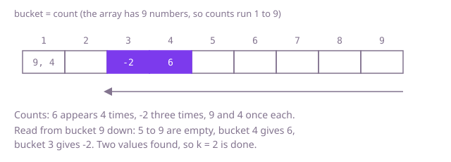

## The question

Given an array of integers and a number `k`, return the `k` values that occur most often. The input is chosen so the answer is unique, and the order of the returned values does not matter.

What makes it harder than it looks is that there are two jobs, not one: first count how often every value occurs, then pick the largest counts. Each job has a slow way and a fast way, and with 200,000 numbers, scanning the array once per distinct value is far too slow when most values are different.

## How to think about it

The first idea is the one you would do on paper: for each value, count its occurrences by scanning the array, then pick the biggest count `k` times. It repeats a full pass per distinct value. The counting should happen once: a hash map from value to count fills in one pass. That leaves the picking. Sorting the distinct values by count works and is easy to trust. A min-heap that holds only the best `k` seen so far avoids sorting everything. And there is a way to avoid comparing counts at all: a count can never exceed the array length, so a count can serve as an index. Put each value in the bucket for its count, and read the buckets from the top.

Walk Example 1, `nums = [6, -2, 6, 9, -2, 6, 4, 6, -2]`, `k = 2`. The counts are 6 four times, -2 three times, 9 once and 4 once. The array has 9 numbers, so buckets run from 1 to 9: bucket 1 holds 9 and 4, bucket 3 holds -2, bucket 4 holds 6, and the rest are empty. Reading from bucket 9 down, buckets 9 to 5 are empty, bucket 4 gives 6, bucket 3 gives -2, and with two values collected the answer is `[6, -2]`.



## Brute force

For each value not seen before, scan the whole array to count it; then pick the largest count `k` times, marking each pick so it is not chosen again. It is what you do by hand, and it fixes the answer to compare against. It is correct because every distinct value gets its exact count and the largest counts are taken in order; the unique-answer guarantee means no tie can change which `k` values are taken.

```java
static int[] topK(int[] nums, int k) {
    List<Integer> distinct = new ArrayList<>();
    List<Integer> counts = new ArrayList<>();
    for (int value : nums) {
        if (distinct.contains(value)) { // linear search: have we counted this value already?
            continue;
        }
        int count = 0;
        for (int other : nums) { // a full pass to count one value
            if (other == value) count++;
        }
        distinct.add(value);
        counts.add(count);
    }
    int[] result = new int[k];
    for (int round = 0; round < k; round++) { // pick the largest count k times
        int best = 0;
        for (int i = 1; i < counts.size(); i++) {
            if (counts.get(i) > counts.get(best)) best = i;
        }
        result[round] = distinct.get(best);
        counts.set(best, -1); // used up: no real count is negative
    }
    return result;
}
```

**Complexity:** with n numbers and d distinct values: time O(n · d + k · d), which is O(n²) when most values differ, extra space O(d).

## Better: count with a map, then sort the distinct values

Count once with a hash map, then sort the distinct values by their count, highest first, and take the first `k`.

```java
static int[] topK(int[] nums, int k) {
    Map<Integer, Integer> counts = new HashMap<>();
    for (int value : nums) {
        counts.merge(value, 1, Integer::sum); // one pass counts everything
    }
    List<Integer> values = new ArrayList<>(counts.keySet());
    values.sort((x, y) -> Integer.compare(counts.get(y), counts.get(x))); // highest count first
    int[] result = new int[k];
    for (int i = 0; i < k; i++) {
        result[i] = values.get(i);
    }
    return result;
}
```

**Complexity:** time O(n + d log d) average (the map is O(n) on average; Java treeifies crowded buckets, so a log factor in the worst case), extra space O(d).

**Prefer it when:** you want the shortest code that is obviously right, or you need the whole ranking and not only the top `k`. It sorts the full list, so the first `k` entries come out ordered by count as a bonus.

## Better: count with a map, then keep the best k in a min-heap

Walk the distinct values and keep a min-heap ordered by count, holding at most `k` values. When a `(k+1)`-th value arrives, the least frequent one on top is removed. What remains are the `k` most frequent.

```java
static int[] topK(int[] nums, int k) {
    Map<Integer, Integer> counts = new HashMap<>();
    for (int value : nums) {
        counts.merge(value, 1, Integer::sum);
    }
    PriorityQueue<Integer> heap = new PriorityQueue<>(Comparator.comparingInt(counts::get)); // least frequent on top
    for (int value : counts.keySet()) {
        heap.add(value);
        if (heap.size() > k) {
            heap.poll(); // drop the least frequent of the k + 1
        }
    }
    int[] result = new int[k];
    for (int i = 0; i < k; i++) {
        result[i] = heap.poll();
    }
    return result;
}
```

**Complexity:** time O(n + d log k) average (the map is O(n) on average; Java treeifies crowded buckets, so a log factor in the worst case), extra space O(d) for the map plus O(k) for the heap.

**Prefer it when:** `k` is much smaller than the number of distinct values. Each value costs one heap operation of O(log k) instead of taking part in a sort of all `d`, and the ranking structure never grows past `k` entries.

## Optimal: count with a map, then buckets by count

A count is at least 1 and at most `nums.length`, so an array indexed by count can hold, in slot `c`, the list of values that occur exactly `c` times. Fill the buckets from the map, then read them from the highest count down until `k` values are collected. No sorting and no comparisons between counts. This is the reference solution.

```java
static int[] topK(int[] nums, int k) {
    Map<Integer, Integer> counts = new HashMap<>();
    for (int value : nums) {
        counts.merge(value, 1, Integer::sum);
    }
    // buckets.get(c) holds the values that occur exactly c times; a count is at most nums.length
    List<List<Integer>> buckets = new ArrayList<>();
    for (int c = 0; c <= nums.length; c++) {
        buckets.add(null);
    }
    for (Map.Entry<Integer, Integer> entry : counts.entrySet()) {
        int c = entry.getValue();
        if (buckets.get(c) == null) {
            buckets.set(c, new ArrayList<>());
        }
        buckets.get(c).add(entry.getKey());
    }
    int[] result = new int[k];
    int filled = 0;
    for (int c = nums.length; c >= 1 && filled < k; c--) { // highest counts first
        if (buckets.get(c) == null) {
            continue;
        }
        for (int value : buckets.get(c)) {
            if (filled < k) {
                result[filled++] = value;
            }
        }
    }
    return result;
}
```

**Complexity:** time O(n) on average, O(n log n) in the worst case (Java's `HashMap` treeifies a crowded bucket), extra space O(n).

## Complexity

| Approach | Time | Extra space |
| --- | --- | --- |
| Brute force | O(n · d), so O(n²) when most values differ | O(d) |
| Better: map, then sort the distinct values | O(n + d log d) average, O(n log n) worst | O(d) |
| Better: map, then a min-heap of size k | O(n + d log k) average, O(n log n) worst | O(d + k) |
| Optimal: map, then buckets by count | O(n) average, O(n log n) worst | O(n) |

## Where it shows up

`duplicate-order-detector` asks for the most duplicated products with `mostDuplicatedSkus`: it counts duplicates per SKU in a map, then sorts the entries by count and takes `k`, which is the sort variant above with a tie-break rule added. The same count-then-rank step is behind "top searches", "busiest endpoints" and "most reported errors".

## Follow-up answers

**Can you do it in O(n) rather than O(n log n)?** Yes, with buckets indexed by count, as in the optimal solution: counts range from 1 to n, so an array of n plus one slots holds every value, and one read from the top finds the k best. Quickselect on the counts is another linear-on-average option.

**What if the values arrive as a stream and you may ask for the top k at any time?** Keep the count map up to date on each arrival. For the answer, keep a min-heap of the k best counts, or a sorted structure keyed by count; exact answers need care because a count only goes up, so a value outside the heap can climb into it. For huge streams, sketches such as Count-Min with a heavy-hitter list give approximate answers in small memory.

**What if two values tie for the last place?** The task must say which to pick. Common rules are the smaller value, the earlier first occurrence, or return more than k values. With buckets, a tie is just two values in one bucket, so you can apply the rule while reading that bucket.
