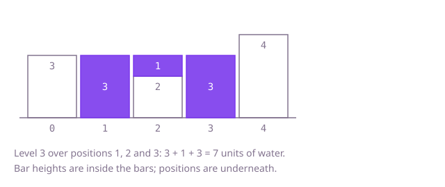

## The question

Given the heights of a row of bars, say how much water the row holds after rain. Water above a position rises to the lower of the tallest bar on its left and the tallest bar on its right, and the amount is that level minus the bar's own height.

What makes it harder than it looks is that the answer for one position depends on bars far away on both sides, so a single left-to-right pass has nothing to compare against. Computing both maxima by scanning for every position is quadratic, which is too slow for 100,000 bars. And the total is large: a deep basin between two tall walls holds nearly a billion units.

## How to think about it

The first idea is to take each position and scan left and right for the two tallest bars. It repeats the same scans: the tallest bar on the left of position 5 is just the tallest on the left of position 4, possibly raised by the bar at 5. So the maxima can be remembered, which is a prefix maximum from the left and a suffix maximum from the right, two arrays filled in one pass each. That is linear, with two arrays of memory. The arrays are only there to answer one question per position, "which side is lower?", and often that is already decided by the bars at the ends. If the bar under the left position is lower than the bar under the right position, the water over the left position cannot be decided by the right side: some taller bar stands on the right, so the left side's running maximum is the limit. That lets two positions walk in from the ends with two running maxima and no arrays.

Walk Example 1, `heights = [3, 0, 2, 0, 4]`. With arrays, the tallest to the left is `[3, 3, 3, 3, 4]` and the tallest to the right is `[4, 4, 4, 4, 4]`; their minimum is `[3, 3, 3, 3, 4]`, and subtracting the heights `[3, 0, 2, 0, 4]` leaves `[0, 3, 1, 3, 0]`, a total of 7. With two positions: the bars at the ends are 3 and 4, and 3 is lower, so the left side settles. Position 0 holds 3 minus 3, nothing. Position 1 holds 3 minus 0 = 3. Position 2 holds 3 minus 2 = 1. Position 3 holds 3 minus 0 = 3. The positions meet at the 4, and the total is 7.



## Brute force

For every position, scan to the left for the tallest bar, scan to the right for the tallest bar, and add the lower one minus the position's own height. It is what you say first, and it fixes the answer every faster version must agree with. It is correct because that is the definition of the water above a position, and the scans include the position itself, so the amount is never negative.

```java
static int trapped(int[] heights) {
    int total = 0;
    for (int i = 0; i < heights.length; i++) {
        int leftMax = 0;
        for (int j = 0; j <= i; j++) { // tallest bar at or to the left of i
            leftMax = Math.max(leftMax, heights[j]);
        }
        int rightMax = 0;
        for (int j = i; j < heights.length; j++) { // tallest bar at or to the right of i
            rightMax = Math.max(rightMax, heights[j]);
        }
        total += Math.min(leftMax, rightMax) - heights[i]; // never negative: both include heights[i]
    }
    return total;
}
```

**Complexity:** time O(n²), extra space O(1).

## Better: prefix and suffix maxima in two arrays

Fill `leftMax[i]` with the tallest bar at or before `i`, and `rightMax[i]` with the tallest bar at or after `i`, each in one pass. Then the water over `i` is the lower of the two minus the bar.

```java
static int trapped(int[] heights) {
    int n = heights.length;
    if (n == 0) {
        return 0;
    }
    int[] leftMax = new int[n];
    int[] rightMax = new int[n];
    leftMax[0] = heights[0];
    for (int i = 1; i < n; i++) {
        leftMax[i] = Math.max(leftMax[i - 1], heights[i]); // tallest so far from the left
    }
    rightMax[n - 1] = heights[n - 1];
    for (int i = n - 2; i >= 0; i--) {
        rightMax[i] = Math.max(rightMax[i + 1], heights[i]); // tallest so far from the right
    }
    int total = 0;
    for (int i = 0; i < n; i++) {
        total += Math.min(leftMax[i], rightMax[i]) - heights[i];
    }
    return total;
}
```

**Complexity:** time O(n), extra space O(n) for the two arrays.

**Prefer it when:** you want the water over each position, not just the total: `Math.min(leftMax[i], rightMax[i]) - heights[i]` is that amount, and the arrays make each one easy to check on its own. It is also the easiest version to get right the first time.

## Optimal: two positions moving inwards

Keep a position at each end and a running maximum for each side. At each step compare the two bars under the positions and settle the lower one's side. If the left bar is lower, the water over the left position is its left maximum minus its height, then move the left position in. Otherwise do the same on the right. The reason it is enough to use only one side's maximum: every time the left position moves past a bar, a taller bar stands at the right position, and the right position only ever moves inwards from there, so that taller bar is still somewhere on the right of the left position. So the left maximum is never above the tallest bar on the right, and the left side is the lower one. The same argument holds on the right, and a tie may be settled by either side. This is the reference solution.

```java
static int trapped(int[] heights) {
    int left = 0;
    int right = heights.length - 1;
    int leftMax = 0; // tallest bar seen so far from the left
    int rightMax = 0; // tallest bar seen so far from the right
    int total = 0;
    while (left < right) {
        if (heights[left] < heights[right]) {
            // a bar at least this tall stands to the right, so the left maximum decides
            leftMax = Math.max(leftMax, heights[left]);
            total += leftMax - heights[left];
            left++;
        } else {
            rightMax = Math.max(rightMax, heights[right]);
            total += rightMax - heights[right];
            right--;
        }
    }
    return total;
}
```

**Complexity:** time O(n), extra space O(1).

## Complexity

| Approach | Time | Extra space |
| --- | --- | --- |
| Brute force | O(n²) | O(1) |
| Better: prefix and suffix maxima | O(n) | O(n) |
| Optimal: two positions moving inwards | O(n) | O(1) |

## Where it shows up

No coding-round problem is linked to this question. Measuring what a profile holds between its peaks comes up in terrain and flood models (how much a surface can pool) and in capacity checks on a time series, such as how much a buffer would fill and drain between two peaks. The left and right running maximum is also used in other "compare with the best so far on each side" questions.

## Follow-up answers

**Can you do it in O(n) time with O(1) extra memory?** Yes: the two positions moving inwards, as in the optimal solution. The two arrays of the previous version are replaced by two running maxima, because the lower side can be settled before the other side's exact maximum is known.

**Can you solve it with a stack, and what does it count on each pop?** Yes. Keep a stack of bar positions with falling heights. When a taller bar arrives, pop the lowest bar as a floor, and add the water over it: the width between the new bar and the one now on top of the stack, times the lower of those two heights minus the floor. It counts water in horizontal layers.

**How would the problem change in two dimensions, with a grid of heights?** A cell's level now depends on the lowest way out in any direction, not just left and right. The usual solution starts from the border cells in a min-heap and floods inwards, always expanding from the lowest border seen so far.
