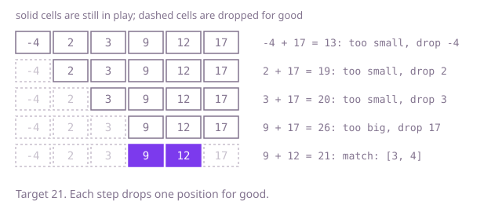

## The question

Given an array already sorted in non-decreasing order and a target, find the two positions whose values add up to the target; exactly one such pair exists. Return both positions, smaller first.

What makes it harder than it looks is that the obvious answers waste the one thing you were given. A hash map ignores the sorting and costs memory. Checking every pair is about 20 billion sums at 200,000 values. And a position must not pair with itself, while two equal values at different positions are fine.

## How to think about it

The first idea is to try every pair. For each value it scans the rest of the array asking "is my partner here?", but the partner is not a mystery: for a value `x` it is exactly `target - x`, and in a sorted array a known value can be found by halving the range instead of walking it. That is the first improvement, a binary search per position. It still repeats a search from scratch for every value. The sorted order says more than where one value is: it says what happens to a sum when you move a position. Move the right position left and the sum cannot grow; move the left one right and it cannot shrink. So start with the widest pair and let the sum tell you which end to move.

Walk Example 1, `numbers = [-4, 2, 3, 9, 12, 17]`, `target = 21`. Positions 0 and 5 give -4 + 17 = 13, too small. The -4 is the smallest value and even the largest value cannot lift it to 21, so it is out for good: move left to 1. Then 2 + 17 = 19, too small, so 2 is out. Then 3 + 17 = 20, too small, so 3 is out. Then 9 + 17 = 26, too big, and since 9 is the smallest value still in play, 17 cannot pair with anything left: move right to 4. Finally 9 + 12 = 21, a match at positions 3 and 4.



## Brute force

Try every pair `i < j`. It is what you say first, and it fixes the answer every faster version must agree with. It is correct because it checks every pair there is, and `j` starts after `i`, so a position never pairs with itself.

```java
static int[] find(int[] numbers, int target) {
    for (int i = 0; i < numbers.length; i++) {
        for (int j = i + 1; j < numbers.length; j++) { // j > i: never the same position
            if (numbers[i] + numbers[j] == target) {
                return new int[] {i, j};
            }
        }
    }
    throw new IllegalStateException("the input always has a pair");
}
```

**Complexity:** time O(n²), extra space O(1).

## Better: binary search for the partner

For each position `i`, the partner value is `target - numbers[i]`. Because the array is sorted, search for it by halving the part after `i`. Searching only after `i` keeps `j > i`, so a position cannot pair with itself, and equal values at different positions still pair.

```java
static int[] find(int[] numbers, int target) {
    for (int i = 0; i < numbers.length - 1; i++) {
        // search only after i: the partner is a different, later position
        int j = Arrays.binarySearch(numbers, i + 1, numbers.length, target - numbers[i]);
        if (j >= 0) {
            return new int[] {i, j};
        }
    }
    throw new IllegalStateException("the input always has a pair");
}
```

**Complexity:** time O(n log n), extra space O(1).

**Prefer it when:** you need the partner of a few chosen positions rather than the one pair among all of them: the loop body answers that for one position in O(log n), where a two-position walk answers nothing until it has run to the match.

## Optimal: two positions moving inwards

Put one position at each end. If the sum is too big, the right value is too big to pair with any value still in play, because the left value is the smallest of them, so move the right position in. If the sum is too small, the left value is too small to pair with any value still in play, because the right value is the largest, so move the left position in. Each step discards one position for good, and the positions never cross because the loop runs while `left < right`, so the pair is never jumped over. This is the reference solution.

```java
static int[] find(int[] numbers, int target) {
    int left = 0;
    int right = numbers.length - 1;
    while (left < right) {
        int sum = numbers[left] + numbers[right];
        if (sum == target) {
            return new int[] {left, right};
        } else if (sum > target) {
            right--; // the right value is too big to pair with any remaining left value
        } else {
            left++; // the left value is too small to pair with any remaining right value
        }
    }
    throw new IllegalStateException("the input always has a pair");
}
```

**Complexity:** time O(n), extra space O(1).

## Complexity

| Approach | Time | Extra space |
| --- | --- | --- |
| Brute force | O(n²) | O(1) |
| Better: binary search for the partner | O(n log n) | O(1) |
| Optimal: two positions moving inwards | O(n) | O(1) |

## Where it shows up

No coding-round problem is linked to this question. Combining two cursors over sorted data is a standard tool: a price lookup such as "which two items in this sorted price list fit the budget exactly" is this question, and a merge-style pass over two sorted lists works with the same idea of advancing whichever side is behind. It beats a hash map when memory is tight or the data is already sorted on disk.

## Follow-up answers

**Can you find the pair in O(n) time using only O(1) extra memory?** Yes: the two positions moving inwards, as in the optimal solution. A hash map is O(n) time too, but it uses O(n) memory and ignores the sorting.

**What if there could be several valid pairs and you had to return all of them?** Do not stop on a match: record the pair, then move both positions inwards. With repeated values, skip over equal values after a match so the same pair of values is not recorded twice, or count them if you need the number of position pairs.

**How would the answer change if the array were not sorted?** The shrinking argument no longer holds, so I would use a hash map from value to position and look up the partner of each value as I go, which is O(n) time and O(n) space. Or I would sort a copy together with the original positions, at O(n log n).
